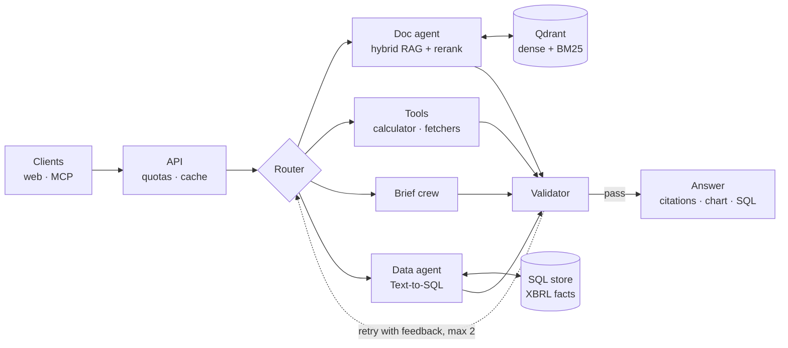

# Filings Research Copilot

[](https://github.com/VinayakMokashi/filings-research-copilot/actions/workflows/ci.yml)

[](LICENSE)

An agentic research copilot for public-company filings. Ask a question about a company and get an answer built from its 10-K and 10-Q text and its XBRL financial facts, with every claim cited to the page or query it came from.

> **Status:** in active development, Phase 0 (foundations), the first of 11 phases numbered 0–10. Progress is tracked in the [build plan](docs/PLAN.md) and the [build log](docs/BUILD_LOG.md).
>
> **Project page:** https://vinayakmokashi.github.io/filings-research-copilot/

## What it does (when finished)

- **Cited answers from filing text.** Hybrid BM25 and dense retrieval over 10-K and 10-Q filings, query rewriting, cross-encoder reranking, page-level citations, and a refusal when the evidence isn't there.
- **Numbers from structured data.** Text-to-SQL over XBRL company facts, built on [text2sql-analyst](https://github.com/VinayakMokashi/text2sql-analyst), with read-only guardrails and a calculator for arithmetic.
- **Research briefs.** A planner, parallel section writers, an editor and a critic, with every claim validated against its source.
- **Tools for other AI apps.** An MCP server exposing search, financial queries and the copilot itself.
- **Measured.** Evaluated on FinanceBench and purpose-built test sets, with 95% confidence intervals on every reported number.
- **Deployable on demand.** Terraform brings a production-shaped AWS stack (ECS Fargate, RDS, SQS, Secrets Manager) up for a demo and tears it down afterwards.

## Architecture



Every model call goes through one gateway (LiteLLM, with Groq first and other providers as fallback), and every step will be traced (Langfuse, Phase 6). Details: [docs/PLAN.md](docs/PLAN.md) and the [decision records](docs/decisions/README.md).

## What's built so far

| Component | Where |
|---|---|
| Typed settings from environment and `.env` | `src/copilot/config.py` |
| Structured logging (console or JSON) | `src/copilot/logs.py` |
| LLM gateway: model roles, retries, fallbacks, cost accounting, reasoning handling, key redaction | `src/copilot/llm/` ([guide](docs/concepts/llm-gateway.md)) |
| Local Qdrant (vector store) and Postgres (app state), bound to 127.0.0.1 | `docker-compose.yml` |
| CI: lint, format, strict types, tests, a full-history secret scan | `.github/workflows/ci.yml`, `.gitleaks.toml` |
| Weekly dependency updates for Actions, `uv.lock` and pre-commit hooks | `.github/dependabot.yml` |

## Local development

Requires Python 3.12, [uv](https://docs.astral.sh/uv/) and Docker.

```bash
uv sync
cp .env.example .env          # add GROQ_API_KEY
uv run poe services-up        # Qdrant on 127.0.0.1:6333, Postgres on 127.0.0.1:5433
uv run poe check              # ruff, format check, mypy, pytest: the same steps as CI
uv run poe secrets            # gitleaks over the full history, as CI does (needs Docker)
uv run poe smoke              # one live call per model role (needs the key)
```

Step-by-step setup and troubleshooting: [docs/runbooks/local-setup.md](docs/runbooks/local-setup.md).

## Documentation

- [Build plan](docs/PLAN.md): phases, steps and exit criteria
- [Build log](docs/BUILD_LOG.md): what happened in each working session
- [Decision records](docs/decisions/README.md): what was chosen and why
- [Concept guides](docs/concepts/README.md): how each component works
- [Runbooks](docs/runbooks/README.md): setup and operations

## License

[MIT](LICENSE)
