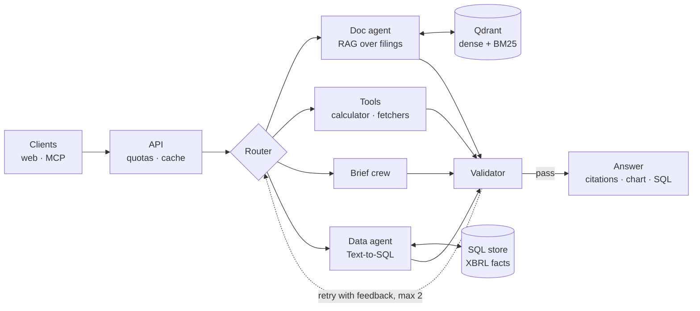

# Filings Research Copilot

[](https://github.com/VinayakMokashi/filings-research-copilot/actions/workflows/ci.yml)

[](LICENSE)

An agentic research copilot for public-company filings. Ask a question about a company and get an answer built from its 10-K and 10-Q text and its XBRL financial facts, with every claim cited to the page or query it came from.

> **Status:** in active development. Phases 0 to 4 are done (foundations, data and evaluation sets, the retrieval baseline, the doc agent with cited answers, and the data agent with Text-to-SQL); Phase 5, orchestration, is next, of 11 phases numbered 0–10. Progress is tracked in the [build plan](docs/PLAN.md) and the [build log](docs/BUILD_LOG.md).
>
> **Project page:** https://vinayakmokashi.github.io/filings-research-copilot/

## What it does (when finished)

- **Cited answers from filing text.** The filings a question names, three rewrites of it, and dense search over page chunks, each chosen by measurement; answers with a citation on every sentence, a calculator for arithmetic, and a refusal when the evidence isn't there. On FinanceBench dev the doc agent answers 65% of questions correctly (88% of those that ask for a figure), by an LLM judge checked against reference labels.
- **Numbers from structured data.** Text-to-SQL over XBRL company facts, built on [text2sql-analyst](https://github.com/VinayakMokashi/text2sql-analyst): hints that link the question to the database's companies and metrics, read-only guardrails, and an answer that carries its SQL, the rows, exact statistics and a chart. On FinanceBench's dev figure questions it answers 32 of 33 correctly, by the same judge, where the doc agent answers 29.
- **Research briefs.** A planner, parallel section writers, an editor and a critic, with every claim validated against its source.
- **Tools for other AI apps.** An MCP server exposing search, financial queries and the copilot itself.
- **Measured.** Evaluated on FinanceBench and purpose-built test sets, with 95% confidence intervals on every reported number.
- **Deployable on demand.** Terraform brings a production-shaped AWS stack (ECS Fargate, RDS, SQS, Secrets Manager) up for a demo and tears it down afterwards.

## Architecture



Every model call goes through one gateway (LiteLLM, with Groq first and other providers as fallback), and every step will be traced (Langfuse, Phase 6). Details: [docs/PLAN.md](docs/PLAN.md) and the [decision records](docs/decisions/README.md).

## What's built so far

| Component | Where |
|---|---|
| Typed settings from environment and `.env` | `src/copilot/config.py` |
| Structured logging (console or JSON) | `src/copilot/logs.py` |
| LLM gateway: model roles, retries, fallbacks, cost accounting, reasoning handling, key redaction | `src/copilot/llm/` ([guide](docs/concepts/llm-gateway.md)) |
| Local Qdrant (vector store) and Postgres (app state), bound to 127.0.0.1 | `docker-compose.yml` |
| CI: lint, format, strict types, tests, a full-history secret scan | `.github/workflows/ci.yml`, `.gitleaks.toml` |
| Weekly dependency updates for Actions, `uv.lock` and pre-commit hooks | `.github/dependabot.yml` |
| FinanceBench download checked against a pinned manifest; dev/test split by company, with the test set held out | `src/copilot/eval/`, `eval/financebench/` ([data card](docs/data/financebench.md)) |
| Evaluation harness: retrieval metrics, bootstrap intervals, paired permutation tests, run reports | `src/copilot/eval/`, `eval/results/` ([guide](docs/concepts/evaluation-statistics.md), [runbook](docs/runbooks/running-evaluations.md)) |
| Routing eval set: 198 labelled questions, split by seed, with keyword and majority baselines | `eval/routing/` ([data card](docs/data/routing-set.md)) |
| SEC EDGAR client (declared contact, rate limit, retries) and the 40-company universe matched to CIKs | `src/copilot/ingest/`, `data/reference/companies.csv` ([data card](docs/data/sec-company-facts.md)) |
| Facts database: 1.06 million XBRL facts and 28 canonical metrics per company-year, matching all 33 FinanceBench dev metrics questions | `src/copilot/facts/` ([guide](docs/concepts/xbrl-and-financial-metrics.md), [dictionary](docs/data/facts-dictionary.md)) |
| SQL eval set: 42 questions with verified gold SQL or a reason to decline, and a read-only scorer | `eval/sql/`, `src/copilot/eval/sql.py` ([data card](docs/data/sql-set.md)) |
| PDF parsing: page text with running headers removed and 10-K/10-Q sections tagged | `src/copilot/ingest/pdf.py` ([ADR-0009](docs/decisions/0009-pdf-parsing.md), [runbook](docs/runbooks/ingesting-filings.md)) |
| Chunking: page-level, token windows with overlap, and semantic, each chunk carrying its pages, section and filing metadata | `src/copilot/ingest/chunking.py` |
| Qdrant index: bge-small dense and BM25 sparse vectors per chunk, payload indexes, resumable per-document jobs, and late chunking with jina-v2-small | `src/copilot/ingest/` ([ADR-0010](docs/decisions/0010-vector-store-and-embeddings.md), [HNSW guide](docs/concepts/hnsw-and-qdrant.md)) |
| Retrieval: dense, BM25 and hybrid search with client-side rank fusion, cross-encoder reranking and neighbouring chunks, each measured on FinanceBench dev; the baseline is dense search over page chunks | `src/copilot/retrieval/` ([report](docs/eval/retrieval-baseline.md), [ADR-0011](docs/decisions/0011-retrieval-baseline.md)) |
| Synthetic training pairs: 1,006 LLM-written questions paired with the chunks that answer them, from filings kept apart from evaluation | `src/copilot/training/` ([data card](docs/data/synthetic-pairs.md)) |
| Query understanding and rewriting: company, period and form resolved to filings; multi-query, HyDE and decomposition rewrites fused with the question | `src/copilot/retrieval/query.py`, `rewrite.py` ([ADR-0012](docs/decisions/0012-query-understanding-and-rewriting.md)) |
| Model-call cache and pacing for free tiers: replay by model, messages and parameters; pauses sized to the tokens each call used | `src/copilot/llm/cache.py`, `pacing.py` |
| Doc agent: numbered sources within 3,000 tokens, one JSON answer call with citations, a safe calculator, and one retry aimed at what a refusal names as missing | `src/copilot/answer/` ([ADR-0013](docs/decisions/0013-answer-format.md), [guide](docs/concepts/grounded-generation.md)) |
| Answer evaluation: an LLM judge with a rubric and code-computed comparisons of figures, checked against reference labels; faithfulness and citation precision; error categories, latency and cost | `src/copilot/eval/judge.py`, `faithfulness.py`, `errors.py` ([ADR-0014](docs/decisions/0014-answer-judge.md), [report](docs/eval/doc-agent-dev.md)) |
| Data agent: text2sql-analyst's Text-to-SQL pipeline over the facts database, with value linking (company, metric and coverage hints) and its model calls on the gateway; every SQL question answered correctly, dev and held-out test, and 32 of FinanceBench's 33 dev metrics questions. A typed answer for other components: status, SQL, rows, exact statistics and a chart spec | `src/copilot/sql/` ([ADR-0015](docs/decisions/0015-reuse-text2sql-analyst.md), [guide](docs/concepts/text-to-sql-agent.md), [value linking](docs/concepts/value-linking.md), [report](docs/eval/data-agent-financebench.md)) |
| Hybrid answers, a prototype: the data agent's query result and the doc agent's pages as numbered sources for one cited answer. On 13 questions of our own it gives every expected figure for 10, including years that no filing in the corpus holds | `src/copilot/answer/hybrid.py` ([guide](docs/concepts/hybrid-answers.md), [report](docs/eval/hybrid-prototype.md)) |

## Local development

Requires Python 3.12, [uv](https://docs.astral.sh/uv/) and Docker.

```bash
uv sync
cp .env.example .env          # add GROQ_API_KEY
uv run poe services-up        # Qdrant on 127.0.0.1:6333, Postgres on 127.0.0.1:5433
uv run poe check              # ruff, format check, mypy, pytest: the same steps as CI
uv run poe secrets            # gitleaks over the full history, as CI does (needs Docker)
uv run poe smoke              # one live call per model role (needs the key)
uv run poe fetch-financebench # evaluation questions and the PDFs they cite (159 MB)
uv run poe eval-retrieval --baseline first-pages   # score a retriever, with 95% intervals
uv run poe eval-routing --baseline keyword         # score a router
uv run poe fetch-sec          # SEC company facts for the 40 companies (needs SEC_USER_AGENT)
uv run poe build-facts        # the SQLite facts database; then `poe check-facts`
uv run poe eval-sql --baseline gold   # score SQL against the facts database
uv run poe parse-pdfs         # clean, section-tagged page text from the filing PDFs
uv run poe chunk-corpus --strategy tokens-480     # chunk the parsed pages
uv run poe index-corpus --strategy page --docs all   # embed chunks into Qdrant (resumable)
uv run poe run-retrieval --collection fb_page_bge-small --mode dense   # search and score on dev
uv run poe generate-pairs --per-doc 6   # synthetic question-to-chunk pairs (needs the key)
uv run poe answer-questions --run doc-agent-v4-full   # answer the dev questions (resumable; needs the key)
uv run poe judge-answers --run doc-agent-v4-full      # grade them against the reference answers
uv run poe check-faithfulness --run doc-agent-v4-full # check each sentence against its citations
uv run poe analyse-errors --run doc-agent-v4-full --judge qwen3.8-27b-p2   # error categories, latency, cost
uv run poe run-sql-agent                              # the data agent on the SQL set, scored
uv run poe ask-data "How did 3M's capital expenditure change from fiscal 2018 to fiscal 2022?"
uv run poe answer-with-data                           # FinanceBench's dev metrics questions, by SQL
uv run poe run-hybrid --agent hybrid --run hybrid-v1  # figures from SQL, reasons from the filings, one answer
```

Step-by-step setup and troubleshooting: [docs/runbooks/local-setup.md](docs/runbooks/local-setup.md).

## Documentation

- [Build plan](docs/PLAN.md): phases, steps and exit criteria
- [Build log](docs/BUILD_LOG.md): what happened in each working session
- [Decision records](docs/decisions/README.md): what was chosen and why
- [Concept guides](docs/concepts/README.md): how each component works
- [Runbooks](docs/runbooks/README.md): setup and operations

## License

[MIT](LICENSE)
