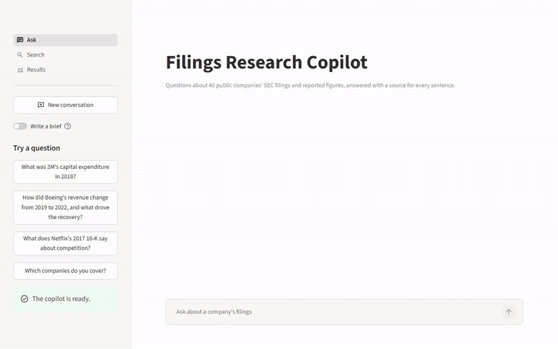
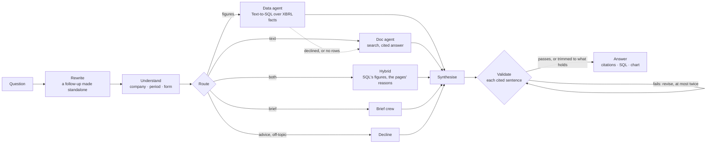
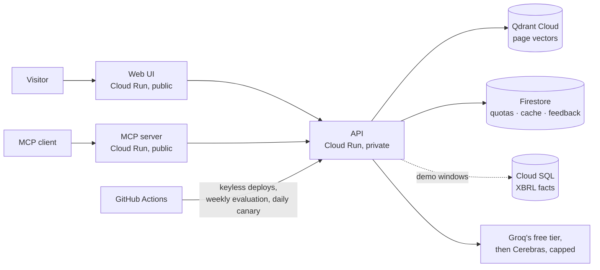

# Filings Research Copilot

[](https://github.com/VinayakMokashi/filings-research-copilot/actions/workflows/ci.yml)

[](LICENSE)

An agentic research copilot for public-company filings. Ask a question about a company and get an answer built from its 10-K and 10-Q text and its XBRL financial facts, with every claim cited to the page or query it came from.



- **Try it:** the [web UI](https://ui-499690143794.asia-south1.run.app) and the [MCP server](https://mcp-499690143794.asia-south1.run.app/mcp) (streamable HTTP), on Google Cloud. Questions are limited to 20 a visitor and 200 a day in all.
- **Project page:** https://vinayakmokashi.github.io/filings-research-copilot/, with a one-minute [demo video](https://vinayakmokashi.github.io/filings-research-copilot/#demo).
- **Write-up:** [what worked and what didn't](docs/WRITEUP.md).

> **Status:** finished. All eleven phases of the [build plan](docs/PLAN.md), numbered 0 to 10, ran from 15 October to 25 November 2026; the [build log](docs/BUILD_LOG.md) records every working session. The live service keeps running: a full evaluation every Sunday, a daily canary and an answer bandit, each within a hard spending cap.

## What it does

- **Cited answers from filing text.** It works out which filings a question names, rewrites the question three ways and searches page-sized chunks of those filings. Every sentence of the answer cites a page, a calculator does the arithmetic, and it declines when the pages don't hold the answer.
- **Numbers from structured data.** Text-to-SQL over XBRL company facts, built on [text2sql-analyst](https://github.com/VinayakMokashi/text2sql-analyst): the answer carries its SQL, the rows, exact statistics and a chart.
- **Both at once.** A question that needs figures and their reasons gets SQL's figures and the filings' explanation in one cited answer.
- **Checked before it's shown.** A third model checks every cited sentence against its source; a failing answer is revised at most twice, then cut to what holds.
- **Research briefs.** A planner, section writers working in parallel, a critic and an editor, with every claim checked against its source.
- **Tools for other AI apps.** An MCP server exposing the filings' search, the facts database and the copilot itself.

## Results

Every rate comes with a 95% bootstrap interval, or an exact binomial one where every answer is right ([ADR-0007](docs/decisions/0007-evaluation-statistics.md)), and links to the report that measured it. FinanceBench was split by company before any code was written, and its 50 test questions were opened once, for the final version.

| Measure | Result (95% interval) | Questions | Report |
|---|---|---|---|
| **Answer correctness, held out** | **0.68 (0.56 to 0.80)**; the doc agent alone 0.66 (0.52 to 0.78), paired difference +0.02 (−0.08 to +0.12, p = 1.00) | FinanceBench test: 50, from 12 companies never used in tuning | [Test split](docs/eval/financebench-test.md) |
| Answer correctness, dev | 0.65 (0.56 to 0.74); the doc agent alone 0.65 (0.55 to 0.74) | FinanceBench dev: 100, from 20 companies | [Copilot v2](docs/eval/copilot-v2.md) |
| Figure questions, answered by SQL | 32 of 33 (exact 0.84 to 1.00); reading pages, 29 | FinanceBench dev's metrics questions | [Data agent](docs/eval/data-agent-financebench.md) |
| Faithfulness: every sentence supported by the pages it cites | 0.82 (0.71 to 0.91); the doc agent alone 0.49 (0.36 to 0.62) | The 55 dev answers from the doc and hybrid routes | [Copilot v2](docs/eval/copilot-v2.md#faithfulness) |
| SQL execution accuracy | 14 of 14 held out (exact 0.77 to 1.00); 28 of 28 dev | The project's SQL set | [Test run](eval/results/sql/sql-agent-v2/test/summary.md), [guide](docs/concepts/value-linking.md) |
| Routing accuracy | 60 of 60 held out (exact 0.94 to 1.00); 138 of 138 dev | The project's routing set | [Routing](docs/eval/routing.md#the-test-split) |
| Retrieval recall@10 | 0.72 (0.63 to 0.81) | FinanceBench dev | [Run](eval/results/retrieval/page_bge-small-dense-rw-multi-hyde-decompose-understood/dev/summary.md), [ADR-0012](docs/decisions/0012-query-understanding-and-rewriting.md) |
| Live answer time | 14.6 s on average | The daily canary's questions to the live API, 20 to 22 November | [Drift checks](docs/eval/drift.md) |
| Cost of an answer | $0.0050 at list prices on Cerebras, the paid provider; Groq's free tier serves visitors first | FinanceBench dev | [Copilot v2](docs/eval/copilot-v2.md#cost) |

The copilot matches the doc agent alone on correctness, on dev and held out, and its gain is elsewhere: figures from SQL rather than read off a page, and text answers whose every sentence is checked against its source before it is shown. The evaluations' judge is a model, checked against reference labels from a stronger model, not a person ([limitations](#limitations)).

## Architecture

A question goes through a LangGraph graph. The router sends it to the specialist it needs, and the validator checks what the specialist wrote before the reply goes out:



It runs on Google Cloud, all in Terraform, built so that nothing costs money while nobody uses it:



Every model call goes through one gateway (LiteLLM), which counts tokens and cost, retries and falls back. Outside a demo window, the data agent queries a copy of the facts that the API image carries, with the same answers ([report](docs/eval/facts-postgres.md)). Each choice has a [decision record](docs/decisions/README.md), and each component a [concept guide](docs/concepts/README.md).

## Limitations

- **A small held-out set.** 50 test questions give intervals about ±0.13 wide ([report](docs/eval/financebench-test.md)), and FinanceBench's questions are templated and name their filing. The test result shows the copilot carries over to new companies, not that it would hold on any question an analyst might ask.
- **Model judges.** Correctness and faithfulness are judged by Qwen3.8 27B with a rubric, and code compares the figures. The judge agreed with all 41 reference labels from a stronger model ([ADR-0014](docs/decisions/0014-answer-judge.md)), but no person has checked it.
- **Faithfulness covers text answers.** The check reads sentences against cited pages; SQL answers cite a query, so the copilot's faithfulness is reported on its doc and hybrid answers.
- **Coverage.** The filings are FinanceBench's: 361 filings from 40 companies ([data card](docs/data/financebench.md)). The facts database holds annual figures for whole companies, so questions about quarters or segments go to the filings' text.
- **No readers yet.** The online signals, the answer bandit's rewards and the search page's clicks, come from the project's own canary questions ([bandit](docs/eval/bandit-online.md), [search page](docs/eval/interleaving.md)).
- **Public benchmark.** FinanceBench has been public since 2023, so the models may have seen it. The split by company and the project's own sets limit what memorisation can explain; they don't rule it out.

## Costs

| | Cost | Report |
|---|---|---|
| An idle month | About $2.10 before credits, 96% of it the stopped database's storage | [Deployment](docs/eval/deployment.md#costs) |
| A demo hour | About $0.015: the database's hour plus its ten-minute start; the model calls on Groq's free tier | [Deployment](docs/eval/deployment.md#a-demo-hour) |
| An answer on the paid fallback | About $0.005, within a cap of $0.50 a day | [Copilot v2](docs/eval/copilot-v2.md#cost) |
| The weekly evaluation | About $0.76 a run, within a cap of $1.20 | [Nightly evaluation](docs/eval/nightly.md) |
| The answer bandit and its canary | At most $0.129 in a day so far, within a cap of $0.25 | [Bandit online](docs/eval/bandit-online.md) |

## What's in the repository

| Component | Where |
|---|---|
| Typed settings from environment and `.env` | `src/copilot/config.py` |
| Structured logging (console or JSON) | `src/copilot/logs.py` |
| LLM gateway: model roles, retries, fallbacks, cost accounting, reasoning handling, key redaction | `src/copilot/llm/` ([guide](docs/concepts/llm-gateway.md)) |
| Local Qdrant (vector store) and Postgres (app state), bound to 127.0.0.1 | `docker-compose.yml` |
| CI: lint, format, strict types, tests, a full-history secret scan | `.github/workflows/ci.yml`, `.gitleaks.toml` |
| Weekly dependency updates for Actions, `uv.lock` and pre-commit hooks | `.github/dependabot.yml` |
| FinanceBench download checked against a pinned manifest; dev/test split by company, with the test set held out | `src/copilot/eval/`, `eval/financebench/` ([data card](docs/data/financebench.md)) |
| Evaluation harness: retrieval metrics, bootstrap intervals, paired permutation tests, run reports | `src/copilot/eval/`, `eval/results/` ([guide](docs/concepts/evaluation-statistics.md), [runbook](docs/runbooks/running-evaluations.md)) |
| Routing eval set: 198 labelled questions, split by seed, with keyword and majority baselines | `eval/routing/` ([data card](docs/data/routing-set.md)) |
| SEC EDGAR client (declared contact, rate limit, retries) and the 40-company universe matched to CIKs | `src/copilot/ingest/`, `data/reference/companies.csv` ([data card](docs/data/sec-company-facts.md)) |
| Facts database: 1.06 million XBRL facts and 28 canonical metrics per company-year, matching all 33 FinanceBench dev metrics questions | `src/copilot/facts/` ([guide](docs/concepts/xbrl-and-financial-metrics.md), [dictionary](docs/data/facts-dictionary.md)) |
| SQL eval set: 42 questions with verified gold SQL or a reason to decline, and a read-only scorer | `eval/sql/`, `src/copilot/eval/sql.py` ([data card](docs/data/sql-set.md)) |
| PDF parsing: page text with running headers removed and 10-K/10-Q sections tagged | `src/copilot/ingest/pdf.py` ([ADR-0009](docs/decisions/0009-pdf-parsing.md), [runbook](docs/runbooks/ingesting-filings.md)) |
| Chunking: page-level, token windows with overlap, and semantic, each chunk carrying its pages, section and filing metadata | `src/copilot/ingest/chunking.py` |
| Qdrant index: bge-small dense and BM25 sparse vectors per chunk, payload indexes, resumable per-document jobs, and late chunking with jina-v2-small | `src/copilot/ingest/` ([ADR-0010](docs/decisions/0010-vector-store-and-embeddings.md), [HNSW guide](docs/concepts/hnsw-and-qdrant.md)) |
| Retrieval: dense, BM25 and hybrid search with client-side rank fusion, cross-encoder reranking and neighbouring chunks, each measured on FinanceBench dev; the baseline is dense search over page chunks | `src/copilot/retrieval/` ([report](docs/eval/retrieval-baseline.md), [ADR-0011](docs/decisions/0011-retrieval-baseline.md)) |
| Synthetic training pairs: 1,006 LLM-written questions paired with the chunks that answer them, from filings kept apart from evaluation | `src/copilot/training/` ([data card](docs/data/synthetic-pairs.md)) |
| Query understanding and rewriting: company, period and form resolved to filings; multi-query, HyDE and decomposition rewrites fused with the question | `src/copilot/retrieval/query.py`, `rewrite.py` ([ADR-0012](docs/decisions/0012-query-understanding-and-rewriting.md)) |
| Model-call cache and pacing for free tiers: replay by model, messages and parameters; pauses sized to the tokens each call used | `src/copilot/llm/cache.py`, `pacing.py` |
| Doc agent: numbered sources within 3,000 tokens, one JSON answer call with citations, a safe calculator, and one retry aimed at what a refusal names as missing | `src/copilot/answer/` ([ADR-0013](docs/decisions/0013-answer-format.md), [guide](docs/concepts/grounded-generation.md)) |
| Answer evaluation: an LLM judge with a rubric and code-computed comparisons of figures, checked against reference labels; faithfulness and citation precision; error categories, latency and cost | `src/copilot/eval/judge.py`, `faithfulness.py`, `errors.py` ([ADR-0014](docs/decisions/0014-answer-judge.md), [report](docs/eval/doc-agent-dev.md)) |
| Data agent: text2sql-analyst's Text-to-SQL pipeline over the facts database, with value linking (company, metric and coverage hints) and its model calls on the gateway; every SQL question answered correctly, dev and held-out test, and 32 of FinanceBench's 33 dev metrics questions. A typed answer for other components: status, SQL, rows, exact statistics and a chart spec | `src/copilot/sql/` ([ADR-0015](docs/decisions/0015-reuse-text2sql-analyst.md), [guide](docs/concepts/text-to-sql-agent.md), [value linking](docs/concepts/value-linking.md), [report](docs/eval/data-agent-financebench.md)) |
| Hybrid answers: the data agent's query result and the doc agent's pages as numbered sources for one cited answer. Version 2 routes each question by need, splits it between the agents, answers in part and retries; on 13 questions of our own it gives every expected figure for all 13, where the prototype gave them for 10 | `src/copilot/answer/hybrid.py`, `hybrid_v2.py` ([guide](docs/concepts/hybrid-answers.md), [prototype report](docs/eval/hybrid-prototype.md), [version 2 report](docs/eval/hybrid-v2.md)) |
| Router: an LLM router on gpt-oss-120b that routes every routing-set question correctly, 138 on dev and 60 on the held-out test split, at $0.0002 and half a second a question, with a semantic router (bge-small, companies and years masked, nearest route centroid; 0.74 on dev, 0.80 on test) beside it as the fallback | `src/copilot/agents/router.py` ([ADR-0017](docs/decisions/0017-routing.md), [guide](docs/concepts/semantic-routing.md), [report](docs/eval/routing.md)) |
| Classifier router: bge-small fine-tuned with LoRA on 2,328 questions the LLM router labelled, trained on a free Kaggle GPU, merged and served with onnxruntime in 8 ms on the CPU; 0.91 on routing dev and 0.95 on test, against 0.74 and 0.80 for the semantic router, so it can stand in as the LLM router's fallback. [Published on Hugging Face](https://huggingface.co/vinayakmokashi45/filings-research-copilot-router) | `src/copilot/agents/classifier.py`, `kaggle/router/` ([ADR-0025](docs/decisions/0025-classifier-router.md), [guide](docs/concepts/lora-classifier.md), [report](docs/eval/lora-router.md), [runbook](docs/runbooks/training-models.md)) |
| Domain embedder, measured and not adopted: bge-small fine-tuned on a free Kaggle GPU with mined hard negatives, from a private dataset; neither version found evidence significantly better in the doc agent's search, and both mixed up companies across filings, so bge-small stays | `kaggle/embedder/`, `src/copilot/training/embedder.py` ([ADR-0027](docs/decisions/0027-domain-embedder.md), [guide](docs/concepts/contrastive-finetuning.md), [report](docs/eval/domain-embedder.md)) |
| Prompt search with DSPy: MIPROv2 over HyDE's instruction on questions about training filings; it returned the hand-written instruction, which no proposal beat | `src/copilot/training/hyde.py` ([ADR-0028](docs/decisions/0028-dspy-hyde.md), [guide](docs/concepts/dspy.md), [report](docs/eval/dspy-hyde.md)) |
| Answer bandit: ε-greedy and UCB1 over three answer-model settings, replayed offline over judged answers; one fixed model earned more, so the bandit waited behind a setting for online rewards (Phase 9, below) | `src/copilot/answer/bandit.py`, `src/copilot/eval/bandit.py` ([ADR-0029](docs/decisions/0029-bandit-routing.md), [guide](docs/concepts/bandit-routing.md), [report](docs/eval/bandit-routing.md)) |
| Brief crew: a Self-Discover plan, sections written in parallel by the doc agent and the hybrid, the validator's checker as the critic and an editor's summary; on 12 briefs of its own set it covers 86% of the rubric items with 92% of its sentences supported | `src/copilot/agents/brief.py` ([ADR-0030](docs/decisions/0030-brief-crew.md), [guide](docs/concepts/research-briefs.md), [report](docs/eval/brief-crew.md), [data card](docs/data/brief-set.md)) |
| Orchestration: a LangGraph state graph from the question to the reply (rewrite, understand, route, the specialist, synthesise, validate, respond), with every node's start and end streamed and kept as a JSON-line trace, and conversations kept by a checkpointer, in Postgres when asked; `poe ask` runs one question through it. End to end on FinanceBench dev, version 2 answers 65% of questions correctly, as many as the doc agent alone and 16 points more than version 1, with 32 of the 33 figure questions right through the data agent and 82% of its doc and hybrid answers fully supported by their citations, against 49% for the doc agent alone. A question the data agent can't answer goes on to the doc agent, and an answer may keep a labelled assessment of the facts it cites. On FinanceBench's 50 held-out test questions, opened once, it answers 68% correctly (0.56 to 0.80), level with the doc agent alone (66%) | `src/copilot/agents/` ([ADR-0018](docs/decisions/0018-graph-design.md), [ADR-0026](docs/decisions/0026-copilot-v2.md), [guide](docs/concepts/langgraph-orchestration.md), [version 1 report](docs/eval/copilot-dev.md), [version 2 report](docs/eval/copilot-v2.md), [test report](docs/eval/financebench-test.md)) |
| Validator loop: every cited sentence of a doc or hybrid answer checked by a third model before it is shown, and a failing answer revised at most twice, then trimmed to what holds or declined; faithful answers rise from 0.63 to 0.85 on FinanceBench dev, at $0.0008 an answer | `src/copilot/agents/validator.py` ([ADR-0019](docs/decisions/0019-validator-loop.md), [guide](docs/concepts/validator-loop.md), [report](docs/eval/validator-dev.md)) |
| Memory: follow-ups rewritten into standalone questions from the conversation and the user's notes; Mem0-style notes about each user (what they follow, how they want answers), kept in Postgres across conversations; every turn of a 20-turn memory set resolved | `src/copilot/agents/memory.py` ([guide](docs/concepts/agent-memory.md), [data card](docs/data/memory-set.md)) |
| API: FastAPI with the answer streamed as server-sent events (each node's start and end, the route, the reply), research briefs streamed the same way (`POST /v1/brief`), feedback, cited pages, health and readiness probes, request ids and OpenAPI docs | `src/copilot/api/` ([ADR-0020](docs/decisions/0020-api-and-streaming.md), [guide](docs/concepts/sse-streaming.md)) |
| Guardrails: daily question quotas per visitor and in total (429 before any model call), anonymous callers who keep no notes, instructions hidden in retrieved pages quoted out before the model reads them (none of 53,901 corpus pages flagged), and an answer cache for exact repeats; a semantic cache was measured and rejected, since it scored swapped measures above paraphrases | `src/copilot/api/quotas.py`, `cache.py`, `src/copilot/answer/injection.py` ([prompt injection](docs/concepts/prompt-injection.md), [semantic caching](docs/concepts/semantic-cache.md)) |
| Web UI: a Streamlit chat over the API that names each step as it runs, then shows the answer with its sources (a cited filing page opens in place, the facts database shows its SQL), a query's chart and table, the steps with their times, and thumbs up or down; a results page with the evaluations' headline numbers | `src/copilot/ui/` |
| MCP server: the filings' search and the facts database as tools that need no model call, the copilot itself through the API, every filing page as a resource, and a prompt for comparing companies, for MCP clients such as Claude Desktop | `src/copilot/mcp/` |
| Containers: an API image that also runs the MCP server and a UI image, from one multi-stage Dockerfile, non-root and pinned by digest; the whole stack from one Compose command, with health checks and the data mounted | `Dockerfile`, `docker-compose.yml` |
| Observability: each API run as a Langfuse trace, with a span per node and every model call's tokens and cost; latency by route and node from the traces | `src/copilot/agents/tracing.py`, `src/copilot/eval/latency.py` |
| Deployment on Google Cloud, all in Terraform: four Cloud Run services that scale to zero (a public web UI and MCP server, a private API, and an ingestion worker fed by Pub/Sub with a dead-letter topic), Cloud SQL on a private address for demo windows, Firestore, Qdrant Cloud, and one least-privilege account per service. Keyless deploys from GitHub Actions with a start check, smoke tests and automatic rollback; a paid fallback capped at $0.50 a day. Under 30 simulated visitors one API instance served cached answers in 49 ms at the median, with no failures. From the billing export: an idle month costs about $2.10 before credits, 96% of it the stopped database's storage, and a demo hour $0.014 | `infra/terraform/`, `.github/workflows/deploy.yml`, `src/copilot/llm/fallback.py` ([ADR-0031](docs/decisions/0031-google-cloud-topology.md), [ADR-0032](docs/decisions/0032-continuous-deployment.md), [ADR-0033](docs/decisions/0033-capped-paid-fallback.md), [report](docs/eval/deployment.md), [runbook](docs/runbooks/deploy.md), [guide](docs/concepts/cloud-costs.md)) |
| An idle limit in the web UI: after 15 minutes without input a page leaves for a static one, so a forgotten tab stops billing Cloud Run's CPU; measured on the live UI, it now costs about $0.023 once instead of about $2.20 a day | `src/copilot/ui/app.py`, `src/copilot/ui/static/paused.html` ([report](docs/eval/deployment.md#an-open-tab)) |
| Scheduled evaluation in GitHub Actions, keyless, within a hard cap that the gateway enforces: every night from 12 to 25 November (32 FinanceBench dev questions, all 100 on Sundays; $0.40 a night, $1.20 on Sundays), and since Phase 10 all 100 every Sunday, with the routing and SQL sets. It keeps metrics only, and paired tests against the last full run fail the run and open an issue on a significant drop. The first complete full night (22 November) scored 0.66 correct (0.57 to 0.75), as the copilot's dev run did, and the trend is on the project page | `.github/workflows/nightly.yml`, `src/copilot/eval/nightly.py`, `src/copilot/llm/budget.py` ([ADR-0034](docs/decisions/0034-nightly-evaluation.md), [report](docs/eval/nightly.md), [runbook](docs/runbooks/nightly-eval.md), [guide](docs/concepts/online-evaluation.md)) |
| Feedback as preference pairs: a rating keeps the answer it rates, "Try another answer" writes a second one with another arm and the reader's pick makes a pair, and `poe export-preferences` writes TRL's format from retries, opposite ratings and the validator's revisions | `src/copilot/eval/preferences.py`, `scripts/export_preferences.py` ([ADR-0035](docs/decisions/0035-preference-pairs.md), [guide](docs/concepts/preference-data.md)) |
| The answer bandit online, within $0.25 a day: a coin flip sends each paid answer to the fixed arm or to ε-greedy, and a daily canary asks the live API ten of the project's own questions, all judged. Over a week the policy earned 0.93 (0.86 to 0.98) against the fixed arm's 0.85 (0.76 to 0.94), a difference that can't be told from none, so by the rule set beforehand it stays on; counting cost as the offline replay did (λ = 100), the fixed arm would win | `src/copilot/api/bandit.py`, `src/copilot/eval/canary.py`, `.github/workflows/canary.yml` ([ADR-0036](docs/decisions/0036-bandit-online.md), [report](docs/eval/bandit-online.md), [runbook](docs/runbooks/bandit-and-canary.md)) |
| Drift checks on retrieval similarity and refusals from the nightly runs, and on the live API's latency from the canary, each window tested question by question; the first comparisons found no drift | `src/copilot/eval/drift.py` ([ADR-0037](docs/decisions/0037-drift-checks.md), [report](docs/eval/drift.md)) |
| A search page that interleaves dense and hybrid search by team draft and credits each click to its ranking, keeping no query; its counts stay illustrative at this traffic | `src/copilot/api/search.py`, `src/copilot/eval/interleaving.py` ([ADR-0038](docs/decisions/0038-interleaved-search.md), [report](docs/eval/interleaving.md), [runbook](docs/runbooks/search-page.md)) |

## Local development

Requires Python 3.12, [uv](https://docs.astral.sh/uv/) and Docker.

```bash
uv sync
cp .env.example .env          # add GROQ_API_KEY
uv run poe services-up        # Qdrant on 127.0.0.1:6333, Postgres on 127.0.0.1:5433
uv run poe check              # ruff, format check, mypy, pytest: the same steps as CI
uv run poe secrets            # gitleaks over the full history, as CI does (needs Docker)
uv run poe check-links        # every documentation link and anchor, as CI does
uv run poe smoke              # one live call per model role (needs the key)
uv run poe fetch-financebench # evaluation questions and the PDFs they cite (159 MB)
uv run poe eval-retrieval --baseline first-pages   # score a retriever, with 95% intervals
uv run poe eval-routing --baseline keyword         # score a router
uv run poe fetch-sec          # SEC company facts for the 40 companies (needs SEC_USER_AGENT)
uv run poe build-facts        # the SQLite facts database; then `poe check-facts`
uv run poe eval-sql --baseline gold   # score SQL against the facts database
uv run poe parse-pdfs         # clean, section-tagged page text from the filing PDFs
uv run poe chunk-corpus --strategy tokens-480     # chunk the parsed pages
uv run poe index-corpus --strategy page --docs all   # embed chunks into Qdrant (resumable)
uv run poe run-retrieval --collection fb_page_bge-small --mode dense   # search and score on dev
uv run poe generate-pairs --per-doc 6   # synthetic question-to-chunk pairs (needs the key)
uv run poe answer-questions --run doc-agent-v4-full   # answer the dev questions (resumable; needs the key)
uv run poe judge-answers --run doc-agent-v4-full      # grade them against the reference answers
uv run poe check-faithfulness --run doc-agent-v4-full # check each sentence against its citations
uv run poe analyse-errors --run doc-agent-v4-full --judge qwen3.8-27b-p2   # error categories, latency, cost
uv run poe run-sql-agent                              # the data agent on the SQL set, scored
uv run poe ask-data "How did 3M's capital expenditure change from fiscal 2018 to fiscal 2022?"
uv run poe answer-with-data                           # FinanceBench's dev metrics questions, by SQL
uv run poe run-hybrid --agent hybrid --run hybrid-v1  # figures from SQL, reasons from the filings, one answer
uv run poe run-router --router llm --role strong --run llm-gpt-oss-120b   # route the routing set, scored
uv run poe validate-answers --source doc-agent-v4-full --run doc-agent-v4-validated   # the validator loop over stored answers
uv run poe self-consistency --source doc-agent-v4-full --k 3 --run doc-agent-v4-sc3   # a vote over sampled figure answers
uv run poe compare-judges --run doc-agent-v4-full qwen3.8-27b-p2 qwen-3.8-27b-p2   # two judges' verdicts on the same answers
uv run poe run-memory --run memory-v2                 # follow-ups and notes on the memory set, scored
uv run poe run-copilot --run copilot-v1               # FinanceBench dev through the whole graph, resumably
uv run poe api                                        # the API on 127.0.0.1:8000, docs at /docs
uv run poe ui                                         # the web UI on 127.0.0.1:8501, over the API
uv run poe mcp                                        # the MCP server on stdio, for a desktop client
uv run poe stack-up                                   # the whole stack in Docker: API, UI and MCP server
uv run poe latency-report                             # median and 95th percentile by route and node, from traces
uv run poe ask "What was 3M's capital expenditure in 2018?"   # one question through the graph, each step shown
```

Step-by-step setup and troubleshooting: [docs/runbooks/local-setup.md](docs/runbooks/local-setup.md).

## Documentation

- [Write-up](docs/WRITEUP.md): what worked and what didn't, with every number linked
- [Evaluation reports](docs/eval/README.md): one per experiment, and every run's headline
- [Build plan](docs/PLAN.md): phases, steps and exit criteria
- [Build log](docs/BUILD_LOG.md): what happened in each working session
- [Decision records](docs/decisions/README.md): what was chosen and why
- [Concept guides](docs/concepts/README.md): how each component works, with review questions
- [Runbooks](docs/runbooks/README.md): setup and operations

## License

[MIT](LICENSE)
