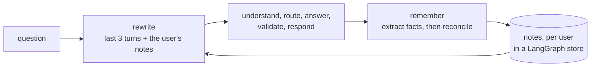

# Agent memory

> Remember the conversation, so a follow-up makes sense; and remember the user, so the next conversation starts where the last one left off.

**Lands in:** Phase 5 · **Code:** `src/copilot/agents/memory.py`, the `rewrite` and `remember` nodes in `src/copilot/agents/graph.py`; `scripts/run_memory.py`

## What it is

An assistant needs two kinds of memory, and they work differently:

- **Short-term memory** is the conversation itself. "What was Netflix's revenue in 2022?" followed by "And in 2021?" only makes sense together. The copilot's graph keeps every turn in its state, and a checkpointer saves that state under the conversation's id, in memory or in Postgres ([LangGraph orchestration](langgraph-orchestration.md)).
- **Long-term memory** is what to carry from one conversation to the next: that a user follows Netflix, wants figures in billions, or is an analyst covering Boeing. Keeping whole transcripts would be costly and noisy, so systems such as Mem0 (Chhikara et al., 2025) keep short **notes** instead, and maintain them: after each exchange, extract the facts worth keeping, compare them with the notes already held, and decide for each to add a note, update one, delete one it contradicts, or do nothing.

## Why we need it here

Every part of the copilot after the first node expects one self-contained question. The router can't route "And in 2021?", the doc agent can't resolve its filings, and the data agent can't write its SQL. Rather than teach each of them about conversations, the first node rewrites a follow-up into a standalone question, the approach text2sql-analyst already uses for its own follow-ups. Notes extend the same idea across conversations: "How did their operating income change?" is answerable when the notes say the user follows Netflix.

## How it works

1. **Rewrite** (the `strong` role). With earlier turns in the conversation, or notes about the user, one call sees the last three turns (each as its standalone question and a clipped answer), the notes and the new question, and returns the question as one that stands alone; a question that already does comes back unchanged. A first question from a user without notes makes no call. A reply that can't be read keeps the question as asked. The response shows both forms, so a wrong reading is visible.
2. **Remember** (the `small` role, after the reply is ready). One call extracts what the user says about themselves: the companies they say they follow or cover, how they ask for answers to be given, their role. A question about a company isn't taken as following it. A second call compares those facts with the user's notes and returns operations: add, update (with the note's id), delete (with the note's id) or none. Operations that name an unknown note are skipped, never guessed, and a note already held isn't added twice.
3. **The store.** Notes live in a LangGraph store, under the namespace `("notes", user_id)`: in memory by default, or in the Compose Postgres (`poe ask --postgres --user NAME`), so they outlive the process. The user's id travels in the run's config, beside the conversation's thread id. A note's id is a hash of the user and its text, so a rerun sends the same prompts and replays its calls from the cache.
4. **Batch runs keep no notes.** An evaluation answers independent questions, each on a thread of its own, so a run built with `batch=True` has no store, and its first questions make no rewrite call: single questions behave exactly as before.

## Where it lives in the code

| Piece | What it does |
|---|---|
| `copilot.agents.memory.rewrite_followup` | The standalone question from the last turns and the notes; no call without either |
| `copilot.agents.memory.extract`, `reconcile` | Facts worth keeping from one exchange; what to do with each, given the notes |
| `copilot.agents.memory.recall`, `apply` | Read a user's notes from the store; carry out the operations |
| `copilot.agents.graph` `rewrite`, `remember` | The two nodes: first and last in the graph |
| `copilot.agents.build.postgres_store` | The notes in the Compose Postgres |
| `scripts/run_memory.py` (`poe run-memory`) | The memory set through the rewrite and the notes, scored |

## How we measured it

On the [memory set](../data/memory-set.md): 10 conversations from 6 users, 20 turns, written for this project. `poe run-memory` sends each turn through the rewrite and the notes as the graph does, with a written answer standing in for the specialists. A turn is **resolved** when its standalone form names exactly the expected companies, and the expected years and terms; each user's final notes are checked for 15 terms they should or shouldn't mention.

| | Notes prompt v1 | Notes prompt v2 |
|---|---|---|
| Turns resolved | 20 of 20 | 20 of 20 |
| Follow-ups, rewritten and resolved | 7 of 7 | 7 of 7 |
| Questions resolved from the notes, in a new conversation | 2 of 2 | 2 of 2 |
| Standalone questions left as asked | 10 of 11 | 10 of 11 |
| Notes kept | 15 | 6 |
| Notes checks passed | 7 of 15 | 15 of 15 |
| Tokens for rewrites (gpt-oss-120b), in / out | 4,167 / 1,981 | 4,100 / 1,963 |
| Tokens for notes (gpt-oss-20b), in / out | 8,542 / 7,012 | 7,410 / 4,913 |
| Cost a turn, at list prices | $0.00023 | $0.00019 |

- **Rewriting** resolved every turn with both prompts; only the notes prompt changed between them. "Which one grew faster from 2021?" came back as "Which company, Coca-Cola or PepsiCo, had a faster net income growth from 2021 to 2022?", and in a new conversation "the company" became Boeing, from the note "Covers Boeing." The one standalone question that was rewritten lost its preamble: "I don't follow Intel any more; I follow AMD now. What was AMD's revenue in 2022?" came back as "What was AMD's revenue in 2022?", which still names what it must.
- **Notes.** With v1, 6 of the 15 notes said what users had said about themselves. Eight were inferred from questions: comparing Coca-Cola's and PepsiCo's net income became "Follows Coca-Cola." and "Follows PepsiCo.", and a question about 737 MAX production became "User is interested in 737 MAX production." One, "User prefers concise answers.", had no basis in anything the user said. With v2, all 6 notes were stated by their users, and the change of mind became an add and a delete: "Follows AMD." in, "Follows Intel." out.
- **What v2 gives up.** A user who never says what they follow gets no notes, so "How did my companies do?" has nothing to resolve against in their next conversation. Within a conversation, the turns themselves still resolve follow-ups.
- **Tuned on the same turns.** The 15 checks and prompt v2 were both written after reading v1's notes, so v2's 15 of 15 is a fit to these 20 turns, not an estimate for new users. The six checks written before any run passed with both prompts.

## Design choices

- **The last three turns.** A rewrite that sees the whole conversation can carry a company from several questions back into a question about another one. Only the last three turns are shown, as text2sql-analyst does, and the memory set includes a turn that switches company and must not inherit the old one.
- **Notes about the user, not the answers.** The figures in an answer belong to the filings, which the copilot can read again; a note that kept them would go stale and could contradict a later filing. The extraction prompt asks for facts about the user only.

Both choices were made before any run, and both held: u4's follow-up after a switch from 3M to Amcor took Amcor, and no note kept an answer's figures.

## Pitfalls we hit

- **Asking is not following.** The first notes prompt asked for "the companies they follow or care about", and the small model took every question as a sign of interest. The six checks written before the run tested what should be in the notes and only one thing that shouldn't, so they all passed while 9 of the 15 notes were wrong. Reading the notes found it. The second prompt notes only what users say about themselves, with an example of a question that says nothing about the user, and the checks now cover what mustn't be there.
- **Random ids defeat the cache.** Notes first got random ids, and the reconcile prompt lists the notes with their ids, so a rerun sent new prompts and paid for them again. An id is now a hash of the user and the note's text.

## Review questions

1. Why rewrite a follow-up into a standalone question rather than pass the whole conversation to every agent?
2. What does a checkpointer remember, and what does the notes store remember?
3. Why does the reconcile step need the existing notes, and what goes wrong if it only ever adds?
4. Why do evaluation runs keep no notes?

## References

- Chhikara et al., [Mem0: Building Production-Ready AI Agents with Scalable Long-Term Memory](https://arxiv.org/abs/2504.19413), 2025.
- LangGraph documentation, [persistence](https://docs.langchain.com/oss/python/langgraph/persistence): checkpointers for short-term memory and stores for long-term memory.
- text2sql-analyst's follow-up rewriting, which this extends to the whole copilot.
