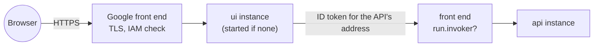

# Cloud Run: containers that scale to zero

> Run a container image as an HTTPS service that starts on the first request, stops when idle, and is billed only while it works.

**Lands in:** Phase 8 · **Code:** `infra/terraform/modules/cloud-run-service/`, `src/copilot/api/client.py`, `src/copilot/api/firestore.py`

## What it is

Cloud Run runs containers without servers to manage:

- **A service** is a name, an address and a configuration.
- **A revision** is an immutable snapshot of one image and its settings. A deploy makes a new revision, and the service's traffic moves to it. Rolling back is moving traffic to an older one.
- **An instance** is one running copy of a revision. Cloud Run starts instances when requests arrive, and stops them when none have come for a while, down to zero.
- **A cold start** is the delay while the first instance starts: pulling the image, starting the process, loading what it needs.
- **Concurrency** is how many requests one instance takes at once. **Maximum instances** caps how many run, and with them the cost of a traffic spike.
- **Request-based billing** (`cpu_idle`) charges for CPU only while a request is in flight; **startup CPU boost** gives a starting instance more CPU.
- **The container contract.** The process listens on `$PORT` on every interface. Anything written to the file system lives in the instance's memory and is lost when the instance stops. On shutdown the process gets SIGTERM and ten seconds.
- **Identity and access.** Each service runs as a service account. Calling a private service takes `roles/run.invoker` and a Google ID token whose audience is the service's address; Google's front end checks it before the request reaches the container.

## Why we need it here

The copilot's four services are idle most of the time ([ADR-0016](../decisions/0016-deploy-on-google-cloud.md), [ADR-0031](../decisions/0031-google-cloud-topology.md)). Cloud Run keeps them deployed and reachable at any hour while charging nothing between visits. It also serves each over HTTPS, and lets each run as its own least-privilege account.

## How it works

Cloud Run's contract changed a few things in the code (step 8.3):

| What Cloud Run does | What the copilot does about it |
|---|---|
| The file system is the instance's memory | The model-call caches and the trace file are switched off (`FRC_LLM_DISK_CACHE=false`, `FRC_API_TRACE_FILE=false`); traces go to Langfuse, logs to Cloud Logging |
| Instances stop when idle and share no memory | Quotas, cached answers and feedback live in Firestore (`FRC_API_STATE=firestore`) |
| A private service checks an ID token | The UI and the MCP server sign each call to the API with a token from the instance's metadata server, fetched again five minutes before it expires (`GoogleIdToken`) |
| A container listens on `$PORT` | The API and the UI already did; the MCP server now does too |
| Every request comes through Google's front end | The UI identifies a visitor by the last address in `X-Forwarded-For`, the one the front end adds after any a client sent (checked on the deployed service in step 8.7) |
| A service's legacy address isn't known before it exists | The MCP server allows its deterministic address (`<service>-<project number>.<region>.run.app`) |
| Downloads at start slow every cold start | The embedding models are in the image, and `HF_HUB_OFFLINE=1` forbids downloads |

## Where it lives in the code

| Piece | What |
|---|---|
| `infra/terraform/modules/cloud-run-service/` | One service: scaling, CPU and memory, request-based billing, environment and secrets, Direct VPC egress, who may call it |
| `infra/terraform/envs/prod/services.tf` | The four services, their accounts and secrets |
| `copilot.api.client.GoogleIdToken` | ID tokens for calls to the private API |
| `copilot.api.client.visitor_from_forwarded` | The visitor behind the front end |
| `copilot.api.firestore` | The API's state in Firestore |
| `copilot.mcp.server.build_parser` | The MCP server's port from `$PORT` |

## How we measured it

The cold starts, the instances' memory and how many visitors one API instance serves are measured with the load test (step 8.7), once the services run.

## Pitfalls we hit

- **Firestore stores no lists inside lists,** and a data answer's rows are exactly that. Cached answers are stored as JSON text.
- **A revision won't start while a secret it reads has no version,** so secrets are filled in before the services exist ([deploy runbook](../runbooks/deploy.md)).

## Review questions

1. What happens to a file the API writes while it answers, and when?
2. Why can't the quotas live in the API's memory once there are two instances, or once the only one has stopped?
3. Who checks the ID token on a call from the UI to the API, and what does the API's own code see of it?
4. What does `max_instances = 1` buy for the API, and what does it cost a second visitor?
5. Why trust only the entry of `X-Forwarded-For` that the front end adds, and how would you find out which one that is?

## References

- Google Cloud: [the container runtime contract](https://cloud.google.com/run/docs/container-contract), [service-to-service authentication](https://cloud.google.com/run/docs/authenticating/service-to-service), [concurrency](https://cloud.google.com/run/docs/about-concurrency), [billing settings](https://cloud.google.com/run/docs/configuring/billing-settings), [Direct VPC egress](https://cloud.google.com/run/docs/configuring/vpc-direct-vpc).
- [ADR-0031](../decisions/0031-google-cloud-topology.md); [Terraform basics](terraform-basics.md).
