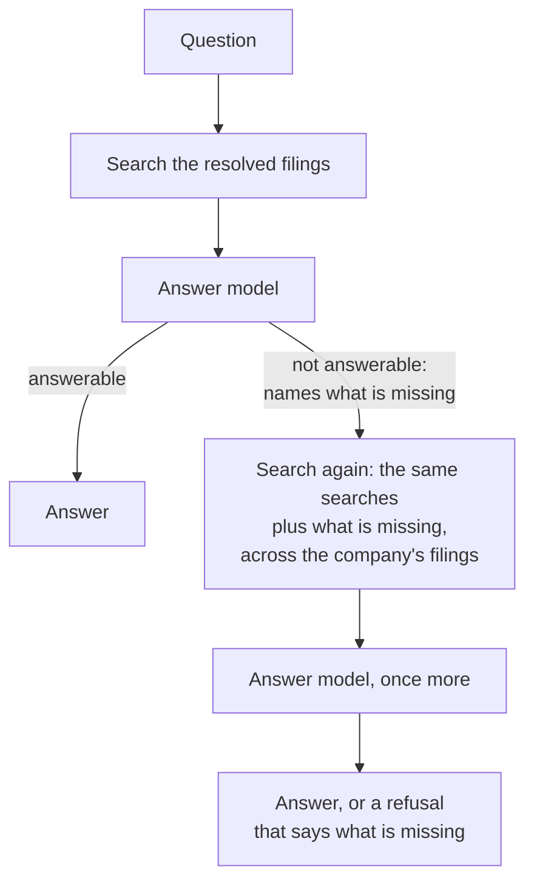

# Corrective RAG

> When the evidence falls short, notice it, search for exactly what is missing, and ask once more before giving up.

**Lands in:** Phase 3 · **Code:** `src/copilot/answer/agent.py`

## What it is

Plain retrieval-augmented generation retrieves once and answers from whatever came back. If retrieval missed, the model either refuses or, worse, fills the gap from memory.

**Corrective RAG** adds a check between retrieval and the answer. In the CRAG paper (Yan et al., 2024), a small fine-tuned evaluator grades the retrieved documents. If they're relevant, it answers from them, keeping only their useful strips. If they aren't, it discards them, rewrites the question as a web search and answers from the results. If it's unsure, it combines both. **Self-RAG** (Asai et al., 2023) goes further and trains the generator itself to emit reflection tokens: whether to retrieve, whether a passage is relevant, whether the output is supported.

Both share one idea: *grade the evidence, and search differently when it's weak*.

## Why we need it here

[Query understanding](query-understanding.md) narrows each search to the filings the question names, and the rewrites search for what the question needs. Both can still miss:

- **The wrong filing.** The resolver picked the 10-K; the passage that answers the question sits in the same company's earnings release.
- **The right filing, the wrong pages.** A figure for fiscal 2017 is printed in the fiscal 2019 10-K's cash-flow statement, which covers three years, but the question's wording led search to other pages.

The first smoke run showed the second kind. Both of its refusals were about Activision Blizzard, which has one filing in the corpus: there was nothing wider to search, the filing does hold both answers, and neither evidence page was in the top 20 of the first search. Each refusal named exactly what was missing: the capital expenditure for fiscal 2017, and the PP&E balances for fiscal 2018 and 2019.

## How it works

The version here is deliberately light: one check, one retry.

1. **The answer call is the grader.** `answerable: false` is the model's verdict on the sources as a whole, and `missing` names the facts it lacks, with their line items and periods. There is no separate call per source: that would add about eight calls a question for a judgement the answer call makes anyway.
2. **One more search, aimed at the gap.** The agent searches for the `missing` text across every filing of the same company (all years and forms), together with the original searches. The new search is weighted as much as all of them together, so its best pages rank alongside the best of the first search instead of being outvoted by five rankings that already missed. The second context is half as large again (4,500 tokens), so the pages found for the gap join the pages that held the rest of the answer instead of replacing them. The rewrites come from the model-call cache, so the retry costs one answer call.
3. **Then stop.** If the second answer also abstains, the agent returns that refusal with what is missing. A refusal with nothing wider to search and nothing named as missing is final.

| | CRAG (Yan et al.) | Here |
|---|---|---|
| Grader | A fine-tuned T5 evaluator, per document | The answer model's `answerable` verdict, over all sources |
| Actions | Correct, incorrect, ambiguous | Answer, or retry once |
| Refining the evidence | Split documents into strips and keep the relevant ones | None: the context budget already limits what goes in |
| The second search | The question rewritten as a web search | The model's own description of what is missing, in the company's filings |

## Where it lives in the code

| Piece | What it does |
|---|---|
| `DocAgent.answer` | Answer; on a refusal, search again and answer once more |
| `DocAgent.retrieve(missing=...)` | Adds the search for what is missing, weighted as much as the others together |
| `DocAgent.retry_budget` | The second context's budget: 1.5 times the first, 4,500 tokens |
| `DocAgent.company_filings` | Every filing of the companies the question names, or None |
| `AgentAnswer.first`, `.retried` | The first, abstaining answer when there was a retry |
| `tests/test_agent.py` | An in-memory index with fake models: no retry after an answer, a retry that widens to the company's other filing, a retry within a company's only filing, and a refusal that is final |

## How we measured it

`poe answer-questions` records `retried` for every question, keeps the first answer's "missing" note, counts the searches of each kind, and adds both calls' tokens to the question's cost. The [ADR](../decisions/0013-answer-format.md) has the smoke-run numbers. On the 100 dev questions ([report](../eval/doc-agent-dev.md)):

| | Questions |
|---|---|
| First answer was a refusal, so the retry ran | 16 |
| Answered correctly after the retry | 6 |
| Answered, but incorrectly | 4 |
| Refused again | 6 |

Without the retry, those 16 would all have been refusals: 6 of the 100 dev questions became correct answers, for one extra answer call on each of the 16. Of the 6 final refusals, 2 had an evidence page in their context, so the model missed what was there; for the other 4, with no evidence page in the context, refusing was the honest outcome.

## Pitfalls we hit

- **Widening alone rarely helps.** The first version retried only when the company had more filings than the resolver picked. Most refusals come from the right filing's wrong pages, and some companies have a single filing, so it never ran in the first smoke run.
- **New pages can push out the ones that held the rest of the answer.** In the second smoke run, both retries brought an evidence page into the context, but at 3,000 tokens the pages found for the gap displaced the income statement both answers also needed: one answer computed its ratio from the wrong figure, the other refused for lack of revenue. Offline, with the same searches, a 4,500-token second context held both evidence pages for the first question; the second needed 6,000. The larger budget applies to retries only, so it adds about 1,500 tokens to each retried question, two in ten in the smoke runs.
- **A vague "missing" note makes a poor query.** The prompt asks for the missing facts with their line items and periods ("capital expenditure for fiscal 2017"), because that text becomes the search.
- **Retries must stay cheap.** The retry runs the same rewrites again; they come from the cache, so it adds one answer call and nothing else.
- **An unparseable reply looks like a refusal.** A reply that isn't valid JSON is recorded as unanswerable with its error and an empty "missing" note, so it is retried only when the company has filings left to search.

## Review questions

1. Why use the answer model's own verdict instead of a separate grader per source?
2. Why is the search for what is missing weighted as much as all the other searches together, and why does the second context get a larger budget?
3. Which kind of retrieval miss does widening to the company's other filings fix, and which does the search for what is missing fix?
4. Why does the retry cost one model call rather than four?
5. What would a CRAG-style per-source grader add, and what would it cost on the free tier?

## References

- Yan et al., [Corrective Retrieval Augmented Generation](https://arxiv.org/abs/2401.15884), 2024.
- Asai et al., [Self-RAG: Learning to Retrieve, Generate, and Critique through Self-Reflection](https://arxiv.org/abs/2310.11511), 2023.
- [Grounded generation](grounded-generation.md) for the answer call itself.
