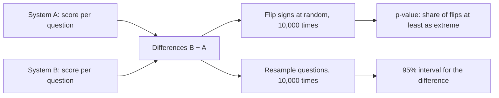

# Evaluation statistics

> How sure are we about a score, and is a change really better? Bootstrap intervals answer the first question; paired tests answer the second.

**Lands in:** Phase 1 · **Code:** `src/copilot/eval/stats.py`, `src/copilot/eval/report.py`

## What it is

Every score in this project is an average over questions: recall@10 over 100 dev questions, answer accuracy over 50 test questions. Another sample of similar questions would give a different average. Two tools say how much that matters.

- A **confidence interval** gives the range a score would plausibly take over other samples of questions like these. The project uses the **percentile bootstrap**: resample the questions with replacement 10,000 times, recompute the score each time, and keep the middle 95% of the results.
- A **paired test** says whether system B beats system A by more than chance. Both systems answer the same questions, so they are compared question by question. That cancels out the fact that some questions are simply harder than others.

## Why we need it here

The evaluation sets are small: 100 dev questions and 50 test questions. At 50 questions, an accuracy near 50% has a 95% interval of about ±14 points. Without intervals, a 5-point gain from a prompt tweak looks like progress when it may be luck. The plan's rule (§2) is that a change ships only when its paired improvement is significant on dev.

## How it works

1. **Per-question scores.** Each metric gives one number per question (`metrics.py`): recall@k, hit@k and reciprocal rank for retrieval now; answer correctness, SQL execution match and route accuracy (each 0 or 1) in later phases. Rankings are de-duplicated first, so three chunks from one page count as one page.
2. **Bootstrap interval** (`bootstrap_ci`). Draw *n* question indices with replacement, average their scores, and repeat 10,000 times. The 2.5th and 97.5th percentiles of those averages bound the 95% interval. A fixed seed makes every rerun identical.
3. **Paired permutation test** (`paired_test`). Compute each question's difference, B minus A. If the systems were interchangeable, each difference would be as likely to come out negative as positive. Flip the signs at random 10,000 times; the p-value is the share of flips whose mean lands at least as far from zero as the observed mean. The observed arrangement counts once: p = (count + 1) / 10,001. The difference also gets its own bootstrap interval.
4. **McNemar's exact test** (`mcnemar_exact`). For right-or-wrong outcomes, only the questions where the systems disagree carry information. If B wins 9 of them and A wins 1, a fair coin gives a split at least that lopsided with probability 2 × (1 + 10) / 1,024 ≈ 0.021.
5. **Several comparisons at once** (`holm`). Testing five variants against one baseline at α = 0.05 gives about a 23% chance of at least one false win. Holm–Bonferroni multiplies the smallest p-value by 5, the next by 4, and so on, which keeps the chance of any false win at 5%.

## Where it lives in the code

| File | What it does |
|---|---|
| `src/copilot/eval/metrics.py` | `recall_at_k`, `hit_at_k` and `reciprocal_rank` over de-duplicated rankings |
| `src/copilot/eval/stats.py` | `bootstrap_ci`, `paired_test`, `mcnemar_exact`, `holm` |
| `src/copilot/eval/report.py` | `summarise` (an interval per metric, overall and per group), `write_run`, `read_rows`, `read_summary`, `compare_runs` |
| `src/copilot/eval/retrieval.py` | Gold pages from FinanceBench evidence, `score()`, the `first_pages` baseline, `read_predictions()` |
| `scripts/eval_retrieval.py`, `scripts/compare_runs.py` | The `poe eval-retrieval` and `poe compare-runs` commands |

A retrieval run goes: `load_split("dev")` → predictions → `retrieval.score()` (one row per question) → `summarise()` and `summarise_by("question_type")` → `write_run()`, which writes `items.jsonl`, `summary.json` and `summary.md`. `compare_runs()` later reads two runs' `items.jsonl`, pairs the rows by question id and calls `paired_test()`.

## How we measured it

- **Unit tests** (`tests/test_stats.py`, `tests/test_metrics.py`, `tests/test_report.py`, `tests/test_retrieval_eval.py`). Intervals bracket the mean, and for a 0/1 metric at n = 50 they match the normal approximation within 15%. Seeds reproduce exactly. Identical systems give p = 1, and a consistent improvement gives the smallest possible p. McNemar matches hand-computed binomial tails, and Holm matches a worked example.
- **First run on real data.** The first-pages baseline ranks the first 20 pages of the correct document. On FinanceBench dev it gets hit@20 = 0.29 (95% interval 0.20 to 0.38), recall@10 = 0.197 (0.123 to 0.277) and MRR@10 = 0.075 (0.041 to 0.117). Questions about financial-statement figures score 0, because the statements sit beyond page 20 of a 10-K. This is the floor Phase 2 retrieval has to beat; the run is in `eval/results/retrieval/first-pages/dev/`.

## Pitfalls we hit

- **Lumpy intervals.** With 0/1 scores at n = 50, every resampled mean is a multiple of 0.02, so two seeds often produce the same interval. Tests that check seeding use graded scores instead.
- **Ties.** With 0/1 scores, many flipped means equal the observed mean exactly, and floating-point noise could make them miss the comparison. The comparison allows a tolerance of 10⁻¹².
- **p = 0 is never right.** With 10,000 flips the smallest honest p-value is 1/10,001. Adding 1 to both the count and the number of flips keeps the test valid.
- **Silent zeros.** A question missing from a predictions file would score 0 without anyone noticing, so scoring refuses predictions that don't cover exactly the split's questions.

## Review questions

1. Why is a paired test more sensitive than checking whether two systems' confidence intervals overlap?
2. With 0/1 scores at n = 50, why can bootstrap means only be multiples of 0.02, and what does that mean when comparing seeds?
3. Why does the permutation p-value add 1 to both the count and the number of resamples?
4. When would you use McNemar's test instead of the paired permutation test, and why do they usually agree on 0/1 scores?
5. You compare six retrieval variants with the baseline, and the best has p = 0.02. Is it significant after Holm–Bonferroni?

## References

- Efron and Tibshirani, *An Introduction to the Bootstrap* (1993).
- Dror, Baumer, Shlomov and Reichart, "The Hitchhiker's Guide to Testing Statistical Significance in Natural Language Processing", ACL 2018.
- Berg-Kirkpatrick, Burkett and Klein, "An Empirical Investigation of Statistical Significance in NLP", EMNLP 2012.
- Noreen, *Computer-Intensive Methods for Testing Hypotheses* (1989), on approximate randomization tests.
- Holm, "A Simple Sequentially Rejective Multiple Test Procedure", *Scandinavian Journal of Statistics* (1979).
- McNemar, "Note on the Sampling Error of the Difference Between Correlated Proportions or Percentages", *Psychometrika* (1947).
