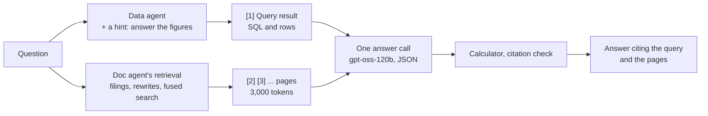

# Hybrid answers

> Take each part of an answer from where it is reliable: figures from a database query, explanations from the filing's pages, each sentence cited to the one it came from.

**Lands in:** Phase 4 (a prototype) · **Code:** `src/copilot/answer/hybrid.py`, `src/copilot/eval/hybrid.py`

## What it is

Analysts' questions often join a figure to a reason: "How did 3M's capital expenditure change from 2017 to 2018, and what did the company say it was investing in?" The figure is reported data, best taken from the XBRL facts, where it is tagged, exact and comparable across years. The reason exists only in the filing's text, in management's discussion. A **hybrid answer** asks the data agent for the figures and the doc agent for the pages, then writes one answer from both, citing the query result for the figures and the pages for the reasons.

Question answering over tables and text together is a research problem of its own: HybridQA (Chen et al., 2020) and, for financial reports, TAT-QA (Zhu et al., 2021) and FinQA (Chen et al., 2021) build benchmarks where an answer needs both. Here the "table" is a SQL result, so the numbers stay exact and the arithmetic stays in the database or the calculator.

## Why we need it here

Each agent alone is half an answer. The data agent got 32 of FinanceBench's 33 dev figure questions right to the doc agent's 29, including every one the doc agent got ([report](../eval/data-agent-financebench.md)), but it can't say why a figure moved. The doc agent can explain, but reads its figures off pages, and refuses when the figures for several years aren't all in its context. Phase 5's orchestrator will route each question to one agent or both and check the result; this prototype tests the combining step on its own first.

## How it works

1. **The figures** (`DataAgent.ask` with `FIGURES_HINT`). The data agent gets the whole question and one more hint: other sources will answer any part that asks for reasons, so answer the figures the database holds, and decline only if it holds none. Without the hint its table-selection step declined questions like 3M's, saying the database holds no commentary. It runs without its own written analysis, since the answer call writes the text.
2. **The query result as a source** (`database_source`). The SQL and the rows become source [1], labelled "Facts database", with large numbers written out (`1,577,000,000`), so the answer model can cite a figure to the query the way it cites one to a page.
3. **The pages.** The doc agent's retrieval, unchanged: the filings the question names, three rewrites, fused dense search, the best page chunks within 3,000 tokens, numbered from [2].
4. **One answer call**, with the doc agent's rules (a citation on every sentence, the calculator for arithmetic, a refusal when the sources fall short) and two more:
   - take figures from the database source when it has them, and use the pages for reasons and context;
   - when a page states a different figure for the same item and period, such as a restated one, give both and say which is which.
5. **Without a query result,** because the data agent declined or failed, the answer comes from the pages alone, numbered from [1].

The prototype always asks both agents and never retries. Deciding which agents a question needs, splitting it into a part for each, and checking the answer before it is shown are Phase 5's router, planner and validator.

## Where it lives in the code

| Piece | What it does |
|---|---|
| `copilot.answer.hybrid.HybridAgent` | Asks both agents and writes one answer; `answer(question)` returns a `HybridAnswer` |
| `copilot.answer.hybrid.database_source` | The data agent's result as numbered source [1] |
| `copilot.answer.hybrid.SYSTEM_PROMPT`, `FIGURES_HINT` | The answer rules for mixed sources, and the data agent's extra hint |
| `copilot.eval.hybrid` | The [hybrid question set](../data/hybrid-set.md): expected figures as formulas over annual values, and the figure check |
| `scripts/run_hybrid.py` | `poe run-hybrid`: the set answered by the hybrid agent or the doc agent alone, with figure, citation and faithfulness checks |

## How we measured it

The [hybrid set](../data/hybrid-set.md)'s 13 questions, answered by the hybrid agent and by the doc agent alone ([report](../eval/hybrid-prototype.md)):

| Measure | Hybrid | Doc agent alone |
|---|---|---|
| Answered with every expected figure | 10 | 10 |
| Explained, read by hand | 9 | 9 |
| Every sentence supported by its citations | 8 | 6 |
| Five-year questions, a middle year missing from the corpus (3) | 1 answered, all figures held | 0 |
| Cost a question at list prices | $0.0048 | $0.0030 |

Neither answers more: each answers one the other doesn't. The difference is where they fail. The doc agent can't reach years its filings don't hold. The hybrid had the figures for every question it refused, but no page explaining them, and its rules allow only a full answer or a refusal. On two-year questions that one filing states, they tie, and the hybrid's gain is provenance: each figure cited to a query over the reported data.

## Pitfalls we hit

- **The narrative half made the data agent decline.** Asked the whole question, its table selection judged "what did the company say" as something no table holds, and declined the figures with it. A hint that other sources answer the reasons fixed 3M's question in the smoke run; Adobe's still declined in the full run, so the answer took its figures from the pages. The lasting fix is to give each agent only its part of the question, which is the planner's job in Phase 5.
- **A restated figure, given without its label.** Boeing restated its 2017 revenue for the new revenue standard. The answer gave both the first-reported figure from the database and the restated one from the page, as the rules ask, but without saying which was the restatement.
- **A page just missed.** General Mills's explanation of its operating cash flow is on PDF page 27; retrieval brought pages 26 and 28, and the answer restated the figure instead of explaining it. The data agent can't help with that half; only retrieval can.
- **All or nothing.** Three refusals came with every figure in hand: no retrieved page explained the change, and the rules ask for a refusal when the sources fall short. The doc agent's retry, a second search for what is missing, found one of those explanations; partial answers and that retry are the first two things Phase 5 adds.
- **A change written twice.** The model sometimes writes a year-over-year change itself and then a calculator placeholder for it, so the answer shows "$122 million ... 122,000,000". Each computed figure should come from the calculator once.

## Review questions

1. Why take a figure from the database when the page that explains it also states it?
2. What should an answer do when the database and a page disagree on a figure, and why can both be right?
3. Why does the data agent need to be told that someone else will answer the "why"?
4. What would a planner that splits the question do better than one hint?

## References

- Chen et al., [HybridQA: A Dataset of Multi-Hop Question Answering over Tabular and Textual Data](https://arxiv.org/abs/2004.07347), 2020.
- Zhu et al., [TAT-QA: A Question Answering Benchmark on a Hybrid of Tabular and Textual Content in Finance](https://arxiv.org/abs/2105.07624), 2021.
- Chen et al., [FinQA: A Dataset of Numerical Reasoning over Financial Data](https://arxiv.org/abs/2109.00122), 2021.
- [Grounded generation](grounded-generation.md), [Text-to-SQL agent](text-to-sql-agent.md).
