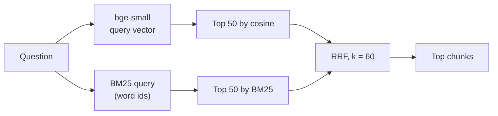

# Hybrid search and reciprocal rank fusion

> Keyword search and semantic search fail on different questions. Running both and merging their rankings by rank, not by score, catches more of the evidence than either alone.

**Lands in:** Phase 2 · **Code:** `src/copilot/retrieval/search.py`, `src/copilot/ingest/embed.py`

## What it is

**Dense search** embeds the question and every chunk as vectors and returns the chunks whose vectors point the most nearly the same way (cosine similarity). It matches meaning: "How much did 3M spend on new equipment?" can find "Purchases of property, plant and equipment".

**BM25** is keyword search. A chunk scores higher when it contains the question's words, especially rare ones, more often, in fewer words:

```
score(q, d) = sum over words w in q of  IDF(w) * tf(w, d) * (k1 + 1) / (tf(w, d) + k1 * (1 - b + b * |d| / avgdl))
```

where `tf` is how often the word appears in the chunk, `|d|` the chunk's length, `avgdl` the average length, and IDF grows as the word gets rarer across the collection. It matches exact strings: a ticker, "Item 7A", "goodwill impairment", a figure such as "1,577".

**Hybrid search** runs both and merges the two ranked lists. **Reciprocal rank fusion (RRF)** merges by position alone:

```
RRF(d) = sum over rankings r that contain d of  1 / (k + rank_r(d))
```

A chunk ranked 1st by BM25 and 5th by dense search scores 1/61 + 1/65 with k = 60; one found by only one list scores at most 1/61.

## Why we need it here

Filings mix both kinds of question. "What drove the change in operating margin?" is semantic. "What was 3M's capital expenditure in fiscal 2018?" depends on matching a line item's exact label, and dense search on a small model blurs it with every other cash-flow line. Neither search alone is reliably better, so the plan measures dense, BM25 and their fusion on the same questions.

Fusing by rank avoids a hard problem: dense cosine scores (around 0.6 to 0.9) and BM25 scores (0 to 30 or more) are on unrelated scales, and the scales shift from question to question. Ranks are always comparable.

## How it works



1. **Index time.** Each chunk stores a dense vector and a sparse vector: the BM25 term weights for the words it contains (FastEmbed's `Qdrant/bm25` computes term frequency with length normalisation). The collection's sparse vectors use Qdrant's IDF modifier, so IDF comes from the collection's live statistics and never goes stale as documents are added.
2. **Query time.** Two Qdrant queries, both restricted by the same filter, return the top 50 chunks by the dense vector and the top 50 by BM25. Each ranking is put in a fixed order (by score, then by point id), and `reciprocal_rank_fusion` merges them, counting ranks from 1. Qdrant can fuse server-side in one call, and the first version did; it was replaced because its order wasn't reproducible (see Pitfalls).
3. **k.** k = 60 follows Cormack, Clarke and Büttcher (2009), who found it robust across collections. Qdrant's own fusion defaults to k = 2, which makes the first one or two ranks of either list dominate; a larger k gives agreement between the lists more weight than position at the very top.

## Where it lives in the code

| Piece | What it does |
|---|---|
| `copilot.ingest.embed.FastEmbedBM25` | Sparse BM25 vectors for chunks and queries |
| `copilot.ingest.index.ensure_collection` | The `bm25` sparse vector with `Modifier.IDF` |
| `copilot.retrieval.search.Searcher.search` | `mode="dense"`, `"bm25"` or `"hybrid"`, with an optional document filter; each ranking sorted by score, then point id |
| `copilot.retrieval.search.reciprocal_rank_fusion` | Sum of `w / (k + rank)` over the rankings, ties broken by point id |
| `scripts/run_retrieval.py` | `poe run-retrieval --mode ...` scores a configuration on FinanceBench dev |

## How we measured it

Dense, BM25 and hybrid search on the 100 dev questions ([report](../eval/retrieval-baseline.md)), recall@10:

| Mode | `tokens-480`, own filing | `page`, own filing | `page`, all 84 filings |
|---|---|---|---|
| Dense | **0.608** | **0.630** | **0.415** |
| BM25 | 0.440 (worse) | 0.430 (worse) | 0.185 (worse) |
| Hybrid, RRF k = 60 | 0.540 (not significantly different) | 0.585 (not significant; MRR worse) | 0.315 (worse) |

"Worse" means significantly worse after Holm's adjustment. Hybrid search didn't help on FinanceBench's questions as asked. Two thirds of them come from templates that add instructions, such as how many decimal places to round to or what to say if a metric doesn't suit the company, and to BM25 those words count as much as the actual subject. On the human-written questions, which carry no template, BM25 beats dense search (0.803 against 0.758 on page chunks within the filing). Phase 3 rewrites questions before searching, and hybrid search gets another look after that.

## Pitfalls we hit

- **Score fusion looks tempting.** A weighted sum of cosine and BM25 scores needs both normalised per query, and the weight then has to be tuned; RRF has one parameter with a well-tested default.
- **Filters on both branches.** The document filter goes on both queries, so neither ranking spends its 50 candidates on other filings.
- **Server-side fusion wasn't reproducible.** Running the same question twice through Qdrant's fused query returned a different order for 35 of 40 dev questions within a filing, and for all 40 across filings. RRF makes ties common (ranks 3 and 7 sum to the same score as 7 and 3), and when two chunks tie inside one ranking, identical boilerplate in different years' filings for example, Qdrant gives them ranks in no fixed order, which RRF then turns into different fused scores. Fusing in our own code, after sorting each ranking by score and point id, made every run repeatable (0 of 40 changed).
- **Qdrant's RRF weights don't multiply scores.** Its RRF takes a weight per prefetch, which suggests `w / (k + rank)`. Probing the 1.19 server showed fused orders that match `1 / (k + rank / w)` instead: a weight rescales a list's ranks, so with k = 60 a larger weight flattens that list's contribution and the *other* list's order decides more. A dense weight of 2 made server-side results worse. The client-side fusion uses the textbook `w / (k + rank)`.
- **BM25 scores depend on the whole collection.** IDF comes from the collection's statistics, so BM25 and hybrid runs made while the main index was still being built gave different numbers from runs on the complete index (BM25 recall@10 0.425 against 0.440 on the complete index). Every reported number comes from the complete index.

## Review questions

1. Why can't you add a cosine similarity of 0.82 to a BM25 score of 14.6 and rank by the sum?
2. A chunk is 1st in the BM25 list and absent from the dense list; another is 3rd in both. With k = 60, which ranks higher after fusion? With k = 2?
3. Why does BM25 find "Purchases of property, plant and equipment" for the query "purchases of PP&E" but not for "capital expenditure", and what would?
4. Why does Qdrant compute IDF at query time instead of storing it in each chunk's sparse vector?
5. The hybrid query fetches 50 candidates from each list. What happens to recall at 20 if that drops to 10?

## References

- Robertson and Zaragoza, The Probabilistic Relevance Framework: BM25 and Beyond, *Foundations and Trends in Information Retrieval*, 2009.
- Cormack, Clarke and Büttcher, [Reciprocal Rank Fusion outperforms Condorcet and individual rank learning methods](https://dl.acm.org/doi/10.1145/1571941.1572114), SIGIR 2009.
- Qdrant documentation, [hybrid and multi-stage queries](https://qdrant.tech/documentation/concepts/hybrid-queries/).
