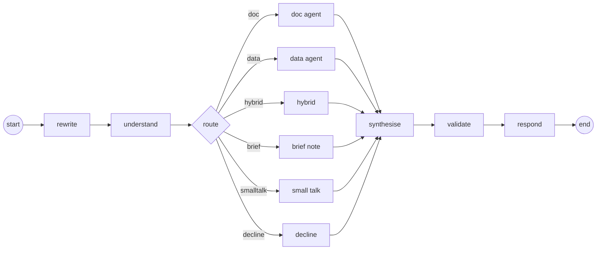

# LangGraph orchestration

> One copilot from several specialists: a state graph that routes each question, runs the right agent, and streams every step as it happens.

**Lands in:** Phase 5 · **Code:** `src/copilot/agents/graph.py`, `runner.py`, `build.py`; `scripts/ask.py`

## What it is

An agent system has to decide what runs next, carry what earlier steps found, and show what it is doing. A **state graph** makes those explicit:

- **State:** one typed record that every step reads and updates, such as the question, the route, the answer and the conversation so far.
- **Nodes:** steps. Each is a function that takes the state and returns the keys it changes.
- **Edges:** what runs next. A plain edge always goes to the same node; a **conditional edge** calls a function on the state and goes where it says, which is how a router branches. An edge back to an earlier node makes a loop, such as a check that sends a draft back for another try.
- **Reducers:** how an update is merged into a key. By default it replaces the old value; `operator.add` appends, which is how a conversation's history grows.
- **A checkpointer:** saves the state after every step under a thread id, so a conversation can continue in a later run, or after a crash, from where it stopped.
- **Streaming:** the run reports events as they happen: a start and a result for each node, and anything a node writes to the stream.

[LangGraph](https://docs.langchain.com/oss/python/langgraph/overview) implements this model: `StateGraph` for the graph, `InMemorySaver` and `PostgresSaver` for checkpoints, and `stream()` for events.

## Why we need it here

By the end of Phase 4 the copilot had specialists but no single entry point: the doc agent for filing text, the data agent for reported figures, and a prototype that combines them. Phase 5 adds a router in front, and later a validator that sends a draft back with feedback at most twice, sampling for numeric answers, and memory across turns. Phase 6 serves the copilot over an API that streams its progress.

A plain chain of function calls could do the first part. A graph makes the branches and the coming loop part of the design, gives every step a start and an end that a trace can show, and keeps conversations in Postgres without code of our own ([ADR-0018](../decisions/0018-graph-design.md)).

## How it works

1. **rewrite** makes a follow-up standalone. It is a pass-through until step 5.5, and it clears what the previous turn left in the state.
2. **understand** reads the companies, years, quarters and forms the question names, with the rules from [query understanding](query-understanding.md).
3. **route** asks the router ([ADR-0017](../decisions/0017-routing.md)): the LLM router on the `strong` role decides, and the semantic router steps in only if that call fails. A conditional edge then picks the specialist.
4. **The specialists.** The doc agent, the data agent (its answer written on the `strong` model) and the hybrid of the two answer with citations. A brief gets a note that briefs come later (Phase 7). Small talk gets a short reply on the `small` role, from a prompt that lists the companies covered. A decline gets a fixed reply, with no model call.
5. **synthesise** puts every result into one shape, the draft: the text, whether it answers, its citations and any SQL.
6. **validate** will check the draft's claims against its sources (step 5.3); for now it passes the draft on.
7. **respond** writes the reply and appends the turn to the history.

**The state** holds plain JSON values only, so any checkpointer can store it. A doc or hybrid answer keeps its cited sources' text, which the validator will need.

**Per-turn keys.** A checkpointer keeps every key of the state between questions, so without care one turn's route or sources would still be there in the next. The first node therefore resets them: the route, the specialist's result, the draft and the response. Only the history accumulates.

**Streaming and traces.** `Copilot.stream` runs the graph with `stream_mode=["tasks", "custom"]` and `version="v2"`, which yields typed parts:

| Part | Becomes |
|---|---|
| A `tasks` start (`id`, `name`, `input`) | A `start` event for the node; the input is the whole state, so it isn't logged |
| A `tasks` result (`id`, `name`, `error`) | An `end` event, with the milliseconds since the start and any error |
| A `custom` part, written by a node with `get_stream_writer()` | An `event`: the cues, the route and its reason, the answer's outline, model usage |

The run's last event is the response. Every event carries the time, a run id, the thread and the turn, and `TraceWriter` appends them to `data/traces/<thread>.jsonl`. Until Langfuse arrives in Phase 6, those JSON lines are the trace, and every node appears in them with a start and an end.

**Cost per task.** Each node is wrapped so that it compares the paced clients' token counts before and after it runs, and emits a `usage` event with the tokens by model and their cost at list prices. Summing those events gives a question's cost, as step 5.6 reports.

**Interactive and batch runs.** `build_components(settings, batch=False)` gives clients that count tokens but neither pause nor retry, so a question asked at the command line isn't slowed by the free tier's pacing: when a quota is spent, the router falls back to its semantic half at once, and a specialist's reply says to try again later. `batch=True` paces every call and retries a rate-limited one after a pause, and a spent quota stops the run so that an evaluation can resume later.

## Where it lives in the code

| Piece | What it does |
|---|---|
| `copilot.agents.graph.CopilotState`, `Turn` | The state, and one finished exchange in the history |
| `copilot.agents.graph.build_graph` | The nodes, the edges, the conditional branch on the route, and the checkpointer |
| `copilot.agents.graph.Components` | What the nodes call, as protocols: the router, the three agents, the small-talk client, the meters |
| `copilot.agents.graph.to_draft` | Every specialist's result in one shape |
| `copilot.agents.graph.metered`, `emit` | The usage event after each node; custom events from inside nodes |
| `copilot.agents.runner.Copilot` | `stream()` and `ask()` for one question on a thread; `history()` |
| `copilot.agents.runner.TraceWriter` | Appends events to a JSON Lines file |
| `copilot.agents.build.build_components` | The real agents, router and clients from settings |
| `copilot.agents.build.postgres_checkpointer` | `PostgresSaver` on the Compose Postgres, with its tables created |
| `scripts/ask.py` (`poe ask`) | One question through the graph, each step printed as it happens; `--thread` and `--postgres` continue a conversation |

## How we measured it

- **Tests with fakes** (`tests/test_graph.py`): each of the six routes runs its own path through every shared node, with a start and an end for each; doc, data and hybrid answers carry their citations and SQL; a second turn starts clean while the history grows; the trace file holds every event with its run and turn; usage events report a node's tokens; a spent quota becomes a reply, or, when strict, stops the run with an error event in the trace.
- **Postgres** (an integration test): a conversation started by one `Copilot` continues in another, as it would in a later process.
- **End to end:** FinanceBench dev through the graph is step 5.6's run, with steps per task, tool success rate and cost per task.

## Pitfalls we hit

- **A checkpointer remembers too much.** In a two-node prototype with a checkpointer, the first node of the second turn still saw the first turn's answer in the state. Resetting the per-turn keys in the first node prevents that, and a test checks that a small-talk turn after a doc answer has no citations.
- **The trace needs a checkpointer.** Reading a thread's history with `get_state` fails on a graph compiled without one, and LangGraph's documentation says the `tasks` stream mode needs one too, so `Copilot` always has one, in memory unless Postgres is given.
- **Two streaming APIs.** LangGraph 1.2 recommends a newer, typed event-streaming API for new applications. The v2 stream parts used here are documented and stable, so the switch, if it pays, belongs with the API's streaming in Phase 6.
- **Event fields that clash.** The trace helper took the event type as a keyword argument named `kind`, and the synthesise node's event has a `kind` field too. The helper's parameter is now positional-only.
- **Pacing is for batches.** The agents' clients pause after each call to stay under the free tier's tokens-a-minute limit, which would add seconds to an interactive answer; the interactive build counts tokens without pausing.
- **psycopg on Windows.** The Postgres checkpointer needs libpq; `psycopg[binary]` ships it, so nothing has to be installed on the machine.

## Review questions

1. What does a conditional edge do that an `if` statement in one big function doesn't, once the graph has loops and a checkpointer?
2. Why does the first node reset the per-turn keys, and what would a user see if it didn't?
3. Which stream mode gives each node's start and end, and why isn't its input logged?
4. Why do interactive runs and evaluation runs use differently paced clients?
5. What has to be true of the state for a Postgres checkpointer to store it?

## References

- LangGraph documentation: [overview](https://docs.langchain.com/oss/python/langgraph/overview), [Graph API](https://docs.langchain.com/oss/python/langgraph/graph-api), [streaming](https://docs.langchain.com/oss/python/langgraph/streaming) and [persistence](https://docs.langchain.com/oss/python/langgraph/persistence).
- [ADR-0018](../decisions/0018-graph-design.md) for the design, and [ADR-0017](../decisions/0017-routing.md) for the router.
