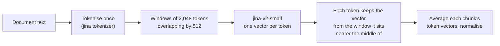

# Late chunking

> Embed a long stretch of the document first and split it into chunks afterwards, so each chunk's vector carries the context around it.

**Lands in:** Phase 2 · **Code:** `src/copilot/ingest/late_chunking.py`

## What it is

The usual way to embed a document is to cut it into chunks and embed each chunk on its own. The model then sees only the chunk's own words. A chunk that says "Its revenue grew 5% this year" doesn't know whose revenue, and a table row that continues from the previous page has lost its column headers.

**Late chunking** reverses the order. A long-context embedding model reads a large window of the document in one pass, which produces one vector per token, each shaped by the tokens around it. Only then is the window divided into the same chunks as before, and each chunk's vector is the average of its own tokens' vectors. The chunk text, its pages and its boundaries don't change; only its vector does.

## Why we need it here

Filings are full of references that only make sense in context: "the Company", "this segment", "the prior year", a note continued from the previous page, a table whose header is two pages up. Chunk-by-chunk embedding loses all of them. Late chunking is the cheapest fix to try: it needs no extra model calls and no rewritten chunks, only a model that can read long inputs. The alternative, contextual retrieval (an LLM writes a context sentence for each chunk), costs one LLM call per chunk, more than 20,000 for one strategy.

## How it works

1. **Tokenise** the whole document with the model's tokenizer, keeping each token's character offsets.
2. **Map chunks to tokens.** A chunk is a character span of the document, so its tokens are those whose offsets overlap the span (`token_range`).
3. **Plan windows** (`plan_windows`). jinaai/jina-embeddings-v2-small-en uses ALiBi attention and was trained on inputs up to 8,192 tokens, but attention cost grows with the square of the input length. Windows of 2,048 tokens overlap by 512.
4. **Assign each token to one window** (`ownership`). The boundary between two windows sits in the middle of their overlap, so every token has at least 256 tokens of context on both sides, except at the ends of the document. A chunk that straddles a boundary takes some tokens from each window.
5. **Run only the windows that are needed.** When resuming, only windows owning tokens of missing chunks run.
6. **Pool** (`pool_late`). Each chunk's vector is the mean of its tokens' vectors, scaled to unit length.

The naive baseline uses the same weights and the same ONNX file (`JinaEmbedder.embed_documents`): each chunk on its own, mean-pooled over all its tokens, the way the model was trained. Queries are embedded the same way for both, so the only difference between the two collections is the context each chunk was embedded in.

## Where it lives in the code

| Piece | What it does |
|---|---|
| `plan_windows`, `ownership`, `token_range`, `pool_late` | The algorithm, as pure functions with unit tests |
| `JinaEmbedder` | Loads `model.onnx` and `tokenizer.json` from the jinaai repository through ONNX Runtime; `embed_documents` (naive), `embed_query`, `embed_late` |
| `scripts/index_corpus.py` | `poe index-corpus --model jina-small --late` fills the `fb_tokens-480_jina-small-late` collection; without `--late`, the naive `fb_tokens-480_jina-small` |

FastEmbed returns only pooled vectors, so this model runs through ONNX Runtime directly.

## How we measured it

The two jina collections index the 58 dev filings with the same `tokens-480` chunks, scored with dense search inside each question's own filing ([report](../eval/retrieval-baseline.md)):

| Embedding | recall@5 | recall@10 | recall@20 | MRR@10 |
|---|---|---|---|---|
| jina-v2-small, chunk by chunk | **0.475** | 0.593 | 0.767 | **0.337** |
| jina-v2-small, late-chunked | 0.453 | **0.613** | **0.770** | 0.328 |

Neither difference is significant (recall@10 +0.020, p = 0.68; MRR −0.009, p = 0.75). The effect has the expected shape, though: late chunking helped the generic domain questions, where surrounding context should matter most (recall@10 0.304 to 0.377), and slightly hurt the metrics questions, whose evidence is a self-contained table. With 100 questions, a gain of that size can't be told from noise, so late chunking isn't adopted ([ADR-0011](../decisions/0011-retrieval-baseline.md)). jina-v2-small itself scored about the same as bge-small (0.593 against 0.608).

Speed on the build laptop: the model reads a 512-token input at about 5,000 tokens a second and a 2,048-token window at about 1,600. With the window overlap, late chunking does about four times the model work per token; end to end, with BM25 and storage included, indexing the 58 dev filings took 51 minutes late-chunked against 22 chunk by chunk.

## Pitfalls we hit

- **A chunk can be longer than the overlap.** Chunks are measured in bge's tokens and jina's tokenizer splits text differently, so a 480-token chunk can exceed 512 jina tokens. A first design that required each chunk to sit wholly inside one window could fail on such chunks; assigning tokens rather than chunks to windows removes the limit.
- **Special tokens.** Each window is wrapped in `[CLS]` and `[SEP]` as in training, and their vectors are dropped before pooling, so a chunk's vector comes only from its own tokens.

## Review questions

1. Why does a chunk's late-chunked vector change when the text two pages earlier changes, while its naive vector doesn't?
2. Why split the document into 2,048-token windows instead of reading all of a 120,000-token 10-K at once?
3. Why does each token take its vector from the window it sits nearer the middle of, rather than from the first window that contains it?
4. Late chunking changes the passage vectors but not the query vectors. Why is that consistent?
5. What would contextual retrieval cost for the 21,899 chunks of the main index, and what would it give that late chunking can't?

## References

- Günther et al., [Late Chunking: Contextual Chunk Embeddings Using Long-Context Embedding Models](https://arxiv.org/abs/2409.04701), 2024.
- Günther et al., [Jina Embeddings 2: 8192-Token General-Purpose Text Embeddings for Long Documents](https://arxiv.org/abs/2310.19923), 2023.
- Press, Smith and Lewis, [Train Short, Test Long: Attention with Linear Biases Enables Input Length Extrapolation](https://arxiv.org/abs/2108.12409) (ALiBi), 2021.
- Anthropic, [Introducing Contextual Retrieval](https://www.anthropic.com/news/contextual-retrieval), 2024.
