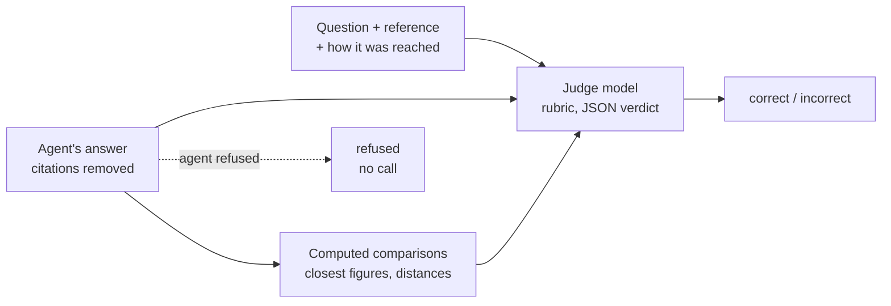

# LLM as judge

> Use a model to grade answers against a reference, then check its verdicts against labels it didn't produce before trusting its numbers.

**Lands in:** Phase 3 · **Code:** `src/copilot/eval/judge.py`, `src/copilot/eval/labels.py`, `scripts/judge_answers.py`, `scripts/judge_agreement.py`

## What it is

Retrieval can be scored by rule: either an evidence page is in the top 10 or it isn't. Answers can't. FinanceBench's reference answer for a capital expenditure question is "$1577.00", and the agent writes "Capital expenditure was $1,577 million in fiscal 2018". A string match calls that wrong; so does a check that the number appears, once the agent writes "$1.577 billion".

An **LLM judge** reads the question, the reference answer and the candidate answer, and decides whether they agree, following a written rubric. It is fast and cheap enough to grade every answer of every run. It is also a model, with a model's failure modes: it can be lenient, inconsistent, swayed by length or confident phrasing, or partial to text that reads like its own. So a judge is itself evaluated: a person labels a sample of the same answers by the same rubric, and the judge's agreement with those labels says how far its numbers can be trusted.

## Why we need it here

Phase 3's question is whether the doc agent answers correctly, and the dev set has 100 questions in three styles: bare figures in the question's units, yes-or-no judgements with reasons, and short explanations. Every agent change in Phases 3 to 7 needs a correctness number, so grading has to be automatic, and it has to be right often enough that a difference between two runs reflects the agents, not the judge.

## How it works



1. **Three outcomes**, as in the FinanceBench paper: correct, incorrect, or refused. When the agent says its sources don't contain the answer, the outcome is "refused" without a judge call; every FinanceBench question is answerable from its filing, so a refusal never counts as correct.
2. **What the judge sees**: the question (which carries the units: "in USD millions"), the reference answer, FinanceBench's note on how the reference was reached when there is one, and the candidate answer with its citation markers removed, since "[2]" means nothing without the sources.
3. **The rubric** (`RUBRIC`): numbers match when they are equal at the reference's precision or within 1%; units and notation can differ; a judgement must reach the same conclusion, and a figure the answer gives for something the reference also quantifies must match it; every part of a multi-part question must match; extra detail is fine unless it contradicts the reference.
4. **Arithmetic in code** (`closest_figures`). For each figure in the reference, the closest figure in the answer and their distance, after allowing for thousands, millions and billions and for percentages written as fractions:

   ```
   Computed comparisons:
   - reference 8.70, closest candidate figure 8.738: 0.44% apart
   ```

   The judge applies the 1% rule to these distances and decides itself whether the two figures measure the same thing. Bare years, quarters and names such as "3M" are not figures.
5. **A different model family.** Models tend to rate text like their own more highly (Zheng et al., 2023), so the default judge is the fast role's Qwen model, not the gpt-oss model that wrote the answers.
6. **One JSON verdict** with a one-sentence reason, at temperature 0. A reply that can't be parsed counts as incorrect, with the error recorded, so a judge failure never flatters the agent.

**Checking the judge** (`copilot.eval.labels`, `poe label-sample`, `poe judge-agreement`):

1. A fixed-seed sample of 44 dev questions, stratified by question type, is drawn before any answer is judged, and the agent answers those questions first. Answered ones get a reference label; refusals need none.
2. The labeller, ideally a person, sees what the judge sees, including the computed comparisons, and applies the same rubric, but never sees the judge's verdict. Labels are correct, incorrect or unsure; unsure ones are left out of the agreement, and each label records who made it. The labels here came from a stronger model (a Claude model) given the same page, not from a person.
3. Agreement is reported two ways: the share of answers where judge and labeller agree, and **Cohen's kappa**, which corrects that share for the agreement two raters would reach by chance given how often each says "correct". With 70% of answers correct, a judge that always says "correct" agrees 70% of the time and scores a kappa of 0.

## Where it lives in the code

| Piece | What it does |
|---|---|
| `copilot.eval.judge.judge` | One verdict: refusals without a call, otherwise the judge prompt in JSON mode |
| `judge_messages`, `RUBRIC`, `SYSTEM_PROMPT` | What the judge reads; the rubric is shared with the labelling page |
| `figures`, `distance`, `closest_figures`, `comparisons` | The computed comparisons of figures |
| `copilot.eval.labels` | Stratified sampling (`allocate`, `stratified_sample`) and reading labels back (`read_labels`) |
| `copilot.eval.stats.cohens_kappa`, `kappa_interval` | Kappa with a bootstrap interval over the labelled answers |
| `scripts/judge_answers.py` | `poe judge-answers`: judges a run resumably; verdicts and reasons stay local, outcomes by id go to `eval/results/correctness/` |
| `scripts/sample_labels.py` | `poe label-sample`: the sample, and what the labeller sees |
| `scripts/judge_agreement.py` | `poe judge-agreement`: agreement and kappa per judge |

## How we measured it

On the 41 labelled answers of the dev run `doc-agent-v3-full` (29 correct and 12 incorrect by the labels; [data card](../data/answer-labels.md)):

| Judge (rubric v2) | Agreement with the labels | Cohen's kappa (95% interval) | Says correct |
|---|---|---|---|
| **Qwen 3.8 27B** (default) | **41 of 41** | **1.00** | 0.71 |
| gpt-oss-20b | 38 of 41 | 0.84 (0.63 to 1.00) | 0.63 |

- gpt-oss-20b is stricter: its three disagreements are all answers the labels call correct.
- On all 94 answered dev questions the two judges agree on 87, kappa 0.83 (0.69 to 0.93), and call 65 and 64 answers correct.
- **What this does and doesn't show.** The labels came from a stronger model, not a person, so these numbers measure agreement between models. Models share failure modes, so perfect agreement here is weaker evidence than it looks; the judge's correctness numbers are reported with that caveat until a person labels a sample ([ADR-0014](../decisions/0014-answer-judge.md)).
- The first rubric, with no computed comparisons, changed 3 of 22 verdicts against the second: the 0.44% case became correct, and two answers whose figures were off became incorrect.

## Pitfalls we hit

- **A judge that can't do the arithmetic it is asked to check.** The first judge prompt left the 1% rule to the model, which called $8.738 billion and $8.70 billion "more than 1% apart" (they are 0.44% apart). The judge now gets computed distances, following the same rule as the answer step: the model reasons, code calculates.
- **A rubric that is silent on the hard case.** The first rubric said only that a judgement's conclusion must match, and the first judge applied it both ways: it failed one answer for a quick ratio of 0.85 against the reference's 0.96, and passed another with a quick ratio of 0.57 against 0.69, and one that quoted a gross margin of 0.19%. For an analyst a wrong figure is an error, so the rubric now says that figures given for something the reference quantifies must also match, even under another reasonable definition.
- **Reference labels that aren't independent.** The plan called for labels by hand; the labels came from another model instead, and matched the default judge on every answer. That is what two models agreeing looks like, and it is why the docs call the judge checked against a stronger model, not validated against a person.
- **Verdicts from different prompts must not mix.** A judge's results are named by model and prompt version (`qwen3.8-27b-p2`), and the judgements file of one version is never resumed by another.
- **Two runs, one cache file.** An answer run and a judge run appending to the same cache file at once could interleave lines, and an unreadable line used to stop every later run. The judge now has its own cache file, and the cache skips and counts lines it can't read.

## Review questions

1. Why is agreement alone a poor measure of a judge, and what does kappa add?
2. Why does the labeller see the computed comparisons but not the judge's verdict?
3. Why is the judge a different model family from the answer model?
4. A judge agrees with a person 90% of the time. What else would you want to know before using it to compare two agents that differ by 3 points?
5. Why is the labelling sample drawn before the answers are judged, and stratified by question type?
6. Why does agreement with a stronger model's labels say less than agreement with a person's?

## References

- Zheng et al., [Judging LLM-as-a-Judge with MT-Bench and Chatbot Arena](https://arxiv.org/abs/2306.05685), 2023: position, verbosity and self-enhancement biases, and agreement with human judges.
- Islam et al., [FinanceBench: A New Benchmark for Financial Question Answering](https://arxiv.org/abs/2311.11944), 2023: correct, incorrect and refusal as outcomes.
- Cohen, A Coefficient of Agreement for Nominal Scales, *Educational and Psychological Measurement* 20(1), 1960.
- [Evaluation statistics](evaluation-statistics.md) for the bootstrap intervals.
