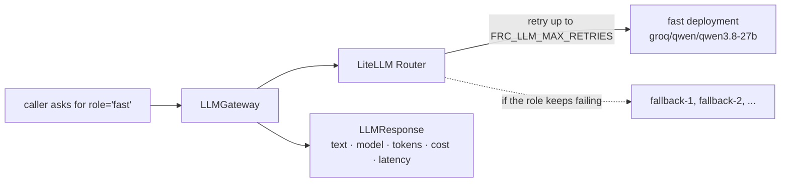

# LLM gateway

> One place where every model call goes, so retries, fallbacks, cost tracking and testing are handled once.

**Lands in:** Phase 0 · **Code:** `src/copilot/llm/`

## What it is

A thin layer between the application and the model providers. Code asks for a **role** (`strong`, `fast` or `small`) and gets back a normalised response: the text, which model answered, how long it took, how many tokens it used and what it cost.

## Why we need it here

The copilot will call models from many places: rewriting queries, routing, writing SQL, synthesising answers, validating claims and drafting briefs. Without a gateway, every one of those call sites would pick a model, handle rate limits, retry, fall back and log usage on its own, and every test would need network access.

## How it works

1. **Roles, not models.** `role_models()` maps each role to its model:
   - `strong`: `FRC_LLM_STRONG_MODEL` (default `groq/openai/gpt-oss-120b`), for hard reasoning such as SQL, synthesis and validation, and for routing;
   - `fast`: `FRC_LLM_FAST_MODEL` (default `groq/qwen/qwen3.8-27b`), for quick, frequent calls such as query rewriting and judging;
   - `small`: `FRC_LLM_SMALL_MODEL` (default `groq/openai/gpt-oss-20b`), for short, cheap replies such as small talk, on the cheapest capable model. It was added in Phase 5, when measuring the router showed that the `fast` model is not the cheap one: at list prices it costs $0.80 per million input tokens and $4.00 per million output tokens, against gpt-oss-20b's $0.075 and $0.30. The router itself ended up on `strong`, which routed the questions the small model missed ([ADR-0017](../decisions/0017-routing.md)).

   Disk caches key their entries by the model a role resolves to, never by the role, so changing a role's model never replays another model's answers.
2. **Router deployments.** `build_router()` registers each role as a LiteLLM deployment and attaches the API key that matches the model's provider prefix (`groq/`, `cerebras/`, `openrouter/`).
3. **Retries, then fallbacks.** The router retries a failing deployment, then tries each model in `FRC_LLM_FALLBACK_MODELS` in order.
4. **A normalised response.** `LLMResponse` carries:
   - the text and token counts;
   - the configured id of the deployment that served the call (for example `groq/openai/gpt-oss-120b`, not the provider's own `openai/gpt-oss-120b`);
   - latency and cost (`None` when LiteLLM has no prices for the model);
   - `fallback_used`, set when a model group other than the role answered.
5. **Reasoning kept apart.** Reasoning models return their chain of thought in a separate field (`reasoning_content`, or `reasoning` for Groq's gpt-oss models) or inline inside `<think>` tags. The gateway keeps it in `LLMResponse.reasoning`. `split_reasoning()` removes inline tags, so a draft inside the reasoning is never mistaken for the answer.
6. **One error type.** When retries and fallbacks are exhausted, the gateway raises `LLMError`, with configured API keys scrubbed from the message. `rate_limited=True` means the role's own model was refused for quota reasons, and the caller can ask the user to try again later. Only that model's error sets the flag: when every fallback fails too, LiteLLM re-raises the role model's error.

## Where it lives in the code

| File | What it does |
|---|---|
| `src/copilot/llm/base.py` | `Message`, `LLMResponse`, `LLMError`, the `LLMClient` protocol, message helpers |
| `src/copilot/llm/gateway.py` | `build_router()`, `LLMGateway.complete()` and `acomplete()`, error mapping and redaction, cost lookup |
| `src/copilot/llm/reasoning.py` | `split_reasoning()` |
| `src/copilot/llm/fake.py` | `FakeLLM`, a scripted stand-in for tests |
| `src/copilot/config.py` | Model roles, fallback chain, retries, timeout, provider keys |
| `scripts/list_models.py`, `scripts/smoke_llm.py` | Live checks against the provider |

## How we measured it

- Unit tests in `tests/test_gateway.py`, `tests/test_reasoning.py` and `tests/test_fake.py`. They cover role routing, a real router falling back to a second deployment, replies shaped like live Groq responses, both forms of reasoning, empty replies, priced and unpriced models, error mapping, key redaction and repeated failures. They use LiteLLM's `mock_response`, and a fixture refuses network access, so no call can leave the machine.
- The live smoke test (`uv run poe smoke`) runs one call per role once the Groq key is configured.

## Pitfalls we hit

- **Price map download.** LiteLLM downloads its model price map at import time unless `LITELLM_LOCAL_MODEL_COST_MAP=True`. It also loads `.env` into the environment by itself unless `LITELLM_MODE` is set. The package sets both before LiteLLM loads.
- **Inline reasoning.** LiteLLM leaves `<think>` blocks inline in the message content. Groq's gpt-oss models put reasoning in a `reasoning` field that LiteLLM passes through unchanged. The gateway handles both.
- **Provider model ids.** Live providers report their own model id, without LiteLLM's provider prefix, so comparing that id with the configured one flagged every call as a fallback. The gateway uses the router's own record of the deployment and model group instead. Only mocked responses carried the prefix, which is why the first tests didn't catch this.
- **Zero costs.** The router registers models missing from LiteLLM's price map with empty prices, and LiteLLM then reports their cost as $0. The gateway checks the price entry and returns `None` instead.
- **Cooldowns.** After a non-retryable error such as a bad key, the router's default cooldown answered the next calls with "no deployments available, try again in 5 seconds". Cooldowns are disabled because each role has a single deployment.
- **Type checking.** `Router` and the exception classes are not re-exported from `litellm`'s top level for type checkers. Import them from `litellm.router` and `litellm.exceptions`.

## Review questions

1. Why do callers ask for a role instead of a model id, and what has to change when the provider changes?
2. What is the difference between a retry and a fallback, and in which order does the router try them?
3. Why does a reply that is cut off inside `<think>` count as reasoning rather than as the answer?
4. Why would comparing the provider's reported model id with the configured id be a poor way to detect fallbacks?

## References

- LiteLLM router: https://docs.litellm.ai/docs/routing
- Groq reasoning: https://console.groq.com/docs/reasoning
