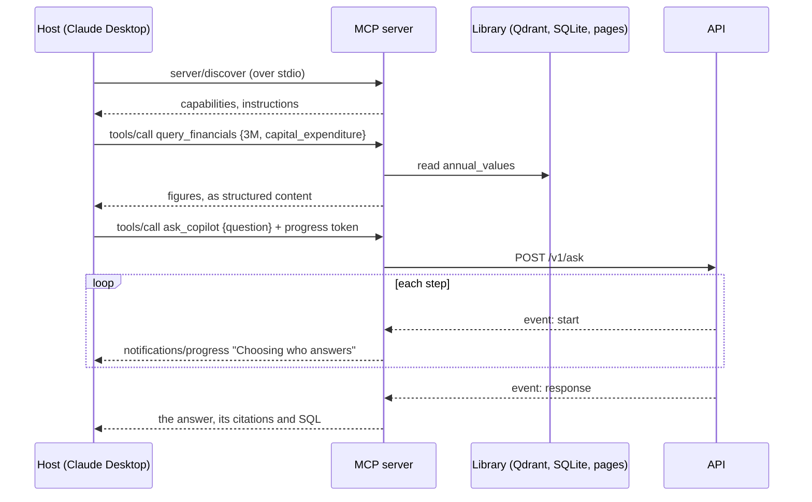

# An MCP server

> Offer the copilot's search, its facts database and the copilot itself to any AI application that speaks the Model Context Protocol, such as Claude Desktop.

**Lands in:** Phase 6 · **Code:** `src/copilot/mcp/library.py`, `server.py`

## What it is

The **Model Context Protocol** (MCP) is an open standard for connecting AI applications to tools and data. Before it, every application wrote its own plug-ins for every service; with it, a service written once as an **MCP server** works in every application that is an **MCP host**.

- The **host** is the AI application a person uses: Claude Desktop, an IDE, a chat app.
- The host runs one **client** per server it connects to. The client keeps the connection, asks the server what it offers and relays calls.
- The **server** is a program that offers capabilities. This project's server is one.

Messages are JSON-RPC 2.0: requests with an id, responses, and one-way notifications. A client first asks what a server offers. In the current revision of the specification (2026-07-28) it calls `server/discover`, and every request then carries what it needs; earlier revisions opened each connection with an `initialize` handshake, and the Python SDK's client tries the new way first and falls back to the old.

A server offers three kinds of thing, and they differ in who decides to use them:

| Primitive | What it is | Who decides | Here |
|---|---|---|---|
| **Tool** | A function with a JSON Schema for its arguments, which the host's model calls | The model | `search_filings`, `query_financials`, `ask_copilot` |
| **Resource** | Data at a URI, which the host can read and add to the model's context | The application, or the person using it | Filing pages, the filings, companies and metrics |
| **Prompt** | A template with arguments, which a person picks, often as a slash command | The person | `compare_companies` |

Messages travel over a **transport**. With **stdio**, the host starts the server as a child process and they exchange newline-delimited JSON on its standard input and output; the server may write logs to standard error. With **streamable HTTP**, the server listens at one URL, and a response can be plain JSON or a stream of server-sent events.

## Why we need it here

The plan's fifth goal is a copilot that other AI tools can use. A host brings its own model, which can read passages and figures and reason over them, so the most useful tools are the ones that hand it good material quickly: a search that returns cited passages, and a lookup that returns exact figures. Neither needs a model call. For a question that needs the copilot's whole pipeline, with routing, the validator and the hybrid agent, `ask_copilot` asks the copilot itself.

## How it works

1. **Starting.** A desktop host launches `python -m copilot.mcp` from the repository. The server tells the client what it offers, with instructions that name the companies it covers and say which tool suits what. The search index, its embedding model and the doc agent's code load on the first call, so a client connecting doesn't wait for them.
2. **Searching.** `search_filings` takes a query and, optionally, a company, fiscal year and form. With filters, they pick the filings; without them, the filings come from the companies and years the query names, as in the doc agent ([query understanding](query-understanding.md)); otherwise every filing is searched. Dense search ranks the pages ([ADR-0011](../decisions/0011-retrieval-baseline.md)), and each passage comes back with its label ("3M, Form 10-K for fiscal 2018, PDF page 39"), its page and a resource URI for the whole page.
3. **Looking up.** `query_financials` reads one company's values of one metric from `annual_values`, by fiscal year: the figure first reported in that year's 10-K, and the latest filing's figure where it was restated. A company can be named or given by ticker; a metric by its name or label. Anything else gets an error listing what would work.
4. **Asking.** `ask_copilot` posts the question to the API and reads its event stream ([SSE streaming](sse-streaming.md)). Each step's start becomes a progress notification, which hosts can show while the copilot works. The API's quotas, answer cache and one run at a time apply to these questions as to the web UI's ([ADR-0021](../decisions/0021-mcp-server.md)).
5. **Reading a page.** A passage's or a citation's `filing://3M_2018_10K/39` resource returns the whole page, with its label and section.

Every result carries an output schema and structured content, so a host can use the fields rather than parse text. Text from the filings goes out with instruction-like sentences replaced by a notice: the host's model reads it, so it gets the same protection as the copilot's own prompts ([prompt injection](prompt-injection.md)).

**Annotations.** All three tools say they only read (`readOnlyHint`) and work on a closed set of data (`openWorldHint: false`). Hosts may use these hints to decide what to confirm with the person, but they are claims by the server, so a host should trust them only from a server it trusts.

## Where it lives in the code

| Piece | What it does |
|---|---|
| `copilot.mcp.library.Library` | The filings, the facts database and the pages: `search`, `financials`, `page`, `catalogue`, `coverage` |
| `copilot.mcp.library.build_library` | The library over the real data, its index built on first use |
| `copilot.mcp.server.create_server` | The server: tools, resources and prompt over a library and an API client |
| `copilot.mcp.server.to_answer` | The API's response as `ask_copilot`'s result, with each cited page as a resource |
| `copilot.api.client.CopilotClient` | The API's Python client, shared with the web UI |
| `copilot.mcp.server.transport_security` | The HTTP transport's DNS-rebinding check: this machine's names, and any `--allowed-host` |
| `poe mcp`, `python -m copilot.mcp` | The server on stdio; `--transport streamable-http` serves it at `http://127.0.0.1:8001/mcp`, as the Compose stack does |

## How we measured it

- **Tests** (`tests/test_mcp.py`, 18), through the SDK's own client connected in memory: tools, annotations and schemas; filters and query resolution; errors that list what would work; figures and restatements; pages counted from 1; resources and the prompt; `ask_copilot` against a mock API, with its progress, a refused question and an unreachable API. One test starts the real server as a process and talks to it over stdio.
- **Live,** against the local data: a search for capital spending in 3M's fiscal 2018 10-K found the page with the capital spending table (PDF page 39, similarity 0.80); "What drove Boeing's revenue change in 2022?" picked Boeing's fiscal 2022 10-K by itself; 3M's capital expenditure for fiscal 2016 to 2019 came back from the facts database exactly; and `ask_copilot` answered a capital expenditure question through the API in 10.1 s with eight progress steps, and in under a quarter of a second from the API's cache when asked again.
- **In an MCP host,** started from a configuration like the runbook's: asked for 3M's fiscal 2018 capital expenditure and its split by region, the host's model called `query_financials` and `search_filings` together and answered in 23 seconds with the total from the facts database and the four regions from PDF page 39 of the 10-K, each cited, and with the shares it worked out marked as its own arithmetic.

## Pitfalls we hit

- **Standard output is the protocol.** Over stdio, a single `print` to stdout corrupts the stream. The project's logs already went to stderr; the stdio test runs the real process so that a stray print would fail it.
- **A child process sees few environment variables.** The SDK's stdio client starts a server with a small set of safe variables plus any it is given, and a host may do the same. An `FRC_API_URL` exported in the shell never reached the server, so its questions went to whatever answered on the default port. The API address is now a setting, read from `.env` like the others, and a host's configuration can pass it in an `env` block.
- **A slow start.** The server first took 18 seconds to answer a client, more than 7 of them spent importing LiteLLM through the doc agent's module. Importing it on first use brought that to about 9 seconds.
- **Open to any host name in a container.** In DNS rebinding, a web page gets a browser to send requests to a server on the reader's own machine under the page's own name. The SDK guards the HTTP transport against it by checking the `Host` header, but only when the server binds to localhost, and in a container it binds to every interface. The server now switches the check on itself, so a request naming another host gets a 421 ([ADR-0022](../decisions/0022-containers.md)).
- **Two page numberings.** Pages count from 0 in the code and from 1 in every label. Resource URIs follow the labels, so a citation's page and its resource agree.
- **A renamed class.** Version 2 of the Python SDK calls its high-level server `MCPServer`, where most examples still show `FastMCP`.

## Review questions

1. Who decides when a tool is used, when a resource is used and when a prompt is used, and why does that matter for what this server offers as each?
2. Why do `search_filings` and `query_financials` run inside the server, while `ask_copilot` goes through the API?
3. Why must a stdio server never write to standard output, and how does this project check that it doesn't?
4. What do tool annotations tell a host, and why shouldn't a host rely on them from a server it doesn't trust?
5. The server's own copilot isn't the model reading the filings' text. Why remove instruction-like sentences from it anyway?

## References

- Model Context Protocol, [Specification](https://modelcontextprotocol.io/specification), revision 2026-07-28; its server features page sets out who controls tools, resources and prompts.
- Model Context Protocol, [Architecture overview](https://modelcontextprotocol.io/docs/learn/architecture).
- Model Context Protocol, [Connect to local MCP servers](https://modelcontextprotocol.io/docs/develop/connect-local-servers), for Claude Desktop's configuration.
- [MCP Python SDK](https://github.com/modelcontextprotocol/python-sdk), version 2.
- [ADR-0021](../decisions/0021-mcp-server.md) for the design.
