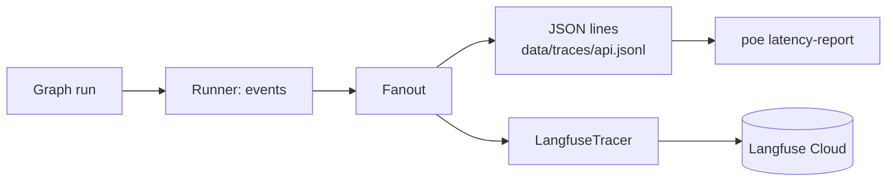

# Observability: traces, spans and latency

> See what each answer did, how long each step took and what it cost, for every question the API answers.

**Lands in:** Phase 6 · **Code:** `src/copilot/agents/runner.py`, `tracing.py`, `src/copilot/eval/latency.py`

## What it is

A **trace** records one request from start to finish. It is a tree of **observations**:

- a **span** covers a piece of work with a start and an end, such as one node of the graph;
- a **generation** is a span for a model call, with the model's name, the tokens in and out, and their cost;
- an **event** marks a moment, such as the moment the router chose a route.

Each child records its parent, so the tree shows which step spent the time. **OpenTelemetry**, the open standard for traces, metrics and logs, defines how spans are recorded and sent. **Langfuse** is an open-source store and viewer for traces of LLM applications, built on OpenTelemetry: it adds models, tokens and cost to spans, groups traces by conversation (a **session**) and charts latency and cost over time.

## Why we need it here

An answer passes through up to nine nodes and several model calls on three models. When an answer is slow, wrong or expensive, the question is which step made it so. The graph already reports every node's start and end, its events and its model usage as a stream ([LangGraph orchestration](langgraph-orchestration.md)), kept as JSON lines. Langfuse turns that stream into something to browse and chart without writing a dashboard, and the latency report summarises the same stream offline.

## How it works

The runner sends each event to a **sink**. In the API, a `Fanout` passes it to both the JSON-lines writer and the `LangfuseTracer`, which turns events into observations as they arrive:

| Event | Becomes |
|---|---|
| The run's first event | The root observation `ask`, typed as an agent, in the conversation's session |
| A node's `start` | A span under the root: an agent for the doc, data and hybrid nodes, an evaluator for the validator |
| A node's `usage` | A generation under the node for each model it called, with its tokens and their cost at the gateway's prices |
| Any other node event (cues, route, verdict) | An event under the node, with its fields as metadata |
| A node's `end` | The span ends, marked as an error if the node failed |
| `response` | The root gets the question as input, the reply as output, and the route, whether it answered and the validator's verdict as metadata, then ends |
| `error` | The root is marked as an error; open spans and the root end |

**Explicit parents.** The API reads the run from a synchronous generator that FastAPI advances in a pool of threads, so one event may arrive on a different thread from the last. Tracing that relies on the current context would lose the parent between events; the tracer keeps each run's open spans and creates every observation from its parent object instead.

**Every trace closes.** A run that fails ends its spans as errors. A client that hangs up stops reading the stream, and the runner now records that as an error event, `Stopped: the caller stopped reading.`, so the tracer can close the trace instead of keeping it open.

**Off without keys.** The tracer exists only when `LANGFUSE_PUBLIC_KEY` and `LANGFUSE_SECRET_KEY` are set; `LANGFUSE_BASE_URL` picks the region. The Langfuse client sends observations in the background, and the API flushes it on shutdown.

**What leaves the machine.** With tracing on, questions, answers and route decisions are stored in the Langfuse project's region. Only the API traces; batch evaluations keep their JSON-lines files, since a hundred-question run would use a large share of the free plan's 50,000 units a month (a question makes about twenty).

**Latency.** `poe latency-report` reads trace files and reports, by route and by node, the median, the 95th percentile and the slowest run, with tokens and cost a run. Runs that stopped before their response are left out. Batch runs pause to stay under the free tier's tokens a minute, so their traces measure throughput under a quota rather than one person's wait.

## Where it lives in the code

| Piece | What it does |
|---|---|
| `copilot.agents.runner.Sink`, `Fanout`, `TraceWriter` | Where a run's events go: any sink, several at once, a JSON-lines file |
| `copilot.agents.runner.Copilot.stream` | The events; records a run whose caller stops reading as stopped |
| `copilot.agents.tracing.LangfuseTracer` | Events to Langfuse observations, as in the table above |
| `copilot.agents.tracing.build_tracer` | The tracer from settings, or None without both keys |
| `copilot.api.services.build_services` | Feeds the API's runs to both sinks and flushes Langfuse on shutdown |
| `copilot.eval.latency`, `poe latency-report` | Median, 95th percentile and slowest run by route and node, from trace files |

## How we measured it

- **Offline**, with the real Langfuse SDK sending to an in-memory OpenTelemetry exporter instead of Langfuse's servers (`tests/test_tracing.py`): one trace a run with its session, input and output; a span per node; a generation per model with its tokens and cost; events under their node; failures marked, with every span closed.
- **Live**, against a Langfuse Cloud project: a figures question, small talk and a hybrid question through the API arrived as three traces of 17 to 20 observations each. The hybrid question's trace held eight node spans (the validator typed as an evaluator), seven events and four generations on three models (gpt-oss-120b twice, Qwen 3.8 27B and gpt-oss-20b) costing $0.0027 in all.

## Pitfalls we hit

- **A newer SDK.** Version 5 of Langfuse's Python SDK starts every kind of observation with `start_observation(as_type=...)` and sets a trace's session and name through `propagate_attributes`; most examples still show `start_span`, `start_generation` and `update_trace`.
- **One client per key.** The SDK keeps one client per public key, so tests that each built a client with its own in-memory exporter would have shared the first; each test uses a fresh public key.
- **Fields left out by default.** Reading the traces back through Langfuse's API at first showed no input and no cost: the observations endpoint returns only core fields unless asked for the rest, with `fields="core,basic,io,usage,model,metrics,metadata"`.
- **A run that never ends.** Before the runner recorded hang-ups, a client that left mid-answer would have left its trace open for good, since no `response` or `error` event followed.

## Review questions

1. What is the difference between a span, a generation and an event, and which does each node, model call and route become here?
2. Why does the tracer pass each observation its parent instead of relying on the context a `with` block sets?
3. What happens to the trace of a run whose caller hangs up, and why did that need a change to the runner?
4. Why do batch runs' traces overstate the latency a person waiting for one answer would see?
5. What leaves the machine when tracing is on, and how would you keep a question out of the trace?

## References

- Langfuse, [Get started with tracing](https://langfuse.com/docs/observability/get-started) and [data regions](https://langfuse.com/security/data-regions).
- OpenTelemetry, [Traces](https://opentelemetry.io/docs/concepts/signals/traces/).
- [ADR-0023](../decisions/0023-observability.md) for the design.
