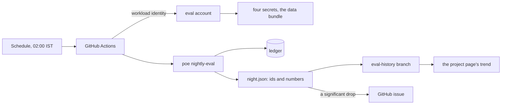

# Online evaluation

> Keep measuring the system that is running, on the same questions and within a fixed budget, so that a change in quality shows as a change in a line.

**Lands in:** Phase 9 · **Code:** `src/copilot/eval/nightly.py`, `src/copilot/llm/budget.py`, `scripts/nightly_eval.py`, `.github/workflows/nightly.yml`

## What it is

**Offline evaluation** measures a system once, on a fixed set of questions, when its code changes: every report from Phases 2 to 7 is one. **Online evaluation** keeps measuring the system after it ships. It has two sources:

- **a schedule:** the same questions at regular intervals, such as a nightly run;
- **the traffic:** visitors' ratings, clicks, and the drift of what the system sees.

Three ideas carry it:

- **A regression test** compares tonight with a baseline on the same questions, question by question, and flags a drop too large to be chance.
- **A trend** shows slow movements no single comparison flags.
- **A budget** caps what a recurring paid job may spend, so running it every night is safe.

In this project, step 9.1 is the scheduled kind: the nightly evaluation. Feedback (9.2), the bandit's rewards (9.3), drift checks (9.5) and an interleaved search page (9.4) come from traffic.

## Why we need it here

The deployment has answered visitors since 2 November, and every number about its quality was measured before that. Quality can change with no commit to the copilot's code:

- a provider can update a model or its defaults ([ADR-0024](../decisions/0024-second-provider.md) found one that changed a judge's verdicts);
- Qdrant Cloud's collection can change;
- a merged change can lower a route its own pull request didn't measure.

A nightly run on fixed questions turns each of these into a dated drop next to the commit that was on `main` that night.

## How it works

1. **Fixed questions.**
   - **The slice:** 32 FinanceBench dev questions, drawn in proportion to the routes copilot v2 took and the question types, with a fixed seed. Every night answers the same ones, and the run on a Sunday answers all 100.
   - **The other sets:** the routing set's 138 dev questions and the SQL set's 28, every night.
2. **Steps, each in a process of its own:** the copilot's answers, the correctness judge, the faithfulness check, the router and the data agent. They are the scripts every earlier evaluation used, so a night measures what the reports measured.
3. **One ledger, one cap.**
   - **The ledger.** With `FRC_LLM_BUDGET_USD` and `FRC_LLM_BUDGET_FILE` set, the gateway appends every real call's cost to the ledger, a JSON-lines file all the steps share. Before each call it adds the ledger up.
   - **Each step's share.** A step may spend until the night's total reaches its share of the cap. The shares are cumulative (50%, 57%, 65%, 82% and 100%), so a step that spends less leaves the rest to the steps after it.
   - **At the cap,** the gateway raises `BudgetSpentError`. A run treats it as a spent quota and stops with what it has, and nothing retries it, since no wait lifts it.
4. **Fresh calls.** No cache carries over from one night to the next, so a provider's change shows. Temperature 0 doesn't make every reply identical, so nights differ a little with nothing changed.
5. **What a night keeps:** ids, categories, scores, costs and times, never a question or an answer. FinanceBench's licence keeps those out of a public history.
   - **The summary.** Each metric has a 95% interval: the bootstrap's, or the exact binomial one when a share reaches 0 or 1, where the bootstrap collapses.
   - **Where.** The per-question rows and the summary go to `nightly/runs/<date>-<set>.json` on the `eval-history` branch, and the summary alone to `nightly/history.jsonl`.
6. **The verdict.**
   - **The tests.** Correct, answered, and the routing and SQL accuracies are each compared with the last complete full run, on the questions both answered, by a paired permutation test. The night's p-values are adjusted together (Holm).
   - **A regression** is a significant drop. It fails the run and opens an issue, or comments on the one already open.
   - **A night cut short** by its cap draws no verdict, since it answered other questions than planned.
7. **The trend.** The project page reads `history.jsonl` from the branch and draws one panel a metric, each night with its interval.

## Where it lives in the code

| Piece | What it does |
|---|---|
| `copilot.llm.budget` (`RunBudget`, `read_ledger`, `spent_by_model`) | The ledger: count a call, add up the night, refuse at the cap |
| `copilot.llm.gateway.LLMGateway` | Checks the cap before each real call and counts it after |
| `copilot.llm.base.BudgetSpentError`, `copilot.llm.pacing` | The cap's error, which reads as a spent quota and is never retried |
| `copilot.eval.nightly` | The slice (`choose_slice`), the steps and their shares (`steps`, `run_steps`), what a night keeps (`copilot_rows`, `set_rows`, `summary`), and the regression test (`compare`) |
| `scripts/nightly_eval.py` (`poe nightly-eval`) | One night: the steps, `night.json` and the history's line; exit code 3 on a regression |
| `scripts/choose_nightly_slice.py` (`poe nightly-slice`) | Draws the slice into `eval/nightly/slice.json` (ids only) |
| `.github/workflows/nightly.yml` | The schedule, the keys, the bundle, the history's push and the issue |
| `infra/terraform` (`github-eval`) | The account the workflow acts as: the bundle and four secrets, nothing else |

## How we measured it

One night of a first draft's 40-question slice was run by hand on 11 November, from an empty cache ([report](../eval/nightly.md)):

- **Cost:** $0.378 of the $0.40 cap. The answers cost $0.191, the judges $0.059, the routing set $0.059 and the SQL set $0.069.
- **Results:** correct 0.65 (0.50 to 0.80), as in copilot v2's dev run. Routing and SQL were 1.00, with exact intervals 0.97 to 1.00 and 0.88 to 1.00.
- **The decision:** that left too little room, so the slice is 32 questions, about $0.33 a night.

## Pitfalls we hit

- **A cached run measures nothing.** The laptop's caches held the same Cerebras calls from Phase 7, so the measured night ran from an empty data folder holding only the data bundle and FinanceBench's question files, as a CI runner does.
- **A night that just fits its cap sometimes won't.** At 40 questions only 5.5% of the cap was left, and a night cut short draws no verdict. Shrinking the slice was the decided answer; raising the cap was not.
- **Intervals that collapse.** 138 of 138 routing decisions gave a bootstrap interval of [1.00, 1.00]; the exact interval says 0.97 to 1.00.
- **Logs are public.** A public repository's Actions logs can be read by anyone, and a step could print what a question asked. So each step's output goes to a file that stays on the runner, and a failed step reports only its exception's class.
- **Small slices detect only large drops.** With four tests a night, adjusted together, 8 questions must change all the same way: 25 points on the slice, 8 on the full run.

## Review questions

1. Why does the nightly run make fresh calls instead of replaying a cache, and what does that cost in noise?
2. Why are the steps' caps cumulative shares of one ledger rather than separate budgets for each step?
3. Why does a night cut short by its cap draw no verdict?
4. How large must a drop on the 32-question slice be to be flagged, and what does the Sunday run add?
5. Why does a night keep only ids, categories and numbers, and where do the answers themselves go?

## References

- Sculley et al., [Hidden Technical Debt in Machine Learning Systems](https://papers.nips.cc/paper/2015/hash/86df7dcfd896fcaf2674f757a2463eba-Abstract.html), NeurIPS 2015.
- Breck et al., [The ML Test Score: A Rubric for ML Production Readiness and Technical Debt Reduction](https://research.google/pubs/the-ml-test-score-a-rubric-for-ml-production-readiness-and-technical-debt-reduction/), 2017.
- Holm, A Simple Sequentially Rejective Multiple Test Procedure, *Scandinavian Journal of Statistics* 6(2), 1979.
- [ADR-0034](../decisions/0034-nightly-evaluation.md) for the design, [ADR-0007](../decisions/0007-evaluation-statistics.md) for the statistics.
