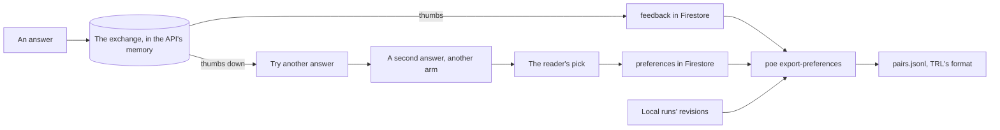

# Preference data

> Turn readers' verdicts into pairs of a better and a worse answer to the same prompt: the data preference tuning learns from.

**Lands in:** Phase 9 · **Code:** `src/copilot/api/exchanges.py`, `src/copilot/api/app.py`, `src/copilot/ui/app.py`, `src/copilot/eval/preferences.py`, `scripts/export_preferences.py`

## What it is

A **rating** is absolute: a reader says one answer is good or bad. A **preference** is relative: of two answers to the same prompt, a reader says which is better. People agree more often on which of two answers is better than on a score for one, and a preference says what to move towards, not only what to avoid.

**Preference tuning** learns from pairs: a prompt, a chosen answer and a rejected one.

- **RLHF** (Christiano et al., 2017; Ouyang et al., 2022) first fits a reward model to the pairs, then tunes the language model against it with reinforcement learning.
- **DPO** (Rafailov et al., 2023) skips the reward model. It raises the likelihood of the chosen answer relative to the rejected one, measured against a frozen copy of the model, so the tuned model can't drift far from where it started.

Either way the data are the same: one prompt, two answers, and which one won. TRL, Hugging Face's library for this, reads them as JSON lines. Its conversational format holds each part as chat messages: `{"prompt": [...], "chosen": [...], "rejected": [...]}`.

## Why we need it here

Since step 6.3 the web UI has had thumbs up and down, kept through `POST /v1/feedback`. A rating kept only the conversation's id and the turn, and the conversation lives in the API's memory, so a rating couldn't be traced back to the answer it rated: nothing could be learned from it.

Step 9.2 keeps ratings as pairs, for preference tuning later. The project doesn't tune on them yet; it builds the data path, so that the pairs are right when there are enough of them.

Traffic is low: from 3 to 15 November the live API answered 3 questions and received no rating. So the export takes pairs from three sources, and labels each with who judged it.

## How it works

1. **The API remembers what it served.** For each answer it keeps an exchange, the newest 256 in memory:
   - the question as asked and as the copilot read it, the route, and the arm (ADR-0029) that wrote it;
   - the answer, its citations, and the numbered sources it was written from;
   - the validator's verdict, and its first draft when it sent one back;
   - the models, the tokens and the cost.

   The sources and the draft aren't in the response, so the API reads them from the graph's checkpoints (`Copilot.details`). Nothing is stored until a reader rates the answer.
2. **A rating keeps its exchange.** `POST /v1/feedback` finds the exchange by the answer's request id and stores both in Firestore (`feedback/<id>`). The exchange goes in as JSON text, since Firestore can't hold the lists inside lists that a query result carries.
3. **"Try another answer."** After a thumbs down on an answer from the filings, the UI asks for a second answer: `POST /v1/ask` with `retry_of`, the first answer's request id. The API answers:
   - the question as the copilot read it, on the same route;
   - with another arm, so the two answers differ in more than chance;
   - in a new conversation, so the reader's own conversation is unchanged;
   - never from the answer cache, which would return the first answer, and never into it.

   The reader then picks the better answer, or neither, and `POST /v1/preference` keeps both exchanges and the pick.
4. **The export** (`poe export-preferences`) reads both collections, and with `--runs` the drafts of local evaluation runs, and makes pairs:

   | Source | Chosen | Rejected | Judged by |
   |---|---|---|---|
   | `retry` | The answer the reader picked | The other one | A reader |
   | `ratings` | An answer rated up | An answer rated down, for the same question as read | Readers' ratings |
   | `validator` | The revision that passed the validator's check | The draft it sent back | The validator's model |

   - **The prompt** is the answer prompt the copilot used: its instructions, the numbered sources and the question. When the two answers came from different sources, or their sources weren't kept (an answer from the cache), the prompt is the question alone, and the metadata says so.
   - **The answers** are the texts readers saw, after the calculator filled in the figures.
   - **Two files:** `pairs.jsonl` holds TRL's three keys only, since TRL's documentation doesn't say what it does with extra columns. `pairs-meta.jsonl` holds each pair's source, labeller, ids and prompt kind, in the same order.

## Where it lives in the code

| Piece | What it does |
|---|---|
| `copilot.api.exchanges` (`exchange_record`, `ExchangeLog`, `usage_of`) | The exchange, and the newest 256 by request id |
| `copilot.agents.runner.Copilot.details`, `first_draft` | The turn's state beyond its response: the sources, and the draft before the first check |
| `copilot.api.app` (`/v1/feedback`, `/v1/preference`, `retry_of`) | A rating with its exchange, a second answer, a pick |
| `copilot.api.firestore` (`FirestoreFeedback`, `FirestorePreferences`) | `feedback/<id>` and `preferences/<id>` |
| `copilot.answer.agent.DocAgent.answer(avoid=)`, `copilot.answer.bandit.other_arm` | A second answer from another arm |
| `copilot.ui.app` (`RATING_NOTE`, `offer_second`, `show_second`) | What a rating keeps; "Try another answer"; the pick |
| `copilot.eval.preferences` | The three sources of pairs, and the prompt rebuilt |
| `scripts/export_preferences.py` (`poe export-preferences`) | Firestore as the owner, or a copy; local runs; the two files |

## How we measured it

- **On local runs.** The export over copilot v1's and v2's dev runs found **37 validator pairs**, each with its answer prompt rebuilt from its sources. They hold FinanceBench's questions, so they stay in the git-ignored `data/` folder.
- **From readers:** none yet. No rating has come in since the deployment went live.
- **On the live API,** on 15 November, a check went through the whole path once. A doc answer got a thumbs down, and Firestore kept the rating with its exchange: 7 sources, the three Groq models and the cost. A second answer came from `strong-low`, in a new conversation and not from the cache. The pick was kept with both exchanges, and an unknown `retry_of` got a 404. The check's two documents were then deleted, so the export can't mistake them for a reader's.
- **The tests** cover each source, the prompt for doc and hybrid answers, mismatched sources, the cap of ten pairs from one question's ratings, and the UI's thumbs down, second answer and pick.

## Pitfalls we hit

- **A rating without its answer.** The first feedback store kept ids that pointed into an instance's memory. A rating has to carry what it rates.
- **A second answer from the same model is nearly the same answer.** At temperature 0 a second call gives almost the first one's text, and a pick between them teaches little. The second answer comes from another arm.
- **The answer cache would answer again with the first answer.** A new anonymous question is served from the cache, so a second answer skips it both ways.
- **The draft before the first check is the turn's, not the thread's.** A conversation's checkpoints hold every turn. Reading the oldest draft waiting for the validator would return the first turn's, so `first_draft` stops at the turn's first step.
- **A test fixture echoed FinanceBench.** One invented fixture used a cash-flow line item worded like a FinanceBench answer's justification. The quote scan caught it before the branch was pushed, and the fixture now uses an invented company.

## Review questions

1. Why is a pair more useful for tuning than a rating, and what does DPO do with one?
2. Why does the second answer come from another arm, and what does that change about what a pick teaches?
3. Why is the prompt rebuilt with the sources, and when does the export fall back to the question alone?
4. Which pairs are judged by a model, and why are they labelled apart from readers' pairs?
5. What does a rating keep about a reader, and what does it leave out?

## References

- Christiano et al., [Deep Reinforcement Learning from Human Preferences](https://arxiv.org/abs/1706.03741), NeurIPS 2017.
- Ouyang et al., [Training language models to follow instructions with human feedback](https://arxiv.org/abs/2203.02155), NeurIPS 2022.
- Rafailov et al., [Direct Preference Optimization: Your Language Model is Secretly a Reward Model](https://arxiv.org/abs/2305.18290), NeurIPS 2023.
- Hugging Face TRL, [dataset formats](https://huggingface.co/docs/trl/dataset_formats) and the [DPO trainer](https://huggingface.co/docs/trl/dpo_trainer).
- [ADR-0035](../decisions/0035-preference-pairs.md).
