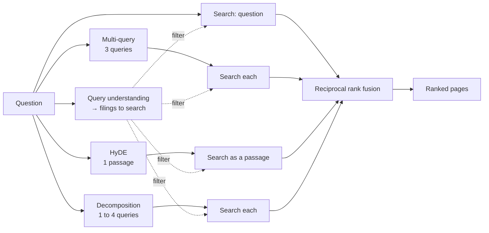

# Query rewriting

> A question is written for a person, not for a search index. Asking a model to restate it in the filing's own words, several ways, finds more of the evidence.

**Lands in:** Phase 3 · **Code:** `src/copilot/retrieval/rewrite.py`, `src/copilot/llm/cache.py`, `src/copilot/llm/pacing.py`

## What it is

**Query rewriting** turns one question into several searches before anything is retrieved. Three kinds are measured here:

- **Multi-query**: a model writes three short search queries in the words a filing would use. "What is the FY2018 capital expenditure for 3M?" becomes, among others, "3M cash flow statement purchases of property plant and equipment 2018".
- **HyDE**, hypothetical document embeddings (Gao et al., 2022): a model writes the passage the filing would contain if it answered the question ("Capital expenditures were $1,842 million in 2018, compared with…"). The passage is embedded as a document, so it lands near real passages that look like it. Its figures are invented and don't matter: only its shape and vocabulary are used.
- **Decomposition**: a model lists the separate facts the answer needs. A quick-ratio question becomes current assets, inventory and current liabilities, each its own search.

Each rewrite is searched separately, inside the same filings, and all the rankings, including the original question's, are merged with reciprocal rank fusion.

## Why we need it here

Phase 2 found that FinanceBench's questions carry instructions that aren't about the topic ("Round your answer to two decimal places", "If the quick ratio is not relevant to measure liquidity, please state that and explain why"), and that they name metrics a filing never prints ("quick ratio", "capital expenditure") instead of the line items it does ("Total current assets", "Purchases of property, plant and equipment"). Rewriting drops the instructions and bridges the vocabulary.

## How it works

1. **Prompts** (`rewrite_messages`). One system line and one instruction per kind, at temperature 0, sent to the fast model (`qwen3.8-27b` on Groq). Each asks for plain lines: no numbering, no explanation.
2. **Parsing** (`parse_queries`). One query per line, list markers and quotes removed, duplicates dropped, capped at three (multi-query) or four (decomposition). HyDE keeps the whole reply as one passage.
3. **Search** (`Searcher.search`). Queries are embedded with bge's query instruction; the HyDE passage without it (`passage=True`), like any chunk.
4. **Fusion** (`reciprocal_rank_fusion`). Every ranking counts once, the original question's included, so a bad rewrite can't push the question's own best hits out of the list.

**The cache.** Every model call goes through `CachedLLM`, a file of responses keyed by the model, the messages and the parameters. The first run of all three rewrites over 100 questions cost about 63,000 tokens; every rerun since has cost nothing. Uncached calls are spaced three seconds apart by `PacedLLM`, which keeps a 200-token call well under Groq's 8,000 tokens a minute, and retries a call refused for quota.

## Where it lives in the code

| Piece | What it does |
|---|---|
| `copilot.retrieval.rewrite` | Prompts, `parse_queries`, `rewrite`, `expand` (the question first, then each rewrite's searches) |
| `copilot.retrieval.search.Searcher.search(passage=True)` | Embeds a HyDE passage as a document |
| `copilot.llm.cache.CachedLLM` | Disk cache of model calls; `cached=True` on replayed responses |
| `copilot.llm.pacing.PacedLLM` | Pauses after uncached calls, retries rate limits, adds up tokens and latency |
| `scripts/run_retrieval.py` | `--rewrite multi`, `hyde`, `decompose` (comma-separated) or `all` |

## How we measured it

On the 100 dev questions, dense search over page chunks inside the filings query understanding resolves ([ADR-0012](../decisions/0012-query-understanding-and-rewriting.md)):

| Rewrites | recall@5 | recall@10 | recall@20 | hit@20 | MRR@10 | Tokens per 100 questions |
|---|---|---|---|---|---|---|
| None | 0.460 | 0.570 | 0.690 | 0.700 | 0.381 | 0 |
| Multi-query | 0.548 | 0.682 | 0.782 | 0.790 | 0.454 | 20,700 |
| HyDE | 0.545 | 0.682 | **0.817** | **0.850** | 0.388 | 24,900 |
| Decomposition | 0.565 | 0.662 | 0.762 | 0.780 | 0.415 | 17,100 |
| **All three** | **0.613** | **0.722** | 0.787 | 0.800 | **0.476** | 62,700 |

- Every rewrite beats none on recall@10 after Holm's adjustment; only all three together also beats it on MRR@10 (+0.095, p = 0.018). All three against multi-query alone (+0.040) is not significant.
- With all three, retrieval across the resolved filings is better than Phase 2's best with the filing given (recall@10 0.630).
- The rewrites also give hybrid search and reranking a second chance, since the template text is gone: hybrid search reaches 0.697 recall@10, bge-reranker-base against a rewritten query 0.692, and against the original question 0.650 (MRR significantly worse). None beats dense search alone, so the pipeline keeps dense search.
- Run one after another, the three calls take about 4.2 seconds per question at p50; in parallel (`aexpand`), about as long as the slowest one.

## Pitfalls we hit

- **Recording rewrites without publishing them.** Rewrites paraphrase FinanceBench questions, which are licensed for non-commercial use only, so run files record how many searches of each kind a question ran, never their text; the text stays in the local cache.
- **HyDE ranks broadly, not sharply.** Its passages pull in many plausible pages, which helped recall@20 most and MRR least: the invented figures make it as close to a neighbouring table as to the right one.

## Review questions

1. Why is the original question kept as one of the fused searches instead of being replaced by its rewrites?
2. HyDE's passage contains made-up numbers. Why does that not mislead the search?
3. Why is the HyDE passage embedded without bge's query instruction?
4. What does decomposition add that multi-query doesn't, for a question about a ratio?
5. What would you check before running the three rewrites in parallel in production?

## References

- Gao, Ma, Lin and Callan, [Precise Zero-Shot Dense Retrieval without Relevance Labels](https://arxiv.org/abs/2212.10496) (HyDE), 2022.
- Rackauckas, [RAG-Fusion: a New Take on Retrieval-Augmented Generation](https://arxiv.org/abs/2402.03367), 2024 (multi-query with reciprocal rank fusion).
- Press et al., [Measuring and Narrowing the Compositionality Gap in Language Models](https://arxiv.org/abs/2210.03350), 2022 (decomposing questions into sub-questions).
