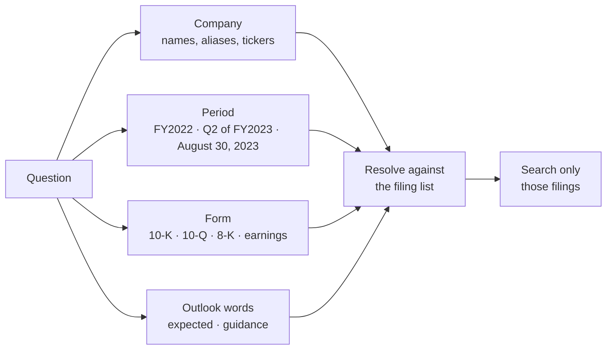

# Query understanding

> Before searching, work out which company, period and form the question is about, and search only those filings.

**Lands in:** Phase 3 · **Code:** `src/copilot/retrieval/query.py`

## What it is

A question like "What is the FY2018 capital expenditure amount for 3M?" carries its own search filter: the company is 3M, the period is fiscal 2018, and capital expenditure is reported in the annual report. **Query understanding** reads those cues out of the question and turns them into a list of filings to search. Everything after it (search, reranking, answering) works inside that list.

## Why we need it here

Filings from the same company and the same industry say nearly the same things year after year: "Purchases of property, plant and equipment" appears in every cash-flow statement in the corpus. Searching all 84 filings, dense search ranked another company's or another year's page first for many questions. In Phase 2 that cost a fifth of the questions: an evidence page reached the top 20 for 77% of dev questions when the right filing was known, and for 52% when it wasn't.

## How it works

1. **Company.** Each of the 40 companies in the universe is matched by its name, a short form ("AES" for AES Corporation), its ticker when it has at least three letters, and a few common aliases ("JnJ", "Amex", "Pepsi"). Matches are whole words; possessives ("3M's") are allowed. Names that are also ordinary words ("Block") must match their capitalisation, and tickers must be upper case, so "the cost of sales" doesn't find Costco by its ticker COST.
2. **Period.** Fiscal years in their usual spellings (FY2022, FY22, fiscal 2022, a bare 2022), quarters (Q2 2023, Q2 of FY2023, 2021 Q1, 2Q23, "second fiscal quarter of 2023") and dates ("August 30, 2023", "1st July 2022").
3. **Form.** 10-K or annual report, 10-Q or quarterly report, 8-K, earnings release.
4. **Outlook.** Words such as "expected", "guidance", "outlook" or "forecast". A company states next year's outlook in the previous year's filings, so a forward-looking question about FY2023 also searches FY2022's.
5. **Resolve** (`resolve`). Keep the company's filings whose fiscal year matches; for quarterly filings (10-Qs, earnings releases) the quarter must match when the question names one; for 8-Ks the date's month, or its quarter, or its year. If a form was named and a matching filing has it, keep only that form. If nothing matches the period, fall back to all the company's filings; with no company at all, search everything.

The 10-K stays in for quarterly questions: an annual report covers every quarter, and one dev question about second-quarter dividends is answered from it.

## Where it lives in the code

| Piece | What it does |
|---|---|
| `CompanyMatcher` | Name, alias and ticker patterns for the universe, longest first |
| `understand` | The cues in a question: companies, years, quarters, dates, forms, outlook |
| `filings_from` | Filing metadata from FinanceBench's document list, with quarters and 8-K dates read from file names |
| `resolve` | The filings to search, or None for everything |
| `scripts/run_retrieval.py` | `--setting understood` searches the resolved filings |

## How we measured it

On the 100 dev questions, dense search over page chunks ([report](../eval/retrieval-baseline.md) for the other settings):

| Setting | recall@10 | hit@20 | MRR@10 |
|---|---|---|---|
| All 84 filings | 0.415 | 0.520 | 0.230 |
| **Filings resolved from the question** | **0.570** | **0.700** | **0.381** |
| The question's own filing (ceiling) | 0.630 | 0.770 | 0.423 |

- The resolver found a company in 98 questions and included the question's own filing in all 98, searching 1.5 filings on average. The other two questions name no company ("Were there any board member nominees with substantially more votes against?"), so they search everything.
- Against all filings, the gain is significant on both metrics (recall@10 +0.155, MRR +0.151, paired permutation test, p = 0.0001).
- The remaining gap to the ceiling (recall@10 −0.060) comes from six questions: the two with no company, and four about FY2022 where both the 10-K and the fourth-quarter earnings release qualify and the other filing's page ranks first. Both filings contain the figures; FinanceBench labels evidence in only one of them.
- Hybrid search inside the resolved filings stays behind dense search (0.525, not significantly different).

## Pitfalls we hit

- **One date, three forms.** A question dated August 30, 2023 matched a second-quarter 10-Q and an August 8-K equally until dates were mapped to their quarter; now the 10-Q drops out.
- **The outlook rule came from one question.** "Is growth in JnJ's adjusted EPS expected to accelerate in FY2023?" is answered by the fourth-quarter 2022 earnings release. The rule is general (guidance is always published before the year it describes), but it was found on dev data, like every rule here; the held-out test set is the check that the rules generalise.
- **Tickers that are words.** Costco's ticker is COST and PepsiCo's is PEP, so tickers match only in upper case.

## Review questions

1. Why does searching fewer filings improve ranking even though dense search scores each page independently?
2. A question asks about "Q4 FY2022". Which filings should it search, and why does the 10-K belong in the list?
3. Why does a forward-looking question about FY2023 also search FY2022's filings?
4. What should happen when no company is found, and why is searching everything better than guessing one?
5. The rules were written while reading dev questions. How would you check they hold up on questions written by someone else?

## References

- Islam et al., [FinanceBench: A New Benchmark for Financial Question Answering](https://arxiv.org/abs/2311.11944), 2023 (question styles and the evidence labels).
- Qdrant documentation, [filtering](https://qdrant.tech/documentation/concepts/filtering/).
