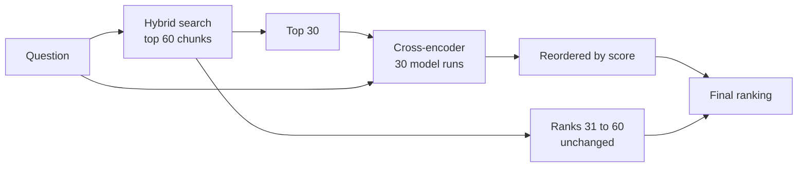

# Reranking with cross-encoders

> Fast search finds a few dozen candidates; a slower model that reads the question and each candidate together puts the best ones first.

**Lands in:** Phase 2 · **Code:** `src/copilot/retrieval/rerank.py`

## What it is

The embedding model behind search is a **bi-encoder**: it turns the question and each chunk into vectors separately, and relevance is the similarity of two vectors computed independently. That is what makes search fast: chunk vectors are computed once, ahead of time. But the model never sees the question and the chunk side by side, so it can't check whether the chunk actually answers *this* question.

A **cross-encoder** takes the pair as one input, `[CLS] question [SEP] chunk [SEP]`, lets every question token attend to every chunk token, and outputs one relevance score. It is more precise and much more expensive: nothing can be precomputed, so it runs once per candidate for every question.

**Reranking** combines the two: search returns the top 30 candidates, the cross-encoder scores each, and the candidates are reordered by those scores. The rest of the list keeps its order.

## Why we need it here

The doc agent will read only the top few chunks, so their order matters more than anything below rank 10. Filings repeat near-identical language across sections and years ("net sales increased", "compared with the prior year"), which bi-encoders score alike. A cross-encoder trained on MS MARCO's question–passage pairs can tell the passage that answers the question from the one that merely shares its vocabulary.

## How it works

Candidates:

| Key | Model | Size | Notes |
|---|---|---|---|
| `minilm-l6` | ms-marco-MiniLM-L-6-v2 | 22M parameters | The standard small reranker; 6 layers |
| `minilm-l12` | ms-marco-MiniLM-L-12-v2 | 33M | 12 layers |
| `jina-turbo` | jina-reranker-v1-turbo-en | 38M | Long inputs (8,192 tokens) |
| `bge-base` | bge-reranker-base | 278M | Much larger and slower; stronger on benchmarks |

All run on the CPU through FastEmbed's ONNX builds. Inputs longer than the model's limit (512 tokens for MiniLM and bge) are cut, so the end of a long chunk isn't seen.

## Where it lives in the code

| Piece | What it does |
|---|---|
| `copilot.retrieval.rerank.FastEmbedReranker` | Loads a cross-encoder and scores (question, chunk) pairs |
| `copilot.retrieval.rerank.rerank` | Reorders the top `top` hits by score and leaves the rest |
| `copilot.retrieval.rerank.OverlapReranker` | A word-overlap stand-in for tests |
| `scripts/run_retrieval.py` | `poe run-retrieval --rerank minilm-l6 --rerank-top 30` |

## How we measured it

Dense search's top candidates on the 100 dev questions, each question searching its own filing ([report](../eval/retrieval-baseline.md)):

| Reranker | Candidates | recall@5 | recall@10 | MRR@10 |
|---|---|---|---|---|
| None | | **0.485** | **0.608** | **0.307** |
| MiniLM-L6 | 30 | 0.390 | 0.510 | 0.264 |
| jina-turbo | 30 | 0.380 | 0.580 | 0.304 |
| bge-base | 20 | 0.435 | 0.605 | 0.284 |

No reranker beat the bi-encoder; after Holm's adjustment none differed significantly from it on `tokens-480`, and on page chunks bge-base lowered MRR@10 significantly (0.335 against 0.423). MiniLM did worst, consistent with reading only 512 tokens of question plus chunk: jina-turbo reads all of it and lost less. bge-base tied (0.605), better on the human-written questions (0.773 against 0.697) and worse on the templated domain questions (0.294 against 0.392). Both were trained on MS MARCO, whose queries are short web searches and whose passages are a paragraph long; FinanceBench's questions are long and full of template instructions, and its chunks are mostly financial prose and tables. On the human-written questions, which carry no template, MiniLM *raised* recall@10 from 0.697 to 0.758.

## Pitfalls we hit

- **Reranking can only reorder.** If the evidence page isn't among the 30 candidates, no reranker can find it, so first-stage recall at 30 caps what reranking can achieve.
- **Latency grows with the candidate count.** Every extra candidate is another model run; the candidate count is a latency budget. On the build laptop, otherwise idle, MiniLM over 30 candidates took 2.6 seconds a question (p50), jina-turbo 3.4 and bge-base over 20 8.7, against about 50 ms for dense search alone.
- **A reranker can make things worse.** It is easy to assume a cross-encoder only helps. Here every one tried lowered recall@5, which is why rerankers are measured like any other change.

## Review questions

1. Why can a cross-encoder rank 30 candidates well but not search a million chunks?
2. What does the cross-encoder see that the bi-encoder never does?
3. Reranking the top 30 can't change recall@60. Why can it change recall@10?
4. A 480-token chunk plus a 40-token question exceeds MiniLM's 512-token input. What is lost, and how could chunking or the reranker choice avoid it?
5. How would you decide between reranking 30 candidates with a large model and 60 with a small one?

## References

- Nogueira and Cho, [Passage Re-ranking with BERT](https://arxiv.org/abs/1901.04085), 2019.
- Reimers and Gurevych, [Sentence-BERT](https://arxiv.org/abs/1908.10084), 2019 (bi-encoders and cross-encoders).
- Bajaj et al., [MS MARCO: A Human Generated MAchine Reading COmprehension Dataset](https://arxiv.org/abs/1611.09268), 2016.
