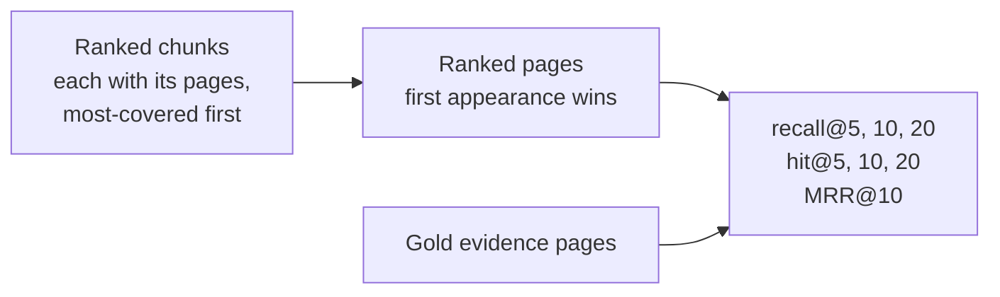

# Retrieval metrics

> Recall@k, hit@k and MRR say whether the evidence was found and how high it ranked. Scoring by page makes every chunking strategy comparable.

**Lands in:** Phase 2 · **Code:** `src/copilot/eval/metrics.py`, `src/copilot/eval/retrieval.py`, `src/copilot/retrieval/search.py`

## What it is

A retriever returns a ranked list; a question has a set of relevant items. For one question:

- **Recall@k**: the share of the relevant items that appear in the top k. One evidence page found out of two is 0.5.
- **Hit@k**: 1 if at least one relevant item is in the top k, else 0. For a question with one evidence page, hit@k and recall@k are the same.
- **Reciprocal rank (MRR@k when averaged)**: 1 / the rank of the first relevant item, or 0 if none is in the top k. Found first scores 1, second 0.5, tenth 0.1.
- **Precision@k**: the share of the top k that is relevant. It isn't reported: with one or two evidence pages per question, precision@10 can't exceed 0.2, and an unlabelled page may hold the answer too.

Each metric is averaged over questions and reported with a 95% bootstrap interval ([evaluation statistics](evaluation-statistics.md)).

## Why we need it here

Step 2.5 chooses chunking, search mode, reranking and context expansion by measurement, one change at a time. That needs one number per question that every variant can be scored on, whatever its chunks look like.

**Why pages.** FinanceBench marks each answer's evidence by document and 0-based page, and nothing finer. Chunking strategies produce different units (one page, 256 tokens, a semantic section), so a chunk-level metric would compare different things. Turning every ranked list of chunks into a ranked list of pages puts all strategies on the same scale, and matches what a citation points to.

## How it works

1. **Chunks to pages** (`ranked_pages`). Walk the chunks in rank order and append each chunk's pages, the page holding most of the chunk first, skipping pages already listed. Stop at 20 pages.
2. **Score** (`retrieval.score`). Compare the page list with the question's evidence pages. Pages are de-duplicated before cutting at k, so "top 10" is always ten distinct pages.
3. **Two settings.** *Oracle document*: search only the question's own filing, which isolates finding the page from finding the filing (FinanceBench's single-document setting, and the primary one here). *Corpus*: search every filing, which adds the problem of picking the right company and year.

A worked example: the evidence is page 59. The ranked chunks cover pages (42), (60, 59), (43). The page list is 42, 60, 59, 43: hit@5 = 1, recall@5 = 1, reciprocal rank = 1/3.

**Which k for what.** Recall@20 bounds what a reranker over the same candidates could reach. Recall@5 is closest to what an answer model will read. MRR rewards putting the evidence first.

## Where it lives in the code

| Piece | What it does |
|---|---|
| `copilot.eval.metrics` | `recall_at_k`, `hit_at_k`, `reciprocal_rank`, over de-duplicated rankings |
| `copilot.eval.retrieval` | Gold pages from the evidence, `score()`, `read_predictions()`, the first-pages floor |
| `copilot.retrieval.search.ranked_pages` | Chunks to pages |
| `scripts/run_retrieval.py`, `scripts/compare_family.py` | `poe run-retrieval` and `poe compare-family` |

## How we measured it

On the 100 dev questions ([report](../eval/retrieval-baseline.md)):

| System | recall@5 | recall@10 | recall@20 | hit@20 | MRR@10 |
|---|---|---|---|---|---|
| First 20 pages of the right filing (floor) | 0.140 | 0.197 | 0.290 | 0.290 | 0.075 |
| Dense search within the right filing | 0.485 | 0.608 | 0.713 | 0.740 | 0.307 |
| Dense search across all 84 filings | 0.170 | 0.345 | 0.500 | 0.540 | 0.115 |

The gap between the second and third rows is what finding the right filing is worth; Phase 3's query understanding (company, period and form as filters) aims to close it.

## Pitfalls we hit

- **Multi-page chunks.** A 480-token chunk often spans two pages, and 52% of `tokens-480` chunks do. Listing its most-covered page first, then the other, keeps one chunk from crowding out others while still crediting the page the evidence sits on.
- **Unlabelled evidence.** Figures appear in more than one place (the income statement and MD&A), but only one page is labelled. Recall is therefore a lower bound, and the same for every variant, so comparisons stay fair.
- **Zero-based pages.** FinanceBench's page numbers are PDF page indexes from 0, not the numbers printed on the pages; the parser numbers pages the same way.

## Review questions

1. A question has evidence pages 12 and 13; the top 10 holds page 13 at rank 4. What are recall@10, hit@10 and the reciprocal rank?
2. Why would chunk-level recall unfairly favour 256-token chunks over page chunks?
3. Why is the oracle-document setting the primary one, and what does the corpus setting add?
4. Why report recall@20 when the answer model only reads the top 5?
5. If an unlabelled page also contains the answer, how does that bias recall, and why doesn't it bias comparisons?

## References

- Manning, Raghavan and Schütze, [Introduction to Information Retrieval](https://nlp.stanford.edu/IR-book/), 2008, chapter 8 (evaluation).
- Islam et al., [FinanceBench: A New Benchmark for Financial Question Answering](https://arxiv.org/abs/2311.11944), 2023.
