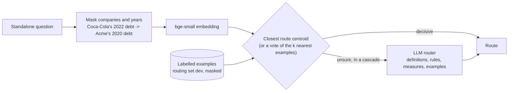

# Semantic routing

> Choose which part of the system answers a question, by comparing it with labelled example questions or by asking a model.

**Lands in:** Phase 5 · **Code:** `src/copilot/agents/router.py`; `scripts/run_router.py`

## What it is

A system with several specialists needs a first decision for every request: which one should handle it. That decision is **routing**, and there are three common ways to make it.

- **Semantic routing.** Each route gets example requests, often called utterances. A new request is embedded with the same model and compared with the examples; the route whose examples are closest wins. No model call is made, so it takes milliseconds and costs nothing. The [Semantic Router](https://github.com/aurelio-labs/semantic-router) library is the best-known implementation: in its current 1.x line, its `IndexedRouter` fetches the `top_k` stored utterances closest to the query (5 by default) and scores each route by aggregating its utterances among them (`"mean"` by default; `"max"` and `"sum"` are the alternatives).
- **LLM routing.** A model reads the route definitions and the request, and names the route. It reads the request the way a person would, so it handles wording it has never seen, at the price of a model call on every request.
- **A trained classifier.** A small model fine-tuned on labelled requests, which this project tries in Phase 7 with the LLM router as its teacher.

The three can be combined in a **cascade**: the cheap router decides when it is confident, and the expensive one is asked only otherwise.

## Why we need it here

The copilot has six routes, defined in `copilot.agents.router.ROUTE_DEFINITIONS` and labelled in the [routing set](../data/routing-set.md):

| Route | Goes to |
|---|---|
| `doc` | The doc agent: filing text, cited to the page ([grounded generation](grounded-generation.md)) |
| `data` | The data agent: SQL over reported figures ([Text-to-SQL agent](text-to-sql-agent.md)) |
| `hybrid` | Both: figures from the database, reasons from the filings ([hybrid answers](hybrid-answers.md)) |
| `brief` | A written deliverable (Phase 7) |
| `smalltalk` | A short reply, with no retrieval |
| `decline` | A polite refusal: advice, predictions, unrelated tasks, attempts to override instructions |

A wrong route costs more than a wrong word. A figure question sent to the doc agent reads pages instead of querying the database, and on FinanceBench's figure questions the data agent is right more often ([report](../eval/data-agent-financebench.md)). A hybrid question sent to the data agent loses its explanation, a request for investment advice must not be answered, and a greeting shouldn't start a search.

## How it works

### The semantic router

1. **Examples.** The routing set's 138 dev questions: 46 hand-written seeds and two reviewed paraphrases of each. The 60 test questions stay out, so they can measure the router later.
2. **Masking.** `entity_mask` replaces every company the [company matcher](query-understanding.md) knows with "Acme" (keeping a possessive) and every year, with any "FY" or "fiscal year" in front, with "2020". The route depends on what is asked, not on whom or when, and the next section shows why that matters.
3. **Embedding.** bge-small, the model that already embeds the filings, without its search instruction: comparing two questions is a symmetric task, and the instruction is meant for a short query against a long passage.
4. **Deciding.** Either a vote, where the `k` most similar examples vote for their routes, each vote weighted by its similarity, or the **nearest centroid**: each route's examples are averaged into one vector, and the question goes to the route whose average is closest.
5. **Confidence.** With a vote, the share of the vote the winning route got; with centroids, the margin between the closest centroid's similarity and the runner-up's. A cascade uses it to decide when to ask the LLM router.

### The LLM router

One call to a model in JSON mode at temperature 0, with a system prompt that holds:

- the six route definitions;
- the labelling rules for close calls (a figure without an explanation is `data`; add a "why" and it is `hybrid`; and so on);
- the 28 measures the facts database holds, so "how many restaurants" goes to the doc agent while "free cash flow" goes to the data agent;
- 13 example questions written for the prompt.

The reply is `{"reason": "...", "route": "..."}`. A reply that can't be read goes to the doc agent, which declines what its sources don't support, and the error is recorded. Calls go through the gateway's cache, so a rerun of an evaluation costs nothing.

## Where it lives in the code

| Piece | What it does |
|---|---|
| `copilot.agents.router.SemanticRouter` | Embeds examples once; `route(question, exclude=...)` votes or picks the nearest centroid, optionally leaving examples out |
| `copilot.agents.router.entity_mask` | Masks companies (through `CompanyMatcher.mask`) and years |
| `copilot.agents.router.vote`, `decide`, `route_centroids`, `nearest` | The two decision rules and their confidences |
| `copilot.agents.router.LLMRouter` | The prompt (`router_prompt`), the call and the reply (`parse_route`) |
| `copilot.agents.router.CascadeRouter` | The semantic route when decisive, the LLM router otherwise, the semantic route again if the LLM fails |
| `copilot.agents.router.RouteDecision` | The route, the confidence, the reason, the model, and the latency, tokens and cost |
| `scripts/run_router.py` (`poe run-router`) | Runs a router over a routing split, resumably, and scores it with a confusion matrix |

## How we measured it

On the routing set's dev side, 138 questions, with accuracy and a 95% bootstrap interval, and paired permutation tests against the keyword rules ([ADR-0007](../decisions/0007-evaluation-statistics.md)). The full numbers are in the [routing report](../eval/routing.md).

**Leave one seed group out.** Each dev question is one of three versions of a seed: the seed and two paraphrases. If the other two versions sat among the semantic router's examples, the router would only have to recognise a rewording of a question it had already seen: a question's own paraphrases are at a median similarity of 0.936 to it, against 0.707 for the closest question from another seed. So each question is routed with its own seed group left out of the examples, and on the test split, whose seeds aren't among the examples, nothing needs leaving out.

| Router | Accuracy (95% interval) | Latency, median | Cost a question |
|---|---|---|---|
| Keyword rules (a floor, written on the seeds) | 0.623 (0.543 to 0.703) | under 1 ms | none |
| Semantic, a vote of the five nearest examples (the first design) | 0.391 (0.312 to 0.471) | 8 ms | none |
| Semantic, companies and years masked, nearest centroid | 0.739 (0.667 to 0.812) | 8 ms | none |
| LLM, gpt-oss-20b | 0.964 (0.928 to 0.993) | 0.68 s | $0.00010 |
| **LLM, gpt-oss-120b** | **1.000 (exact 0.974 to 1.000)** | 0.51 s | $0.00019 |
| LLM, Qwen3.8 27B | 1.000 (exact 0.974 to 1.000) | 0.33 s | $0.00080 |

The copilot routes with gpt-oss-120b and keeps the masked-centroid router as its fallback ([ADR-0017](../decisions/0017-routing.md)). The semantic router's design choices after the first were made on these same questions. On the held-out test split, opened once at Phase 5's milestone, it scored 0.800 (0.700 to 0.900) and the LLM router 60 of 60 ([report](../eval/routing.md#the-test-split)).

## Pitfalls we hit

- **Topic beats intent.** The first design, a vote of the five nearest examples, routed only 39% of dev correctly, below the keyword rules' 62%. Its nearest examples shared the question's company or metric, not its route. "Which competitors does AMD name in its annual report?" (`doc`) was closest to five questions about AMD's R&D spending (`data` and `hybrid`), and "What does Ulta Beauty disclose about its loyalty program?" (`doc`) to three requests for a report on Ulta Beauty (`brief`). Masking companies and years and comparing with route centroids instead of single examples raised it to 74%. Both changes were chosen on dev after seeing these errors, so the held-out test split had the last word: 0.800 on seeds they never saw.
- **A paraphrase in the index is a leak.** Evaluated with the question's own paraphrases among the examples, any similarity router looks nearly perfect. Grouping the split, and the leave-out, by seed is what keeps the number honest.
- **Prompt examples close to test questions.** Two of the LLM router's first prompt examples came within 0.91 of held-out test questions by embedding similarity: one about a company's store count and one thanking the assistant. They were replaced; the closest example left is 0.78 from any routing-set question. The check prints similarities and question ids only, never the test questions' text.
- **Confusions depend on the questions.** On dev, the masked-centroid router sent `decline` requests to small talk; on test, it sent requests for a share price next year and for non-public earnings details to the data agent, since their words are a figure question's words. A fallback's error rate is only half its risk: where its errors land matters as much.
- **The fast model is not the cheap one.** At list prices, Qwen3.8 27B, the gateway's `fast` role, costs $0.80 per million input tokens and $4.00 per million output tokens; gpt-oss-20b costs $0.075 and $0.30. A router call is mostly prompt, so the same prompt costs about ten times as much on the "fast" model.

## Review questions

1. Why does a router evaluated with paraphrases of its own examples overstate its accuracy, and how does grouping by seed fix that?
2. Why would masking company names help a router but hurt a retriever?
3. A route centroid beat a vote of the nearest examples. What does averaging remove that a nearest-neighbour vote keeps?
4. What does the LLM router know that the semantic router can't, and what does that knowledge cost per question?
5. When is a cascade worth its extra moving part?

## References

- Aurelio AI, [Semantic Router](https://github.com/aurelio-labs/semantic-router), and its documentation on [routers](https://docs.aurelio.ai/docs/semantic-router/v1/user-guide/components/routers) (top-k retrieval of utterances, per-route aggregation, thresholds) and [calibration](https://docs.aurelio.ai/docs/semantic-router/v1/user-guide/features/calibration).
- Xiao et al., [C-Pack: Packaged Resources To Advance General Chinese Embedding](https://arxiv.org/abs/2309.07597) (BGE), 2023, for bge-small and its query instruction.
- Ong et al., [RouteLLM: Learning to Route LLMs with Preference Data](https://arxiv.org/abs/2406.18665), 2024, on routing between cheap and expensive models.
- The [routing set's data card](../data/routing-set.md) for the labels and the labelling rules.
