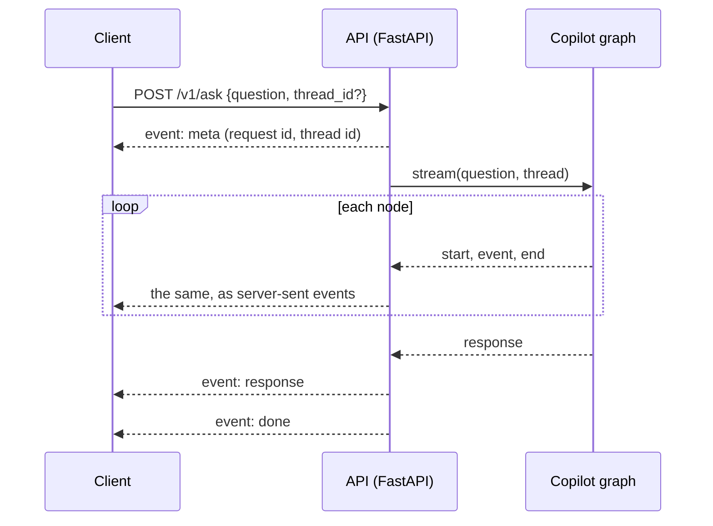

# Streaming with server-sent events

> Show an answer's progress as it happens: the server keeps one HTTP response open and writes an event whenever a step finishes.

**Lands in:** Phase 6 · **Code:** `src/copilot/api/app.py`, `services.py`, `schemas.py`

## What it is

An ordinary HTTP response arrives all at once, when the server has finished. **Server-sent events** (SSE) keep the response open instead: its content type is `text/event-stream`, and the server writes short blocks of text, one per event, as they happen. Each block is a few `field: value` lines ended by a blank line:

```text
event: end
id: 4
data: {"node": "route", "ms": 512.3, "error": null}

```

- `event` names the event, so a client can handle each kind on its own; without it the event is a plain `message`.
- `data` is the payload; this API always sends JSON.
- `id` lets a client that reconnects tell the server, in a `Last-Event-ID` header, where it got to.
- A line starting with a colon is a comment. Servers send one now and then as a keep-alive, so that proxies don't close a connection that is quiet while a slow step runs.

SSE is one-way: the server talks and the client listens. That is all an answer needs, and it stays plain HTTP, which every proxy, load balancer and Cloud Run understands. A browser's built-in `EventSource` takes only a URL (and whether to send credentials), so it can't send a question in a POST body; a client that does reads the stream with an ordinary HTTP client instead.

## Why we need it here

An answer takes seconds: the router's model call, retrieval, the answer call, the validator's check and perhaps a revision. The graph already reports each of those steps as it happens ([LangGraph orchestration](langgraph-orchestration.md)), and the UI can show them: the route as soon as it is chosen, each step's time, then the answer and its citations. A JSON response would make the reader wait blind; a WebSocket would add a two-way connection that nothing uses ([ADR-0020](../decisions/0020-api-and-streaming.md)).

## How it works



1. **Before the stream.** The request body is checked first: a question of at most 2,000 characters and well-formed ids. A bad request gets an ordinary 422 and never reaches the graph.
2. **`meta`.** The first event gives the request's id (also in the `X-Request-ID` header) and the conversation's id: a new one, unless the request continued a thread.
3. **The graph's events.** `Copilot.stream` yields the trace's events, and the endpoint, a generator, yields each as a server-sent event with its type as the event name and a sequence number as its id. FastAPI runs the generator in a worker thread, because the graph is synchronous, and writes a keep-alive comment whenever 15 seconds pass without an event.
4. **The end.** `response` carries the reply, its citations and any SQL; `done` closes the stream. A failure becomes an `error` event, followed by `done`, so a client never has to tell a broken connection from a failed answer.

**One run at a time.** The agents' clients count the tokens each node uses, and two runs at once would count each other's, so a lock admits one run per process. A request that waits for it more than two minutes gets a busy error and `done`.

## Where it lives in the code

| Piece | What it does |
|---|---|
| `copilot.api.app.create_app` | The application, with its middleware and routes; takes services from outside when given them |
| `copilot.api.app.ask` | `POST /v1/ask`: `meta`, the graph's events, `done`, under the run lock |
| `copilot.api.app.request_ids` | The `X-Request-ID` middleware, which also logs every request |
| `copilot.api.services.Services`, `build_services` | The copilot, the feedback store, the pages and the readiness checks, built once |
| `copilot.api.schemas` | The request and response models, from which the OpenAPI document is built |
| `poe api` | uvicorn serving the application on 127.0.0.1:8000, with interactive docs at `/docs` |

## How we measured it

- **Tests** (`tests/test_api.py`), with a fake copilot: the order of a streamed answer's events, a follow-up on its thread, refused requests, a failure ending in one `error` and `done`, the busy error, feedback, cited pages and the OpenAPI document.
- **Live**, against the local stack: "Hi! Which companies do you cover?" streamed `meta`, a start and an end for each of the eight nodes on its path, the reply and `done`; the router's model call took 4.7 s and the cached small-talk reply 6 ms, which a reader of the stream sees step by step instead of all at the end.

## Pitfalls we hit

- **A lock held across `yield`.** The endpoint keeps the run lock while it streams. If the client disconnects, closing the generator runs its `finally` and frees the lock; and if a run ever hangs, the next request gives up after two minutes instead of waiting for ever.
- **Errors from two places.** The runner already sends an `error` event when the graph fails, before raising; the endpoint sends its own only for a failure that happens before the graph starts, so a client sees exactly one.
- **A library that wasn't needed.** sse-starlette was the usual way to stream SSE from FastAPI; FastAPI has done it natively from a generator since version 0.135, keep-alive comments included, so the dependency went.

## Review questions

1. Why does an SSE stream need keep-alive comments, and what reads them?
2. Why can't a browser's `EventSource` send this API's questions, and what does a client use instead?
3. Why is a failed answer an `error` event inside a 200 response, rather than an HTTP error status?
4. What would two simultaneous runs get wrong here, and what would let them run together?

## References

- WHATWG, [HTML Living Standard: Server-sent events](https://html.spec.whatwg.org/multipage/server-sent-events.html).
- MDN, [Using server-sent events](https://developer.mozilla.org/en-US/docs/Web/API/Server-sent_events/Using_server-sent_events).
- FastAPI, [Server-Sent Events](https://fastapi.tiangolo.com/tutorial/server-sent-events/).
- [ADR-0020](../decisions/0020-api-and-streaming.md) for the design.
