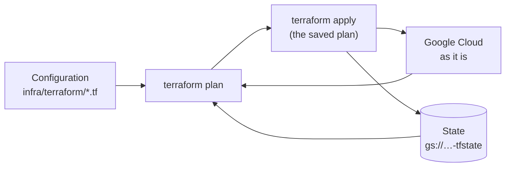

# Terraform basics: infrastructure as code

> Describe the cloud resources in files, let a tool work out what has to change, and keep one record of what exists.

**Lands in:** Phase 8 · **Code:** `infra/terraform/`

## What it is

**Infrastructure as code** means the servers, databases, networks and permissions a system runs on are written down as code. They are reviewed, versioned and recreated from it, rather than clicked together in a console.

**Terraform** does this declaratively. You describe the resources you want, and Terraform works out how to get from what exists to that:

- **Configuration.** Files in HCL, Terraform's language. Each `resource` block declares one object, such as a bucket or a Cloud Run service, with its settings. Blocks refer to each other (`google_storage_bucket.filings.name`), and Terraform orders the work by those references.
- **Providers** are plugins that speak to an API. The `hashicorp/google` provider turns each block into Google Cloud API calls. Its version is pinned, and a lock file records the checksum of each build.
- **State** records which real object each block created, with its ID and attributes. It is what lets Terraform tell an update from a creation. Kept in a versioned Cloud Storage bucket, it is shared, locked while someone applies, and recoverable. State holds attribute values in the clear, which is why secret values never pass through Terraform.
- **Plan and apply.** `plan` compares the configuration with the state and with the cloud, and lists what it would create, change or destroy. `apply` does it. Applying a saved plan file guarantees that what runs is exactly what was reviewed.
- **Modules** are reusable groups of resources with inputs and outputs. A **root** is a directory with its own state; `init` downloads its providers and connects it to its state.

## Why we need it here

The deployment is about sixty resources in fifteen services ([ADR-0031](../decisions/0031-google-cloud-topology.md)). Made by hand, they would drift apart from any description of them, couldn't be reviewed before they changed, and couldn't be rebuilt if the project were lost. As code, every change goes through a pull request and CI validates it.

## How it works

Two roots, with different owners and blast radii:

| Root | What it holds | Who applies it |
|---|---|---|
| `bootstrap` | APIs, the budget, the state and data buckets, the registry, workload identity federation, the service accounts, empty secrets | The project owner, rarely |
| `envs/prod` | The network, the database, Firestore, Pub/Sub, the services and who may call them, the scheduler, alerts | The project owner |

The identity that deploys code never needs the rights to change IAM or the budget.

Three things change the deployment, and each owns its own part:

| Who | Owns | How Terraform stays out of its way |
|---|---|---|
| Terraform | Every resource's configuration | |
| The deploy workflow | Each service's image | `lifecycle { ignore_changes = [...image] }` |
| `demo-up` and `demo-down` | Whether the database runs | `ignore_changes = [settings[0].activation_policy]` |

So a plan right after a deploy or a demo says "No changes".

## Where it lives in the code

| Path | What |
|---|---|
| `infra/terraform/bootstrap/` | `main.tf` (APIs, budget, buckets, registry, secrets, billing dataset), `iam.tf` (federation, accounts, the deployer's roles), `imports.tf` (adopting what gcloud made first) |
| `infra/terraform/envs/prod/` | `network.tf`, `database.tf`, `state.tf`, `pubsub.tf`, `services.tf`, `scheduler.tf`, `monitoring.tf` |
| `infra/terraform/modules/cloud-run-service/` | One Cloud Run service: scaling, resources, environment, secrets, VPC egress, invokers |
| `.github/workflows/ci.yml` | The "Terraform" job: `fmt -check`, then `init -backend=false` and `validate` for each root |

## How we check it

- **On every pull request,** CI checks the formatting and validates each root against the provider's schema, without touching the cloud.
- **Before every apply,** the owner reads the plan.
- **After every deploy,** a plan should say "No changes"; any difference is drift and gets explained.

## Pitfalls we hit

- **The budget comes first,** before Terraform exists. It is created with gcloud and then imported, so nothing that costs money exists without it.
- **The first plan needs two APIs on.** Terraform enables the project's APIs itself, but it needs Cloud Resource Manager and Service Usage to do so, and those are enabled with gcloud.
- **A secret without a version stops a revision,** and the database's address is known only after it exists. So the first apply of `envs/prod` creates the database alone (`-target`), its address goes into the `facts-url` secret, and then everything else follows.
- **A service can't name its own address** in its own settings. Cloud Run's deterministic address (`<service>-<project number>.<region>.run.app`) is known in advance, and the MCP server's allowed host uses it.

## Review questions

1. What would go wrong if two people applied the same root at once without a shared, locked state?
2. Why do secret values go into Secret Manager by gcloud, and never through Terraform?
3. What does `ignore_changes` on a service's image buy, and what would happen without it after every deploy?
4. Why are `bootstrap` and `envs/prod` two roots rather than one?
5. What is the difference between `terraform validate` and `terraform plan`, and why can CI run only the first?

## References

- HashiCorp, [Terraform language](https://developer.hashicorp.com/terraform/language), [state](https://developer.hashicorp.com/terraform/language/state), [the gcs backend](https://developer.hashicorp.com/terraform/language/backend/gcs), [import blocks](https://developer.hashicorp.com/terraform/language/import).
- [The Google provider's documentation](https://registry.terraform.io/providers/hashicorp/google/latest/docs).
- [Deploy runbook](../runbooks/deploy.md); [ADR-0031](../decisions/0031-google-cloud-topology.md).
