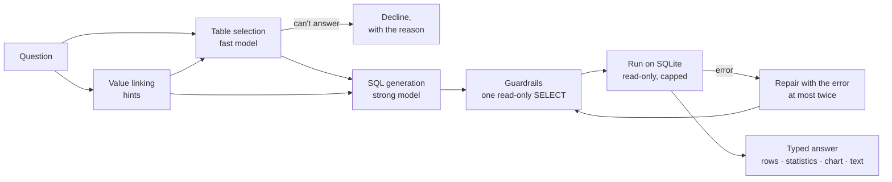

# Text-to-SQL agent

> Turn a question about reported figures into one safe, read-only SQL query over the facts database, run it, and explain the result.

**Lands in:** Phase 4 · **Code:** `src/copilot/sql/`; the pipeline is [text2sql-analyst](https://github.com/VinayakMokashi/text2sql-analyst), an earlier project, pinned as a dependency

## What it is

A **Text-to-SQL agent** answers a question in plain English by writing a database query, running it and reporting the result. The model never sees the data in bulk and never does the arithmetic over it: the database does both, and the model only has to say what to ask for.

For numbers that companies report, this beats reading filings. A filing states a figure once, on one page, in a table that a parser may flatten; the facts database ([ADR-0008](../decisions/0008-xbrl-normalisation.md)) holds the same figure as a tagged XBRL value, for every company and year, exactly as reported. "How did 3M's capital expenditure change from fiscal 2018 to 2022?" is one query over five rows, not a search across five annual reports.

## Why we need it here

The doc agent answers 88% of FinanceBench's figure questions on dev by finding and reading the right page. A figure across several years or companies means finding several pages, and 13 of its 29 wrong answers used another definition, line item or period than the reference ([dev evaluation](../eval/doc-agent-dev.md)). The data agent handles the questions that are really lookups and computations, with the definitions written down once, and Phase 5 routes each question to one agent or both.

## How it works

1. **Value linking** ([guide](value-linking.md)). Hints name the companies in the question with their database values and coverage, list every company and every metric value, define combined measures such as margins and free cash flow, and explain fiscal years. On the SQL set this one step took accuracy from 61% to 100%.
2. **Table selection** (fast model). The facts database has seven tables, so every one is offered with its hand-written description, and the model picks the few the query needs. It can also decide that the database can't answer the question, which is how questions about Tesla's revenue (a company not in the database) or Amazon's for fiscal 2005 (a year before its coverage) get declined before any SQL is written.
3. **SQL generation** (strong model). It sees the chosen tables' definitions, three sample rows each, the join conditions from the foreign keys, and the hints. The rules ask for one SELECT (CTEs allowed), names rather than bare IDs, clear aliases for computed columns, and `CANNOT_ANSWER: <reason>` when no reasonable query exists.
4. **Guardrails**, in three layers:
   - sqlglot parses the query and allows exactly one SELECT, with no PRAGMA or ATTACH;
   - SQLite opens the database read-only (`mode=ro`);
   - an SQLite authorizer refuses every action but reading, which holds where the parser and SQLite disagree (it blocks `pragma_table_info()` inside a SELECT); caps limit the run to 200 rows, 1 MB per value and 10 seconds.
5. **Repair.** When the database rejects a query, the model gets its own SQL and the error, and tries again, twice at most. One dev question needed it.
6. **The typed answer** (`DataAgent.ask` returns a `DataAnswer`):
   - the status and the SQL;
   - the rows, and exact statistics per measure column (total, mean, extremes and the rows they fall on);
   - a chart suggestion;
   - the written answer with insights and caveats, by the fast model from the rows and the statistics, so it quotes numbers rather than computing them.

text2sql-analyst does steps 2 to 5 and the analysis; this project adds the value linking, the model routing through its gateway, and the typed answer ([ADR-0015](../decisions/0015-reuse-text2sql-analyst.md)).

## Where it lives in the code

| Piece | What it does |
|---|---|
| `copilot.sql.agent.build_pipeline` | text2sql-analyst's pipeline over the facts database: every table, the descriptions, the linker, models on the gateway |
| `copilot.sql.adapter.GatewayLLM` | text2sql-analyst's model interface on the cached, paced gateway |
| `copilot.sql.linking.FactsLinker` | The value-linking hints |
| `copilot.sql.tool.DataAgent`, `DataAnswer` | One question in, a typed and serialisable answer out |
| `copilot.sql.tool.column_statistics` | Exact statistics for the measure columns |
| `scripts/run_sql_agent.py` | `poe run-sql-agent`: the SQL set, answered and scored |
| `scripts/ask_data.py` | `poe ask-data "..."`: one question, printed |

## How we measured it

On the SQL set's 28 dev questions, scored by execution against the gold queries' rows (declining is right only for the 7 questions the database can't answer):

| Run | Accuracy | Answerable (21) | Unanswerable (7) | Tokens a question |
|---|---|---|---|---|
| Decline everything | 0.25 | 0 | 7 | 0 |
| The pipeline, no value linking | 0.61 (0.43 to 0.79) | 12 | 5 | 2,345 |
| **With value linking** | **1.00 (exact 0.88 to 1.00)** | **21** | **7** | 3,313 |

Model time is 1.5 seconds a question at the median and 2.1 at p95, for two calls: selection on the fast model (Qwen3.8 27B), SQL on the strong one (gpt-oss-120b), both on Groq. The written analysis adds a third call, on the fast model.

On FinanceBench's 33 dev metrics questions, written by other people and graded by the doc agent's judges, with gpt-oss-120b writing both agents' answers ([report](../eval/data-agent-financebench.md)):

| Agent | Correct (exact 95% interval) | Refused | Cost a question |
|---|---|---|---|
| **Data agent** | **32 of 33 (0.84 to 1.00)** | 0 | $0.0025 |
| Doc agent, reading filing pages | 29 of 33 (0.72 to 0.97) | 2 | $0.0010 |

It is right wherever the doc agent is, and also on two calculations across years that the doc agent refused. Its one miss is a rounding question about the reference: the reported $389 million as $0.39 billion, where the reference says $0.40. With three questions between the agents, the difference isn't significant (p = 0.25).

Neither dev score is a fair test any more. The combined-measure definitions were written after reading the SQL set's first errors, and the facts database was checked against FinanceBench's dev metrics questions in Phase 1. The SQL set's test split and FinanceBench's test split check the agent on questions it wasn't tuned on.

## Pitfalls we hit

- **A dependency built as an app.** text2sql-analyst required Streamlit and ChromaDB, a second vector database, to index seven tables. Making both optional upstream kept the install small, and an all-tables retriever replaced the index.
- **Years are not measures.** The first statistics added up the fiscal-year column ("total 10,100") and couldn't name the year of a peak. The tool now uses text2sql-analyst's rule for measure columns, under which a year labels the rows.
- **The value list was one join away**, and empty results looked like answers: see the [value linking guide](value-linking.md).

## Review questions

1. Why does the model write SQL instead of reading the rows and answering itself?
2. What does each of the three guardrail layers catch that the others might miss?
3. Why is table selection allowed to decline the question?
4. When is a repair loop worth its extra model call, and when does it just repeat the mistake?
5. Why does the typed answer carry statistics computed in code, when the model already wrote an answer?
6. Why does the data agent answer calculations across years that the doc agent, with the same answer model, refuses?

## References

- Liu et al., [A Survey of NL2SQL with Large Language Models](https://arxiv.org/abs/2408.05109), 2025.
- Talaei et al., [CHESS](https://arxiv.org/abs/2405.16755), 2024, on schema and value linking.
- [text2sql-analyst](https://github.com/VinayakMokashi/text2sql-analyst) for the pipeline and its own evaluation.
- [ADR-0015](../decisions/0015-reuse-text2sql-analyst.md), [value linking](value-linking.md).
