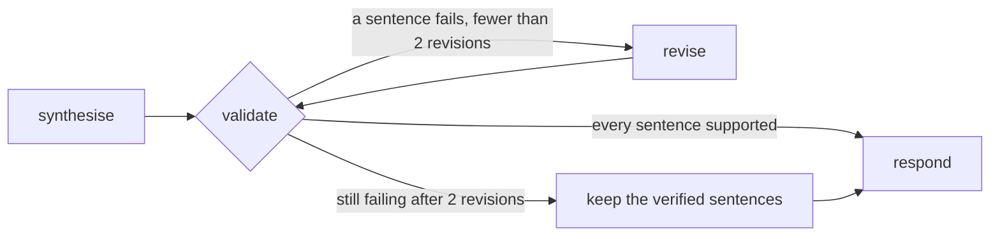

# The validator loop

> Check every cited sentence against its sources before the user sees it; rewrite what fails, at most twice, then keep only what holds.

**Lands in:** Phase 5 · **Code:** `src/copilot/agents/validator.py`, the `validate` and `revise` nodes in `src/copilot/agents/graph.py`; `scripts/validate_answers.py`

## What it is

A grounded answer cites its sources, but a citation is a claim, not a proof: a sentence can cite the right page and still say more than the page does. A **validator** checks an answer before it is shown, and a **loop** gives the writer a chance to fix what failed:

1. **Check** each sentence against the sources it cites.
2. **Revise:** send the failing sentences back to the writer, with the same sources, and ask for an answer whose every sentence is supported.
3. **Stop** after a fixed number of rounds. What still fails is dropped, and if nothing is left, the copilot declines and says what it could not verify.

This is the generate, critique and refine pattern of Self-Refine (Madaan et al., 2023), with the critique made specific: not "improve this answer", but "these sentences aren't supported by the sources they cite". Checking sentence by sentence, rather than the answer as a whole, follows work on fine-grained factual precision such as FActScore (Min et al., 2023), and revising an answer against evidence follows RARR (Gao et al., 2023).

## Why we need it here

The doc agent's Phase 3 evaluation measured faithfulness separately from correctness: of the 94 answers it gave to FinanceBench dev questions, 35 had at least one sentence that the sources it cited didn't support (faithful 0.63, [report](../eval/doc-agent-dev.md)). Most were judgement sentences that went further than their pages, above all on the domain-relevant questions (0.41 faithful), and figures the model worked out itself instead of with the calculator. A user can't tell those sentences from the supported ones, so the copilot should catch them itself.

## How it works

- **What is checked.** Doc and hybrid answers that answer the question: they carry `[n]` citations. A data answer cites its query as a whole, and a refusal, small talk or a decline makes no claims to check, so those pass straight on.
- **The check** reuses the faithfulness judge from Phase 3 (`copilot.eval.faithfulness.check`): one call that splits the answer into sentences and asks whether each is supported by the sources it cites, with the calculator's expressions, so a computed figure counts when its inputs are on the cited pages. A sentence that cites nothing fails.
- **Who checks.** The `small` role, gpt-oss-20b: a different model from the answer's writer (gpt-oss-120b, the `strong` role), and a different model from the evaluation's judge (Qwen3.8 27B). Checking with the evaluation's own judge would tune the copilot to its grader, and every gain it measured would be suspect.
- **The revision** goes to the writer with its original rules (the doc agent's prompt, or the hybrid prompt for a split hybrid answer), the same numbered sources, its answer, and the failing sentences listed: correct each one from the sources or leave it out, and keep the rest.
- **A labelled assessment** (version 2). A question that asks for a judgement needs one, and the pages seldom state it, so a revision may give it as one last sentence that begins "Assessment:" and cites the facts it rests on. The check doesn't fail the answer for that sentence, and trimming keeps it beside at least one verified sentence, never alone. The evaluation's faithfulness judge still grades it like any other sentence.
- **A revision that refuses** is set aside (version 2): the answer stays as it was, and the next check trims it to its verified sentences.
- **At most twice.** After two revisions that still fail, `trim` keeps the supported sentences. With none left, the answer becomes a refusal whose `missing` names what couldn't be verified. The response reports the check: whether it ran, whether the final answer passed, the number of revisions and any sentences cut.

## Where it lives in the code

| Piece | What it does |
|---|---|
| `copilot.agents.validator.check_answer` | The faithfulness check of one answer, on the `small` role |
| `copilot.agents.validator.revise`, `revise_messages` | The writer's second try, with the failing sentences listed |
| `copilot.agents.validator.trim` | The supported sentences and any labelled assessment, or a refusal |
| `copilot.agents.validator.labelled`, `failing`, `passes` | Which sentences are the answer's own assessment; which fail; whether the answer passes |
| `copilot.agents.validator.to_answer`, `verdict_record` | Answers and verdicts to and from the graph's JSON state |
| `copilot.agents.graph` `validate`, `revise`, `after_validation` | The loop: a conditional edge to `revise` or `respond`, and back |
| `scripts/validate_answers.py` (`poe validate-answers`) | The loop over a run's stored answers, kept as a new run for the judges |

## How we measured it

On the doc agent's 100 stored answers to FinanceBench dev questions, each run through the loop by `poe validate-answers` and graded by the Phase 3 judges ([report](../eval/validator-dev.md)):

| | Doc agent | With the loop |
|---|---|---|
| Faithful: every sentence supported by its citations | 0.628 | 0.848 |
| Share of sentences supported | 0.771 | 0.906 |
| Correct | 0.65 | 0.61 |
| Correct, domain-relevant questions (34) | 0.588 | 0.441 |
| Correct, metrics-generated questions (33) | 0.879 | 0.879 |
| Cost a question, at list prices | $0.0011 | $0.0011 + $0.0008 |

- **The loop at work:** 66 of the 94 answers passed the first check; 28 were revised, and 21 of those then passed; 5 kept only their verified sentences, and 2 became refusals.
- **Faithfulness** rose by 21 points on the 92 answers given both times (p = 0.0001), and no answer went from faithful to unfaithful.
- **Correctness** fell by 4 points overall, which a paired test can't tell from noise (p = 0.28), and all five answers it lost answer domain-relevant questions (p = 0.063 on those): the loop drops judgements that rest on a general benchmark or an industry norm rather than on the cited pages.
- **The checker and the judge** mostly agree: the checker revised 25 of the 35 answers the evaluation's judge found unfaithful, and 3 of the 59 it found faithful.
- **Version 2, inside the copilot** ([report](../eval/copilot-v2.md)): the validator's cost to correctness fell from 6 right drafts lost in version 1 to 2, and the doc and hybrid answers ended 0.82 faithful, against 0.49 for the doc agent alone on the same questions. 18 answers kept a labelled assessment, and the evaluation's judge found 3 of those went beyond their pages.

## Pitfalls we hit

- **The grader in the loop.** The obvious checker was the faithfulness judge's own model, Qwen, already wired up for Phase 3. It would have raised measured faithfulness by construction, since the loop would rewrite answers until the grader approved them, so the checker is a third model and the evaluation stays independent. It is also the cheapest: about a tenth of Qwen's price per token.
- **Judgement isn't in the sources.** Domain-relevant questions ask for an analyst's judgement, and the first answers often reached it through a usual benchmark, such as a ratio's customary threshold, or an industry norm. The checker fails such sentences, the revision drops them, and the conclusion the question asked for goes with them: correctness on those questions fell from 0.59 to 0.44. The copilot's rules already forbid outside knowledge, so version 2 lets the answer keep its assessment as a labelled sentence of its own instead ([ADR-0026](../decisions/0026-copilot-v2.md)).
- **A revision can trade a right sentence for a wrong one.** In one answer the model had worked out a margin itself, correctly, beside the calculator's result written as a fraction of one per cent; the revision dropped the unsupported sentence and kept the misformatted one. In the copilot's first end-to-end run, two revisions wrote margins of 33% and 39% as "0.33%" and "0.39%": a revision sees the answer's text, not how its first calculations were scaled, and wrote the placeholder without the factor of 100. The revision prompt now asks for every figure to be computed again, a percentage's expression multiplying by 100, and both came back right.
- **Revisions need every source.** The graph's state first kept only the cited sources' text, which is all the check needs. A revision may need a page the first answer didn't cite, so answer records now keep every source with its text.

## Review questions

1. Why is "these sentences aren't supported by the sources they cite" better feedback than "improve this answer"?
2. Why must the model that checks inside the loop differ from the model that grades the evaluation?
3. What does the loop do with an answer that still fails after two revisions, and why not keep trying?
4. Which answers does the validator not check, and why?

## References

- Madaan et al., [Self-Refine: Iterative Refinement with Self-Feedback](https://arxiv.org/abs/2303.17651), 2023.
- Min et al., [FActScore: Fine-grained Atomic Evaluation of Factual Precision in Long Form Text Generation](https://arxiv.org/abs/2305.14251), 2023.
- [ADR-0019](../decisions/0019-validator-loop.md) for the decision and the [dev report](../eval/validator-dev.md) for the numbers.
- Gao et al., [RARR: Researching and Revising What Language Models Say, Using Language Models](https://arxiv.org/abs/2210.08726), 2023.
- [LLM as a judge](llm-as-judge.md) and [grounded generation](grounded-generation.md) for the checks and the answers this loop works on.
