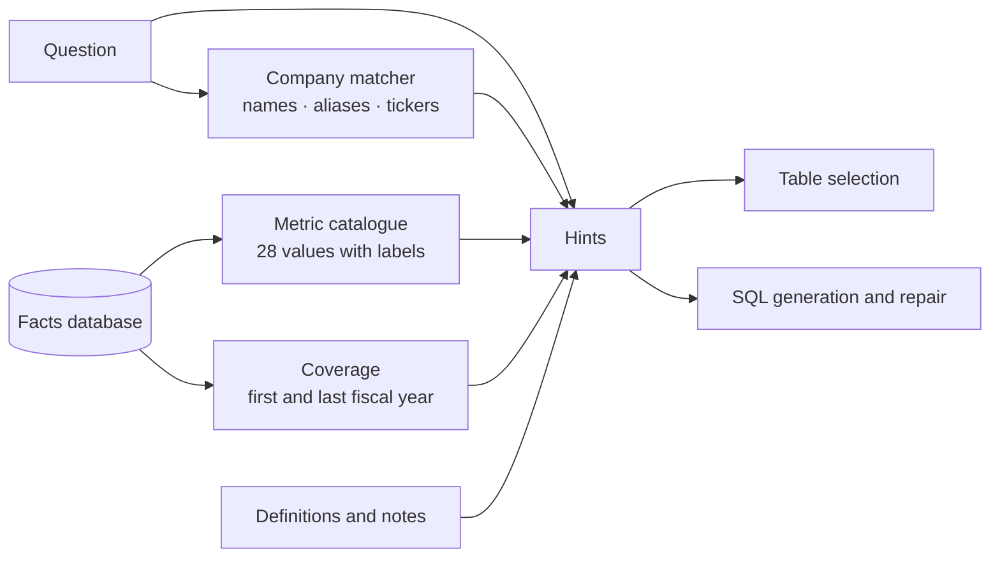

# Value linking

> Tell the SQL model which database values a question refers to, because the schema alone doesn't.

**Lands in:** Phase 4 · **Code:** `src/copilot/sql/linking.py`; upstream, `text2sql.linking` in text2sql-analyst

## What it is

A Text-to-SQL model sees the tables, their columns and a few sample rows. That is enough to write the shape of a query, and not enough to write its filters. Asked for Pfizer's cash at the end of 2021, the model knows there is an `annual_values` table with a `metric` column, but not which of its values means cash. So it guesses: `metric = 'cashAndCashEquivalents'`, a value that doesn't exist, and the query returns nothing.

**Value linking** finds the database values a question refers to and hands them to the model: the column's real values, the value a name or alias stands for, and the facts the data can't show, such as which years it covers. In the research literature it is part of schema linking: CHESS (Talaei et al., 2024) retrieves matching values from the database before generating SQL, and the BIRD benchmark gives models "evidence" notes for the same reason.

## Why we need it here

The data agent's first run answered 61% of the SQL set's dev questions ([ADR-0015](../decisions/0015-reuse-text2sql-analyst.md)), and value linking explains nearly all of the rest:

- Seven of the nine wrong answers to answerable questions guessed metric names: `netProfitMargin`, `gross_margin`, `cash_from_operations`, or a `LIKE '%asset%'` that also matched current assets. The 28 real names sit in the `metrics` table, which table selection never chose.
- One declined Boeing's current ratio as "not a canonical metric", not knowing that current assets and current liabilities are.
- Two questions that should have been declined (Tesla's revenue, Amazon's revenue for fiscal 2005) were answered with queries that returned nothing, because nothing told the model the company or the year wasn't there.

## How it works



`FactsLinker.hints(question)` returns, in order:

1. **Each company the question names**, found by the matcher from [query understanding](query-understanding.md) (names, short names, tickers in capitals, common aliases such as "Coke" and "JnJ"), with its database value, CIK and the years its annual values cover:

   ```
   "Coca-Cola" is companies.name = 'Coca-Cola' (cik 21344); its annual values cover fiscal 2009 to 2025.
   ```

2. **Every company in the database**, so a question about one that isn't there can be declined.
3. **The metric catalogue**: every value `annual_values.metric` takes, with its label: `capital_expenditure (Capital expenditure), cash_and_equivalents (Cash and equivalents), ...`
4. **Definitions of combined measures**, since the database stores the parts and not the ratios: gross, operating and net profit margin, free cash flow, current and quick ratio, return on assets; a margin or ratio is a fraction unless the question asks for a percentage.
5. **Notes** on what `fiscal_year` means (the company's own label for its year) and on naming companies by name, not CIK.

text2sql-analyst shows the hints to its table-selection, SQL-generation and repair prompts ([ADR-0015](../decisions/0015-reuse-text2sql-analyst.md)). The pieces that any database could use went upstream into `text2sql.linking`: `ColumnCatalogue` lists a short column's values (it builds the metric catalogue here), `ValueMatcher` finds the values a question mentions by name or alias, and `Pipeline(..., linker=...)` adds a linker's hints to every question. The company matcher, the coverage and the definitions are specific to the facts database, so they stay in this project.

All of it costs no model call: about 590 tokens of hints per question, computed from the database in milliseconds.

## Where it lives in the code

| Piece | What it does |
|---|---|
| `copilot.sql.linking.FactsLinker` | The hints for one question; `read(db_path)` builds it from the database |
| `copilot.sql.linking.read_companies` | Every company with the first and last fiscal year of its annual values |
| `copilot.retrieval.query.CompanyMatcher` | Names, aliases and tickers, from query understanding |
| `text2sql.linking.ColumnCatalogue` | A short column's values with labels, as one hint (upstream) |
| `text2sql.linking.ValueMatcher` | Values mentioned in a question, by name or alias (upstream; this project uses its own company matcher) |
| `copilot.sql.agent.build_pipeline(linking=True)` | The data agent with the linker; `linking=False` reproduces the baseline |

## How we measured it

The SQL set's 28 dev questions, the same agent with and without the linker ([v1](../../eval/results/sql/sql-agent-v1/dev/summary.md), [v2](../../eval/results/sql/sql-agent-v2/dev/summary.md)):

| Run | Accuracy | Answerable (21) | Unanswerable (7) | Tokens a question |
|---|---|---|---|---|
| v1, no value linking | 0.607 (0.43 to 0.79) | 12 | 5 | 2,345 |
| **v2, value linking** | **1.000 (exact 95% interval 0.88 to 1.00)** | **21** | **7** | 3,313 |

- +0.393 (0.21 to 0.57), p = 0.001, paired permutation test. When every answer is right, the bootstrap interval collapses to a point, so the interval above is the exact binomial one.
- All seven unanswerable questions were declined at table selection, before any SQL was written, with reasons drawn from the hints: "Tesla is not in the list of companies held by the database", "the database only contains annual values for fiscal years 2009 to 2025". One query needed a repair (a syntax error), the same rate as without linking.
- **Read the perfect score with care.** The definitions of combined measures were written after reading the first run's errors, and the dev set asks for exactly those measures, so dev is no longer a fair test of them. Two checks followed that the hints weren't shaped on. On FinanceBench's metrics questions, written by other people, the agent answered 32 of 33 correctly ([report](../eval/data-agent-financebench.md)). On the SQL set's held-out test split, opened once when Phase 4 closed, it got all 14 right (exact 95% interval 0.77 to 1.00), declining the 3 it should.

## Pitfalls we hit

- **The value list was one join away.** The metric names were in the database all along, in a table the selection step had no reason to pick for a question about one company's cash. A catalogue in the prompt is cheaper and more reliable than hoping the right lookup table gets selected.
- **Empty results look like answers.** A query for a company or a year that isn't there runs fine and returns nothing. Without coverage in the prompt, the model can't tell "no data" from "zero rows match", and the honest response, declining, never happens.
- **Names that are ordinary words.** "Block" is a company and a common word; the matcher only takes it with a capital letter, and tickers only in capitals, as in query understanding.

## Review questions

1. Why does a model with the full schema still guess filter values?
2. Why put the whole metric catalogue in the prompt rather than retrieving the closest metric names?
3. How does knowing a company's coverage turn a wrong empty answer into a right decline?
4. Which parts of this linker are specific to financial facts, and which went upstream, and why?

## References

- Talaei et al., [CHESS: Contextual Harnessing for Efficient SQL Synthesis](https://arxiv.org/abs/2405.16755), 2024.
- Li et al., [Can LLM Already Serve as A Database Interface? A BIg Bench for Large-Scale Database Grounded Text-to-SQLs](https://arxiv.org/abs/2305.03111) (BIRD), 2023.
- [Query understanding](query-understanding.md) for the company matcher.
