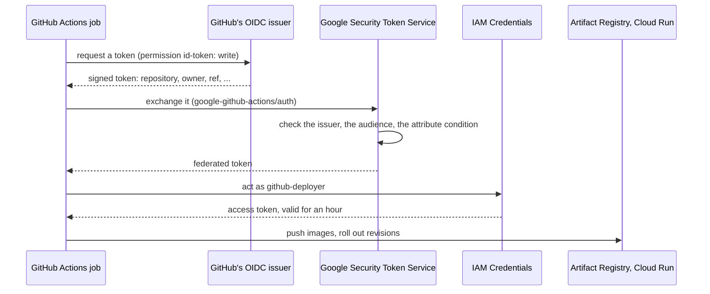

# Workload Identity Federation: deploying without stored keys

> GitHub Actions proves who it is with a short-lived token, and Google Cloud trades that token for an hour of the deployer account's access, so no key is stored anywhere.

**Lands in:** Phase 8 · **Code:** `infra/terraform/bootstrap/iam.tf`

## What it is

A **service account key** is a long-lived JSON credential. Anyone who copies it can act as the account until someone notices and deletes it. Kept as a CI secret, it is one leak away from someone else's deploy.

**OpenID Connect (OIDC)** lets an identity provider sign short statements about who someone is. GitHub Actions acts as one: a job that asks for it gets a signed token. Its claims say which repository, owner, branch and workflow the job runs for, among other things.

**Workload Identity Federation** lets Google Cloud trust such tokens:

- **A pool and a provider** name the issuer to trust (`https://token.actions.githubusercontent.com`).
- **An attribute mapping** turns the token's claims into attributes Google can check.
- **An attribute condition** decides which tokens are accepted at all.
- **Google's Security Token Service** exchanges an accepted token for a federated token. With that, the job may act as a service account that allows it (`roles/iam.workloadIdentityUser`), and gets an access token for that account, valid for an hour.

## Why we need it here

The definition of done says deploys go through GitHub Actions with no stored keys. The repository is public, so its CI secrets are an obvious target. With federation, there is nothing in GitHub worth stealing.

## How it works

The provider accepts a token only if all three of these hold:

- `assertion.repository_id == '1421062366'`: this repository, by its numeric ID;
- `assertion.repository_owner_id == '88434571'`: its owner, by ID;
- `assertion.ref == 'refs/heads/main'`: the main branch, so a pull request's branch or a fork can't deploy.

**IDs rather than names.** A repository or account can be renamed. If one is deleted, someone else can take its name, but never its ID.

**What the deployer account may do,** and nothing else:

- push images to one registry;
- roll out revisions of the services (`roles/run.developer`);
- act as the four services' own accounts, so that a new revision runs as its service;
- read the data bundle.

It can't change IAM, the budget or the network.

## Where it lives in the code

| Piece | Where |
|---|---|
| The pool, the provider and its condition | `infra/terraform/bootstrap/iam.tf` |
| The deployer account and its roles | Same file |
| The workflow side: `permissions: id-token: write` and `google-github-actions/auth` | The deploy workflow (step 8.6) |
| The repository's variables (`GCP_WIF_PROVIDER`, `GCP_DEPLOYER_SA`) | Set from the bootstrap's outputs ([runbook](../runbooks/deploy.md)) |

## How we check it

Step 8.6 checks both sides once the deploy workflow exists:

- a deploy from `main` succeeds;
- the same workflow run from another branch is refused at the token exchange.

The repository holds no Google Cloud credential, which the full-history secret scan in CI confirms on every run.

## Pitfalls we hit

- **The token has to be asked for.** A job without `permissions: id-token: write` gets no OIDC token, and the auth step fails with a message about the missing request token.
- **The condition and the binding must agree.** The service account binding names a `principalSet` by the mapped attribute (`attribute.repository_id/<id>`). The attribute has to be in the mapping, or no token ever matches.

## Review questions

1. What can someone do with a leaked service-account key that they can't do with a leaked federated token?
2. Why does the condition check the repository's ID and not its name?
3. What stops a pull request from a fork from deploying?
4. Why may the deployer act as the services' accounts, and why only those?
5. Where does the hour-long access token come from, and what happens when it expires during a long job?

## References

- Google Cloud, [Workload Identity Federation with deployment pipelines](https://cloud.google.com/iam/docs/workload-identity-federation-with-deployment-pipelines).
- GitHub, [Configuring OpenID Connect in Google Cloud Platform](https://docs.github.com/en/actions/security-for-github-actions/security-hardening-your-deployments/configuring-openid-connect-in-google-cloud-platform).
- [google-github-actions/auth](https://github.com/google-github-actions/auth).
- [Terraform basics](terraform-basics.md); [deploy runbook](../runbooks/deploy.md).
