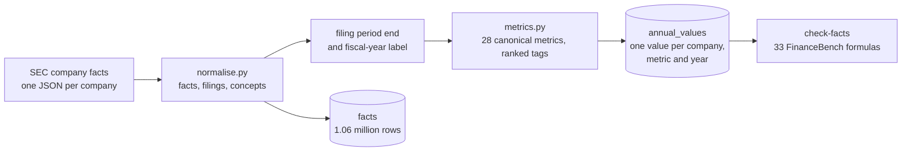

# XBRL and financial metrics

> Companies file their financial statements as tagged data. Turning those tags into one trustworthy number per company, metric and year takes a handful of explicit rules.

**Lands in:** Phase 1 · **Code:** `src/copilot/facts/`, `src/copilot/ingest/sec.py`

## What it is

**XBRL** (eXtensible Business Reporting Language) is the format US public companies use to file financial statements with the SEC. Every number in a 10-K or 10-Q is tagged with:

- a **concept** from a taxonomy, such as `us-gaap:PaymentsToAcquirePropertyPlantAndEquipment` (capital expenditure);
- a **period**: a duration with a start and end date (income and cash-flow items) or an instant (balance-sheet items);
- a **unit**, such as `USD`, `shares` or `USD/shares`.

SEC's company-facts API returns every such fact a company has filed, as one JSON file per company. A **canonical metric** is this project's name for a line item, such as `capital_expenditure`, mapped to the tags companies actually use for it.

## Why we need it here

Numeric questions ("What was 3M's FY2018 capex?", "How did Nike's gross margin move over five years?") should be answered from reported figures with SQL, not read off a PDF page. The raw facts can't be queried directly, for four reasons:

1. **Repeats.** Each 10-K shows two or three years, so 3M's 2021 capex appears in its 2021, 2022 and 2023 10-Ks, and a later filing may restate it.
2. **Misleading labels.** The `fy` on a fact is the fiscal year of the filing that reported it, and it is sometimes simply wrong.
3. **Different tags.** Revenue alone has at least six common tags, and companies switch between them.
4. **Different calendars.** Fiscal years end in January, May, June, August or December; some run 52 or 53 weeks; and companies name them differently.

## How it works

1. **Flatten** (`iter_facts`). Keep facts from 10-K, 10-K/A, 10-KT and 10-Q filings, once per filing.
2. **Find each filing's period** (`filings_from`). Take the facts that cover a full fiscal year (or quarter, or transition period) and end on or before the filing date; the period end is their most common end date within two weeks of the latest. Comparatives end a year earlier and fall outside the window.
3. **Label the fiscal year** (`fiscal_year_labels`). Name each 10-K's year from its period end, using the company's convention: the year it ends in (Walmart) or the year most of its days fall in (Ulta). The convention that agrees with more of SEC's labels wins, which outvotes SEC's occasional mistakes.
4. **Pick annual values** (`annual_values`). For each canonical metric and fiscal year, use the year's own 10-K, only facts ending on its period end, a full-year period for flow items, and the highest-ranked tag reported that year (for revenue, the largest figure among its tags). Store the value as first reported, and the latest figure for the same period beside it.
5. **Cross-check** (`checks.py`). Each FinanceBench dev metrics question becomes a formula, such as `revenue[2019] / ((property_plant_equipment_net[2018] + property_plant_equipment_net[2019]) / 2)` for Activision Blizzard's fixed-asset turnover. A small evaluator parses the formula with `ast` and allows only arithmetic and `metric[year]` lookups.

## Where it lives in the code

| File | What it does |
|---|---|
| `src/copilot/ingest/sec.py` | The EDGAR client: declared contact, rate limit, retries, cached downloads |
| `src/copilot/ingest/universe.py` | Matching FinanceBench company names to CIKs |
| `src/copilot/facts/normalise.py` | `iter_facts`, `iter_concepts`, `filings_from` (period ends), `fiscal_year_labels` |
| `src/copilot/facts/metrics.py` | The 28 canonical metrics and their tags; `annual_values` |
| `src/copilot/facts/database.py` | The SQLite schema, `build`, `connect_read_only` |
| `src/copilot/facts/formula.py` | The safe formula evaluator |
| `src/copilot/facts/checks.py` | FinanceBench cross-checks and their report |
| `scripts/fetch_sec.py`, `scripts/build_facts_db.py`, `scripts/check_facts.py` | `poe fetch-sec`, `poe build-facts`, `poe check-facts` |

## How we measured it

- **FinanceBench cross-check.** All 33 metrics questions in the dev split, rewritten as formulas over `annual_values`, match the gold answers exactly at the precision each question asks for. They cover 15 companies and every kind of calculation in the set: single figures, ratios, year-over-year changes, three-year averages, days payable outstanding and the cash conversion cycle ([report](../../eval/results/facts/financebench-dev-checks.md)).
- **Coverage.** For FY2015 to FY2023, revenue, net income, operating cash flow, total assets and equity have values for 96 to 98% of company-years. Items that many companies don't report score lower: R&D 49%, gross profit 52%, total liabilities 60%, inventory 69% (banks and service companies have none).
- **Consistency.** After the rules, each company has one 10-K per fiscal year with no gaps (one harmless duplicate accession at Salesforce), and no filing's period ends after its filing date.
- **Unit tests** (`tests/test_facts.py`, `tests/test_formula.py`) use a synthetic company with each tricky case: comparatives, a restatement, a tag change, equity-statement balances, a forward-looking fact, a stray date, a 10-Q and an 8-K.

## Pitfalls we hit

- **Rounding conventions, not errors.** The first cross-check run had 28 of 33 agreeing. Four "misses" were FinanceBench printing whole millions as `$1616.00` while the filing said 1,615.9. Taking each check's precision from the question ("Answer in USD millions") fixed them all.
- **A company-specific tag.** Nike tags inventory as `InventoryFinishedGoodsNetOfReserves`, not `InventoryNet`, so it became a fallback tag.
- **The most common date isn't the current period.** Equity statements list balances at several earlier dates, which once dated Nike's FY2010 balance sheet to May 2009.
- **The latest date isn't either.** Boeing's FY2017 10-K, filed in February 2018, contains a forward-looking fact for 2018; Foot Locker's FY2013 10-K has stray facts a day after its year end. The filing-date limit and the two-week window handle both.
- **SEC's fiscal year is sometimes wrong.** Best Buy's FY2021 10-K is labelled 2020, which collided with FY2020 and dropped a year. Deriving the label from the period end fixed it, and fixed the same problem at Ulta, Foot Locker and Salesforce.
- **Transition years.** Best Buy's 2013 10-KT covers 11 months. It gets balance-sheet values but no annual flow values.
- **The top-ranked tag isn't always the total.** General Mills tags a $2 billion `Revenues` figure beside $19 billion of sales, and American Express tags contract revenue beside its larger total. Writing the SQL eval set exposed the first (a 127% net margin). Revenue now takes the largest figure among its tags, which changed 12 company-years, every one a fix.
- **Original isn't always right.** MGM's original FY2011 10-K tagged net income as −$30.3 million; the next year's filing corrected it to $3,114.6 million. Stock splits restate share counts too (Amazon, 2022). `latest_value` makes both visible.

## Review questions

1. Why can't you answer "What was 3M's 2021 revenue?" with a plain `SELECT value FROM facts WHERE tag = 'Revenues' AND period_end = '2021-12-31'`?
2. Walmart and Ulta both end their fiscal years in late January. Why do their labels for the same period differ, and how does the database decide each company's convention?
3. Why does the period-end rule need both the filing-date limit and the two-week window?
4. When is the first-reported value the right answer, and when is `latest_value` better?
5. A new company reports revenue only under a tag that isn't in the priority list. What happens to its `revenue` values, and how would you notice?

## References

- SEC, [EDGAR application programming interfaces](https://www.sec.gov/search-filings/edgar-application-programming-interfaces).
- FASB, US GAAP Financial Reporting Taxonomy.
- XBRL International, [An introduction to XBRL](https://www.xbrl.org/introduction/).
