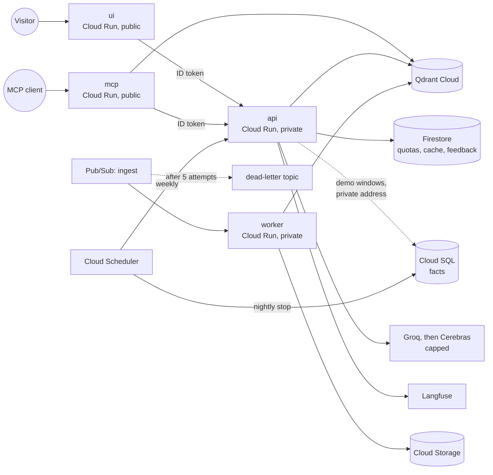

# ADR-0031: The Google Cloud topology: a public UI and MCP server, a private API, and a database only for demos

- **Status:** Accepted
- **Date:** 2026-10-28
- **Phase:** 8

## Context

[ADR-0016](0016-deploy-on-google-cloud.md) chose Google Cloud: services that scale to zero, and Cloud SQL started only for demos. It left the shape of the deployment to Phase 8, and [ADR-0022](0022-containers.md) left one question open: Cloud Run has no volume for `data/`. The plan listed six questions to settle:

1. **The facts tables.** In Cloud SQL, the data agent could answer only during demo windows.
2. **The data the services read at start:** the parsed pages, the embedding models and the router's examples.
3. **Qdrant Cloud's free cluster** is suspended after a week without use.
4. **Where the quotas live.**
5. **Where conversations and feedback live** outside demo windows.
6. **Which models the public demo may spend on.**

What the code needs at run time (surveyed on 2026-10-28):

- **The API reads, at start:**
  - facts.db (245 MB, read-only), for the data agent's schema and value linking;
  - the index card of the Qdrant collection;
  - the bge-small model, in FastEmbed's cache;
  - the semantic router's 138 labelled questions;
  - the list of the 84 corpus filings.
- **Per question,** it queries facts.db and Qdrant, and calls the model providers.
- **Page files** (84 of 367) serve only `GET /v1/sources` and the MCP server's `filing://` resources.
- **Written by default:** the model-call caches and a trace file, both under `data/`.
- **State.** Conversations, notes, feedback, quotas and the answer cache live either in the process or in Postgres, which the API uses over one connection with no reconnect.
- **The web UI** imports only Streamlit, pandas, httpx and the API client.
- **The MCP server** reads facts.db and Qdrant itself and sends questions to the API.

Costs checked on 2026-10-28:

| Item | Price | Source |
|---|---|---|
| A stopped Cloud SQL instance | Pays for storage and IP addresses: a public IPv4 address costs $0.01 an hour while the instance is idle ($7.30 a month) | [Cloud SQL: start and stop](https://cloud.google.com/sql/docs/postgres/start-stop-restart-instance), [pricing](https://cloud.google.com/sql/pricing) |
| A running db-f1-micro | About $0.011 an hour (us-central1 list price) | [pricing](https://cloud.google.com/sql/pricing) |
| Artifact Registry's vulnerability scanning | $0.26 for each new image digest | [Artifact Analysis pricing](https://cloud.google.com/artifact-analysis/pricing) |
| Qdrant Cloud's free cluster | 1 GB of RAM, 0.5 vCPU, 4 GB of disk; suspended after a week without use, deleted after four; snapshots by API only | [Qdrant: create a cluster](https://qdrant.tech/documentation/cloud/create-cluster/) |
| Monitoring's alert policies | $0.10 per condition a month, from no sooner than 1 May 2026 | [Manage alerting costs](https://cloud.google.com/monitoring/alerts/cost-control) |

## Options considered

| Question | Options | Chosen, and why |
|---|---|---|
| Facts tables | (a) Cloud SQL only; (b) facts.db in the API image only; (c) both: Cloud SQL in demo windows, facts.db otherwise | **(c).** (a) loses every figure answer outside demo windows. (b) leaves Cloud SQL nothing to do. (c) keeps one model-side path, measured to give the same answers ([report](../eval/facts-postgres.md)). |
| Data at start | (a) built into the image; (b) downloaded from Cloud Storage at start; (c) a Cloud Storage volume | **(a),** from a data bundle in Cloud Storage that CI builds in. (b) costs every cold start a download and holds the files in the instance's memory, since Cloud Run's file system is in memory. (c) reads a SQLite file over the network. |
| Qdrant's free cluster | (a) restore from a snapshot at each demo; (b) a scheduled weekly request; (c) a paid cluster | **(b), with (a) as the fallback.** The weekly request also smoke-tests the API, and a snapshot in Cloud Storage restores a deleted cluster. |
| Quotas, answer cache, feedback | (a) in memory; (b) Cloud SQL; (c) Firestore | **(c).** Firestore is shared by every instance, survives scale-to-zero and is free at this volume. (a) forgets quotas whenever an instance stops; (b) is down outside demo windows. |
| Conversations | (a) in memory, one API instance; (b) Postgres; (c) a Firestore checkpointer | **(a).** Visitors are anonymous and keep no notes, a conversation lasts minutes, and LangGraph has no first-party Firestore checkpointer. The load test (8.7) decides whether one instance is enough. |
| The API's exposure | (a) public; (b) callable only by the UI, the MCP server and the scheduler | **(b).** Only the UI's per-visitor quotas then count; the API's documentation is still served to its callers. |
| Image scanning | (a) Artifact Registry's scanning on every push; (b) Trivy in CI, plus one registry scan in the security pass | **(b).** Trivy scans every build for nothing; at $0.26 a digest, scanning every deploy would cost more than the rest of the deployment. |

## Decision

**Region asia-south1, one project with its own gcloud configuration, everything in Terraform.**

### Services

All four services are on Cloud Run, scale to zero, and bill CPU only while a request is in flight. The settings are starting points; the load test (8.7) sizes them.

| Service | Image | Who may call it | Instances | Memory | Reads |
|---|---|---|---|---|---|
| `ui` | `ui`: Streamlit, httpx, the API client | Anyone | 0 to 2, with session affinity for Streamlit's websocket | 512 MiB | The API's address |
| `api` | `api`: the code with its data built in | `ui`, `mcp` and the scheduler | 0 to 1 | 2 GiB | facts.db, pages, models; model, Langfuse and Qdrant keys; the facts URL |
| `mcp` | The `api` image, serving MCP | Anyone | 0 to 1 | 1 GiB | facts.db, pages, models; Qdrant's read key; the API's address |
| `worker` | The `api` image, serving the ingestion endpoint | Pub/Sub's push identity | 0 to 1 | 2 GiB | Qdrant's write key; the SEC contact |

### Data

- **Built into the `api` image.** CI downloads a versioned data bundle from a private Cloud Storage bucket and checks its checksum. The bundle holds:
  - facts.db;
  - the 84 corpus filings' pages;
  - the index card;
  - the corpus list (document names and labels only);
  - FastEmbed's bge-small and BM25 files.

  The image runs with `HF_HUB_OFFLINE=1`, so nothing is downloaded at start. The model-call caches and the trace file are switched off in production; traces go to Langfuse and logs to Cloud Logging.
- **Vectors in Qdrant Cloud's free cluster.** The collection is uploaded from the local index. Keys:
  - a read-only key for `api` and `mcp`;
  - a write key for `worker`.

  A Cloud Scheduler job calls the API's readiness check every week, and that check reads from Qdrant. A collection snapshot in Cloud Storage restores a deleted cluster; its runbook comes with step 8.4's cloud part.

### State

- **Firestore** (Native mode, asia-south1) holds:
  - the per-visitor and daily quotas;
  - the answer cache, expired by a TTL policy;
  - feedback, which Phase 9 turns into preference pairs.
- **Conversations stay in memory,** on one API instance. They last as long as the instance; anonymous visitors keep no notes.
- **Visitors.** The UI identifies a visitor by a hash of the client address that Cloud Run passes in `X-Forwarded-For`, so a new browser session doesn't reset the visitor's quota. All MCP clients share one daily allowance.

### The database, for demos

- **The instance:**
  - Cloud SQL for PostgreSQL 18, Enterprise edition, `db-f1-micro`, 10 GB SSD;
  - a private address only, through private services access on a small VPC;
  - daily backups kept for 7 days, and deletion protection;
  - stopped outside demo windows. Terraform ignores whether it is running, since `demo-up` and `demo-down` decide that.
- **The data:**
  - the `facts` database (C collation), loaded from a dump in Cloud Storage with `gcloud sql import`;
  - the read-only role `facts_reader`, whose URL is a secret.
- **How the API reaches it.** The API reaches the private address through Direct VPC egress, for private ranges only; everything else leaves Cloud Run directly. While the instance is stopped, the API's `FactsExecutor` uses facts.db.
- **Stopping it:**
  - a Cloud Scheduler job stops the instance every night at 23:30 IST, through the Cloud SQL Admin API;
  - an alert fires if it has been up for four hours.

### Ingestion

- **The queue.** A Pub/Sub topic `ingest` pushes each request (a filing to index) to `worker`, signed with a push identity.
- **Failures.** Deliveries retry with exponential backoff; after 5 attempts a message moves to the dead-letter topic `ingest-dead-letter`, which an alert watches.
- **Storage.** The worker keeps each downloaded filing in Cloud Storage.

### Identity, secrets and deploys

- **Service accounts.** Each service runs as its own account with only what it needs:
  - `ui` and `mcp` may invoke `api`;
  - `api` reads its secrets and uses Firestore;
  - `worker` reads its secrets and writes to the filings bucket;
  - the scheduler's account may invoke `api` and stop the instance;
  - Pub/Sub's push account may invoke `worker`.
- **Secrets** live in Secret Manager. Terraform creates them empty, so no value ever enters its state; the owner adds the values, and each account may read only its own secrets.
- **Deploys.** GitHub Actions authenticates through Workload Identity Federation, limited to this repository and `main`. The deployer account may push images, roll out revisions and act as the runtime accounts, and nothing else.
- **Who applies what.** The owner applies Terraform by hand; CI checks formatting and validates every root.
- **Images.** Each image is built in CI, scanned with Trivy and pushed to Artifact Registry, where cleanup rules keep the newest few.

### Models

- **Groq's free tier first.** Its quota bounds the public demo's spending by itself.
- **Cerebras as a fallback,** only if the owner approves it: the same models, with a daily cap counted in Firestore.

## Evidence

- **The facts on PostgreSQL** ([report](../eval/facts-postgres.md)):
  - 119 distinct evaluated queries: 116 identical on both databases, and 3 with the same rows in another order where SQL leaves the order open;
  - the SQL set's dev split and FinanceBench's 33 figure questions, replayed end to end: identical answers, with no new model calls.
- **Cold starts and sizes** are measured once the services run (step 8.7), and costs from the billing export (step 8.9).

## Consequences

**Estimated costs,** measured in step 8.9:

| | Idle month | Per demo hour |
|---|---|---|
| Cloud SQL | About $2 (10 GB SSD; no public address) | About $0.01 |
| Artifact Registry | About $0.30 (a few versions of two images, layers shared) | |
| Secret Manager | About $0.40 (ten secrets; six versions are free per billing account) | |
| Monitoring alerts | About $0.50, if charged (five conditions) | |
| Cloud Run, Firestore, Pub/Sub, Scheduler, Logging, Cloud Storage | Within the free tiers | Within the free tiers |
| **Total** | **About $3 to $4** | **About $0.02** |

- **Figures work at any hour.** In a demo window, the data agent's SQL runs on Cloud SQL, and each answer records the SQL the server ran.
- **The image carries the data.** It is larger, but it starts with nothing to download and is identical everywhere. CI needs read access to the data bucket.
- **New code** (steps 8.3 and 8.6):
  - Firestore stores for the quotas, the cache and feedback;
  - ID tokens on the UI's and the MCP server's calls to the API;
  - the visitor hash;
  - settings that switch off the disk caches and the trace file;
  - a Qdrant API key setting;
  - the MCP server honouring `$PORT` and its Cloud Run host;
  - the worker's ingestion endpoint.
- **One API instance** means a second simultaneous visitor waits for the first (ADR-0020's one run at a time per process). The load test decides whether to raise it, and with it to move conversations to a shared store.
- **Two copies of the facts.** facts.db stays the build target. A rebuild must be loaded into Cloud SQL and checked with `poe check-facts-postgres`, as the runbook says.
- **The plan changes:**
  - step 8.2 scans with Trivy, plus Artifact Registry once;
  - step 8.3 adds the VPC and the scheduler;
  - the prerequisites, technical choices and change log follow.

## References

- Cloud Run: [Direct VPC egress](https://cloud.google.com/run/docs/configuring/vpc-direct-vpc), [session affinity](https://cloud.google.com/run/docs/configuring/session-affinity), [service-to-service authentication](https://cloud.google.com/run/docs/authenticating/service-to-service), [in-memory file system](https://cloud.google.com/run/docs/container-contract#filesystem).
- Cloud SQL: [private IP](https://cloud.google.com/sql/docs/postgres/private-ip), [start and stop](https://cloud.google.com/sql/docs/postgres/start-stop-restart-instance), [importing SQL dumps](https://cloud.google.com/sql/docs/postgres/import-export/import-export-sql).
- Pub/Sub: [dead-letter topics](https://cloud.google.com/pubsub/docs/handling-failures).
- Firestore: [time-to-live policies](https://cloud.google.com/firestore/docs/ttl), [free quota](https://cloud.google.com/firestore/pricing).
- Cloud Scheduler: [pricing](https://cloud.google.com/scheduler/pricing), [HTTP targets with authentication](https://cloud.google.com/scheduler/docs/http-target-auth).
- [Trivy](https://trivy.dev/), for the image scans in CI.
